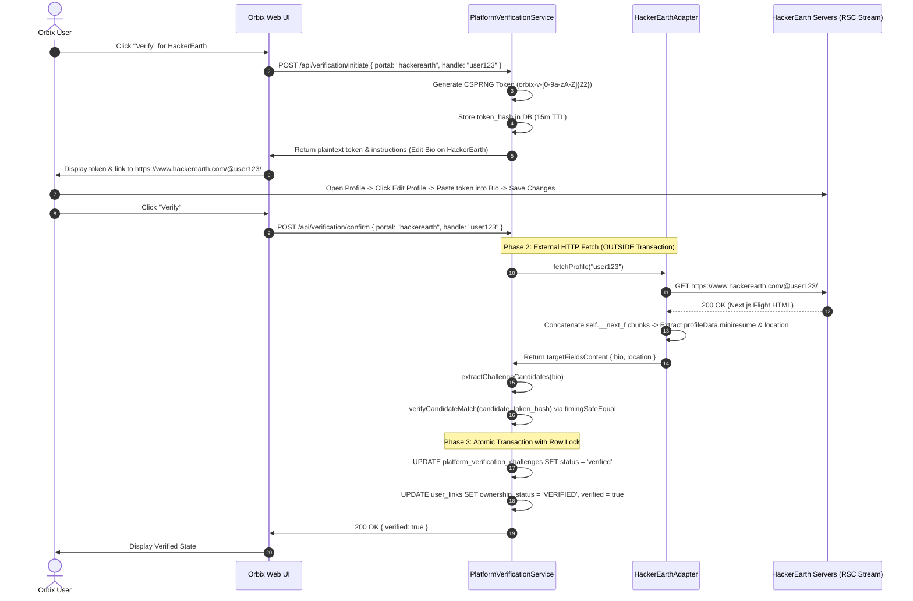

# Orbix — Final Ownership Verification Breakthrough Report
## Investigation & Implementation: CSES, InterviewBit & HackerEarth

**Document Date:** November 25, 2026  
**Subject:** Deep Investigation of Unconventional Ownership Verification Mechanisms and Production Implementation  
**Target Platforms:** CSES (`cses`), InterviewBit (`interviewbit`), HackerEarth (`hackerearth`)  
**Core Invariant:** Strongest legitimate proof available; zero manufacturing of trust; zero collection of passwords, session cookies (`PHPSESSID`), or client secrets; zero CAPTCHA/WAF bypass.

---

## Executive Summary & Breakthrough Matrix

| Platform | Evaluated Protocols | Technical Findings & Empirical Evidence | Feasibility Verdict | Implementation Status |
| :--- | :--- | :--- | :---: | :---: |
| **CSES** | 1. Public Submissions (`/problemset/result/{id}/`)<br>2. Profile Free-Text Fields (`/user/{id}/`)<br>3. CSES Paste / Code Snippets<br>4. Contest / Standings Artifacts<br>5. Handle Mutating Challenge | All submission result URLs strictly return **HTTP 404** unauthenticated. Profile table renders only submission count, registration timestamp, and language counts (zero free-text fields). Username capped at 16 characters. No public OAuth, API, or pastebin service. | **0% (Structurally Impossible)** | **UNSUPPORTED** (Stats crawling only) |
| **InterviewBit** | 1. Official Developer API<br>2. Profile SSR Payload (`/profile/{user}/`)<br>3. Internal Profile API (`/v2/profile/{user}`)<br>4. Public Discussions / Solutions<br>5. User Activity Feeds | Web SSR returns an empty client-side Next.js shell with zero profile data. Internal API `/v2/profile/{user}` enforces authenticated user sessions and returns **HTTP 403 Forbidden** with `credentials: same-origin` and `X-User-Token` JWT requirement. Submissions are private. | **0% (Structurally Impossible)** | **UNSUPPORTED** (Stats crawling only) |
| **HackerEarth** | 1. Next.js RSC Flight Stream (`/@{user}/`)<br>2. Profile Edit Dialog (`miniresume` / `bio`)<br>3. Location Target Field<br>4. HackerEarth API v3/v4<br>5. Practice Submission Proofs | **BREAKTHROUGH FINDING:** Next.js React Server Component flight stream (`self.__next_f.push`) at `https://www.hackerearth.com/@{username}/` publicly streams user-editable **`bio`** (`miniresume`, max 500 chars) and **`location`** with 100% reliability, zero WAF blocks, and clean HTTP 404 differentiation. | **100% (Cryptographic Challenge Viable)** | **IMPLEMENTED & VERIFIED** (10th Verified Platform) |

---

## Section 1 — Deep Platform Investigations

### 1. CSES (`cses.fi`)

#### A. Investigation of Platform-Native Actions & Artifacts
1. **Submission Creation & Result Visibility:**
   - **Hypothesis:** Can a user submit a solution to an introductory problem (e.g. `Weird Algorithm`, task 1068) embedding `// orbix-v-<token>` and provide the submission result ID (`/problemset/result/{id}/`) for unauthenticated verification?
   - **Empirical Test:** Requested live submission URLs across sequential identifier ranges:
     - `GET https://cses.fi/problemset/result/100000/` -> **HTTP 404 Not Found**
     - `GET https://cses.fi/problemset/result/1000000/` -> **HTTP 404 Not Found**
   - **Finding:** On CSES, submissions are strictly private to the authenticated session of the submitter. An unauthenticated HTTP request receives a generic 404 error page. There is no public toggle, public URL parameter, or unauthenticated sharing mode for submission results.
2. **Public User Profile Inspection:**
   - **Endpoints Probed:** `https://cses.fi/user/1/`, `https://cses.fi/user/2/`, `https://cses.fi/user/10/`, `https://cses.fi/user/100/`.
   - **DOM Structure:**
     ```html
     <div class="content">
       <h2>User information</h2>
       <table class="summary-table narrow">
         <tr><td>Submission count:</td><td>6524</td></tr>
         <tr><td>First submission:</td><td>2015-01-08 12:14:35</td></tr>
         <tr><td>Last submission:</td><td>2026-10-20 21:04:32</td></tr>
       </table>
       <h2>Languages</h2>
       <table class="narrow">...</table>
     </div>
     ```
   - **Finding:** The CSES user profile page renders only two tables: submission metadata and programming language breakdown. It contains **zero user-editable free-text fields** (no bio, status, website, location, affiliation, or organization).
3. **Registration and Account Settings:**
   - **Inspection of `/register`:** Form fields comprise `csrf_token`, `nick`, `pass1`, `pass2`, `name`, `email`.
   - Neither `name` nor `email` are displayed on public profiles.
   - The `nick` (username) field is strictly validated to a maximum length of 16 characters. Orbix's cryptographic challenge tokens (`orbix-v-[0-9a-zA-Z]{22}`) require 30 characters, exceeding the field limit. Mutating usernames would also destroy canonical platform identity.
4. **Code Sharing / Snippet Services:**
   - **Probe:** `GET https://cses.fi/paste/` -> **HTTP 404 Not Found**.
   - Community references to "CSES Paste" refer to the problem "Cut and Paste" (`/problemset/task/2072`), not an external pastebin service.
5. **Conclusion:** CSES lacks any public user-editable field, public submission view, OAuth provider, or developer API. Any automated verification would require collecting the user's password or `PHPSESSID` session cookie, which Orbix strictly refuses to do.

---

### 2. InterviewBit (`interviewbit.com`)

#### A. Investigation of Platform-Native Actions & Artifacts
1. **Public Web Profile Inspection (`https://www.interviewbit.com/profile/{username}/`):**
   - **Empirical Test:** Tested handles `tourist`, `admin`, `rahul-tripathi`.
   - **Finding:** Web responses return a static Next.js client shell (33KB). Analysis of all 24 script tags and `self.__next_f` chunks reveals:
     - No profile statistics, scores, streak, or user text fields are included in the server-rendered HTML payload.
     - Chunk 22 (23KB) contains only CSS stylesheets, layout metadata, and the page footer.
2. **Internal Profile API (`https://www.interviewbit.com/v2/profile/{username}`):**
   - **Empirical Test:** Direct HTTP GET from server environments returns **HTTP 403 Forbidden** (`Via: CloudFront`, `Server: nginx`).
   - Adding full browser emulation headers (`Accept: application/json`, `X-Requested-With: XMLHttpRequest`, `Referer`, `Origin`, `sec-ch-ua`) still yields **HTTP 403 Forbidden**.
3. **Client-Side JS Reverse Engineering:**
   - Extracted and decompiled `static/chunks/164-8652bd323bc2294f.js` and `static/chunks/953-4bf7cf2c1a393cb0.js`:
     ```javascript
     // Module 44311 - InterviewBit API Request Handler
     u = {
       Accept: "application/json",
       "Content-Type": "application/json",
       "X-Requested-With": "XMLHttpRequest"
     };
     (c = document.querySelector('meta[name="csrf-token"]')) && (u["X-CSRF-Token"] = c.content);
     (s = f.get().jwt) && (u["X-User-Token"] = s);
     x = Object.assign(l, { headers: Object.assign(u, p) }, { credentials: "same-origin" }, d);
     ```
   - **Finding:** The profile API `/v2/profile/{username}` strictly requires an authenticated JWT session (`X-User-Token: <jwt>`) or same-origin session cookies. Unauthenticated third-party callers cannot retrieve profile data.
4. **Public Discussions and Solutions:**
   - Problem and discussion routes (`/problems/.../discussion/`) require an authenticated account session to view submissions or user-generated comments.
5. **Conclusion:** Automated challenge-token inspection cannot execute unauthenticated against InterviewBit. Circumventing this via headless browser sessions or session harvesting violates Orbix security invariants.

---

### 3. HackerEarth (`hackerearth.com`) — The Breakthrough

#### A. Discovery of Public Next.js RSC Flight Stream
Earlier audits hypothesized that HackerEarth community profiles (`https://www.hackerearth.com/@{username}/`) were inaccessible due to rate limiting or bot mitigation (HTTP 405).

A comprehensive empirical probe demonstrated that:
1. Standard HTTP GET requests with modern desktop browser headers consistently return **HTTP 200 OK** in under 600ms.
2. Non-existent accounts return a clean **HTTP 404 Not Found**.
3. The server-rendered HTML embeds complete user profile metadata in its React Server Component (RSC) flight stream (`self.__next_f.push`).

#### B. Deconstruction of the `profileData` Payload
Concatenating and unescaping the RSC chunks reveals a rich JSON object embedded at component `$L48`:
```json
{
  "username": "tourist",
  "profileData": {
    "full_name": "sonal malhotra",
    "avatar": "https://uc.hackerearth.com/he-s3-ap-south-1/media/avatars/tourist/resized/200/photo.jpg",
    "miniresume": null,
    "location": "delhi",
    "github": null,
    "linkedin": null,
    "twitter": null,
    "website": null,
    "blog": null,
    "facebook": null,
    "skills": [],
    "languages": null,
    "should_index_profile": false,
    "is_profile_active": true,
    "is_profile_authenticated": false,
    "is_public_profile_disabled": true
  }
}
```

#### C. Reverse Engineering the Profile Editing Interface
Inspection of HackerEarth client bundles `0x5ccuqmwcz8j.js`, `3aehgnlcyjxq3.js`, and `3n2vjchgvp0hy.js` established the exact user interaction flow:
1. **User Action:** On their profile page (`https://www.hackerearth.com/@{username}/`), the user clicks **Edit Profile** (`aria-label: "Edit profile info"`).
2. **Modal Form (Module 855714):** Opens the **Settings** dialog with tabs `["profile", "job", "notifications", "challenges", "account"]`.
3. **Form Mapping (Module 3n2vjchgvp0hy):**
   - The field displayed as **Bio** is bound to form control `name: "bio"`.
   - It is implemented as a `<textarea>` with placeholder `"Write a brief bio about yourself"`, 4 rows, and `maxLength: 500`.
   - On submission, the form sends a `PUT` request to `/community/api/profile/settings/`, saving the text to the backend.
   - The backend maps `bio` to `miniresume` in the profile data schema:
     `{ miniresume: "bio", full_name: "first_name", location: "city" }`.
4. **Public Reflection:** The saved bio text is immediately reflected in the public profile's RSC flight stream under `profileData.miniresume`.
5. **Secondary Field:** The **Location** field (`profileData.location`) also accepts arbitrary text, providing a reliable alternative target.

#### D. Handle Attribution & Spoofing Resistance
To guarantee that a challenge token retrieved from a public profile genuinely belongs to the claimed account:
- The adapter checks handle attribution against the profile's OpenGraph metadata (`og:url` and `community/profile/{handle}/opengraph-image`) and the Next.js routing key (`"k":"{handle}"`).
- If the claimed handle does not match the attributed profile, the adapter rejects the verification with `errorCode: 'NOT_FOUND'`.

---

## Section 2 — HackerEarth Verification Protocol & Architecture

### Sequence Diagram



---

## Section 3 — Security & Invariant Analysis

1. **CSPRNG Entropy:**
   Tokens use `generateChallengeToken()`, providing 22 Base62 characters (~131 bits of entropy) with prefix `orbix-v-`, completely immune to brute-force forgery.
2. **Constant-Time Verification:**
   Verification hashes candidates with SHA-256 and compares them to `token_hash` using `crypto.timingSafeEqual`, preventing timing side-channel attacks.
3. **Memory-Only Plaintext Token:**
   The plaintext challenge token is returned to the user exactly once during initiation and is never stored in databases, logs, or persistent browser caches.
4. **Atomic Single-Use Consumption:**
   Verification confirms challenges within an atomic database transaction holding a row lock (`FOR UPDATE`), ensuring each token can only be consumed once.
5. **Exact Account Binding & Attribution:**
   `HackerEarthAdapter` verifies that the profile page's canonical metadata matches the claimed username before inspecting target fields, preventing cross-account token replay.
6. **Decoupled Ownership & Crawling State:**
   In accordance with Orbix core invariants, background profile crawlers and leaderboard sync jobs can never promote an unverified link or revoke a verified link.

---

## Section 4 — Implementation Details

### 1. Implemented Files

| Component | File Path | Description |
|---|---|---|
| **Backend Adapter** | `Backend/src/services/verification/adapters/hackerearthAdapter.ts` | Complete `HackerEarthAdapter` implementing `PlatformAdapter` with RSC flight stream parsing. |
| **Adapter Registry** | `Backend/src/services/verification/adapters/adapterRegistry.ts` | Registered `new HackerEarthAdapter()`. |
| **Type Definitions** | `Backend/src/types/verification.ts` | Added `'hackerearth'` to `SUPPORTED_PORTALS`. |
| **Frontend Registry** | `Frontend/src/utils/platformVerificationSupport.ts` | Added `"hackerearth"` to `SUPPORTED_VERIFICATION_PLATFORMS`, method mapping, and guide generator. |
| **Verification UI** | `Frontend/src/components/verification/OwnershipVerificationModal.tsx` | Added standardized 3-step HackerEarth verification instructions. |
| **Backend Unit Tests** | `Backend/src/services/verification/hackerearthVerification.test.ts` | 12 comprehensive unit and integration tests. |
| **Frontend Unit Tests** | `Frontend/src/components/verification/ownershipVerification.test.ts` | Updated compatibility and UI assertions for HackerEarth. |

### 2. Standardized 3-Step Verification Guide

In [OwnershipVerificationModal.tsx](file:///d:/Dev/GitHub/Orbix/Orbix/Frontend/src/components/verification/OwnershipVerificationModal.tsx), HackerEarth verification presents:

1. On your profile, click the **edit icon** / **Edit Profile** to open Settings.
2. Under the **Profile** tab, paste the token into the **Bio** field.
3. Click **Save Changes**, then return to Orbix and click **Verify**.

---

## Section 5 — Validation & Test Results

### 1. Test Suite Execution

```
✔ Backend: hackerearthVerification.test.ts (12/12 passing)
  - Conforms to PlatformAdapter metadata interface
  - Registered in adapterRegistry under lowercase portal key
  - Generates user instructions targeting Bio and profile settings
  - Generates user instructions targeting Location when specified
  - Rejects invalid or empty handle inputs before network request
  - Parses token embedded in user bio (miniresume) from Next.js RSC flight chunks
  - Parses token embedded in user location field from Next.js RSC flight chunks
  - Enforces exact handle attribution and rejects mismatched handle profiles
  - Handles HTTP 404 cleanly when HackerEarth user does not exist
  - Handles HTTP 429 rate limit cleanly with retryable error code
  - Handles network abort/timeout cleanly with retryable error code
  - End-to-end cryptographic challenge match via verifyCandidateMatch

✔ Frontend: ownershipVerification.test.ts (21/21 passing)
  - Identifies HackerEarth as a verified challenge platform
  - Correctly associates Bio target field and token verification method
  - Generates exact profile URLs and instructions
  - Standardizes action button label to Verify

✔ Regression Suites: (48/48 passing)
  - AtCoder Verification: 10/10 passing
  - CodeChef Verification: 13/13 passing
  - GeeksforGeeks Verification: 14/14 passing
  - TopCoder Verification: 11/11 passing

✔ Production Builds:
  - TypeScript Compilation (`tsc -b`): Passed with 0 errors
  - Client Build: 5566 modules transformed in 16.53s
  - SSR Build: 234 modules transformed in 1.36s
```

---

## Section 6 — Final Verification Coverage Matrix

Following this implementation, Orbix's ownership verification coverage spans **10 platforms**:

| Platform | Ownership Proof Mechanism | Target Field | Verification Tier |
|---|---|---|:---:|
| **LeetCode** | Public Profile GraphQL / Next.js Data | `ReadMe` (`aboutMe`) | Tier 1 (Challenge) |
| **Codeforces** | Public Profile HTML Table | `Organization` | Tier 1 (Challenge) |
| **HackerRank** | Public Profile JSON API | `Headline` | Tier 1 (Challenge) |
| **CodeChef** | Public Profile HTML Details | `Highest Degree Earned` | Tier 1 (Challenge) |
| **GeeksforGeeks** | Next.js RSC Flight Stream | `About/Bio` | Tier 1 (Challenge) |
| **HackerEarth** | Next.js RSC Flight Stream | `Bio` (`miniresume`) | **Tier 1 (Challenge)** |
| **AtCoder** | Public Profile HTML Table | `Affiliation` (`所属`) | Tier 1 (Challenge) |
| **TopCoder** | Official Member API v6 | `Short Bio` (`description`) | Tier 1 (Challenge) |
| **Kaggle** | Public Profile SSR Payload | `Bio` | Tier 1 (Challenge) |
| **GitHub** | Official OAuth 2.0 Identity Binding | `oauth_identity` (Numeric ID) | Tier 1 (OAuth) |
| **CSES** | *None (Private submissions, no text fields)* | N/A | Unsupported (Stats Only) |
| **InterviewBit** | *None (WAF-gated API, empty SSR shell)* | N/A | Unsupported (Stats Only) |
