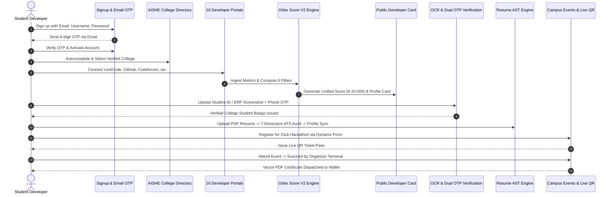
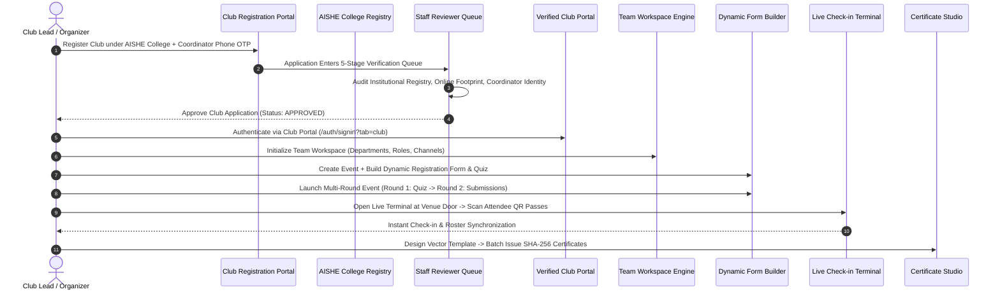
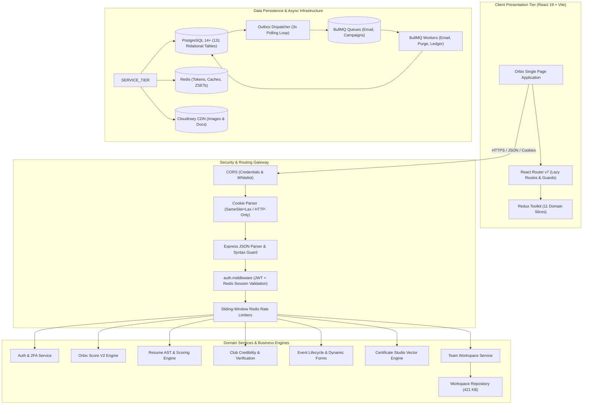
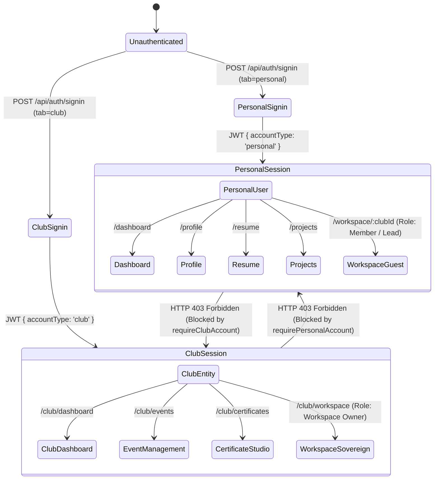

# ORBIX PLATFORM MASTER BRIEF: VISION, DUAL-PERSPECTIVE ARCHITECTURE & CODEBASE GUIDE
**Document Classification:** Definitive AI System Context, Architectural Blueprint & Engineering Specification  
**Target LLM / Agent:** Claude 3.5 Sonnet / Claude 3.7 Sonnet / Advanced Coding & Systems Engineering Agents  
**Project Name:** Orbix (Orbix Developer Ecosystem & Campus Platform)  
**Primary Repository Location:** `/Users/vineetchandel/Developer/SAAS/Orbix`  
**Authoritative Reference:** `PROJECT_CODEBASE_MASTER_GUIDE.md` & Production Source Code  
**Document Purpose:** Equip Claude with 100% complete, unambiguous, and deep contextual understanding of Orbix's grand vision, the dual personal/club paradigms, complete feature mechanisms, algorithmic foundations, database schemas, and codebase implementation details.

---

## TABLE OF CONTENTS
1. [EXECUTIVE SUMMARY & THE ORBIX THESIS](#1-executive-summary--the-orbix-thesis)
   - The Core Problem: The Fragmented Campus Developer Crisis
   - The Solution: The Dual-Sided Campus Engineering Synergy
   - Core Architectural & Philosophical Invariants
2. [THE PERSONAL PERSPECTIVE (STUDENT DEVELOPER POINT OF VIEW)](#2-the-personal-perspective-student-developer-point-of-view)
   - Persona Profile & Motivations
   - End-to-End Student Journey
   - Feature Breakdown (Personal Side)
     - 2.1 Unified Developer Identity & "Get The Card"
     - 2.2 16 Platform Integrations & Real-Time Sync
     - 2.3 The Orbix Score V2 (0 to 10,000 Points) & Multi-Tier Leaderboards
     - 2.4 Multi-Channel Academic Identity Verification (AISHE, OCR, Dual OTP)
     - 2.5 Resume Intelligence & 7-Dimension ATS Scoring Engine
     - 2.6 Project Showcase & 3-Way GitHub Diff Merge Protection
     - 2.7 Digital Certificate Wallet & Cryptographic Verification
     - 2.8 Team Workspace Participation & Orbits Peer Recognition
     - 2.9 Event RSVP, Dynamic Form Submissions & Live QR Passes
     - 2.10 Privacy Controls, Recruiter Gating & Session Governance
3. [THE CLUB PERSPECTIVE (CAMPUS CHAPTER & ORGANIZER POINT OF VIEW)](#3-the-club-perspective-campus-chapter--organizer-point-of-view)
   - Persona Profile & Motivations
   - End-to-End Club Lifecycle
   - Feature Breakdown (Club Side)
     - 3.1 5-Stage Institutional Club Verification & Review Rubric
     - 3.2 Club Credibility Bayesian Reputation Engine (0 to 100 Score)
     - 3.3 Chapter Identity, Institutional Directory & Safe-Zone Branding
     - 3.4 Full-Featured Team Workspace Operating Suite (Slack + Linear + Notion)
       - 3.4.1 Department Hierarchies & Management
       - 3.4.2 Granular RBAC Permissions (Owner, Admin, Dept Lead, Member, Observer)
       - 3.4.3 Communication Channels & Real-Time Discussion
       - 3.4.4 Kanban Task Management & Deliverable Reviews
       - 3.4.5 File Asset Vault & Cloud Storage
       - 3.4.6 Orbits Recognition Double-Entry Ledger
     - 3.5 Dynamic Event Registration & Custom Form Engine (Quiz & Branching)
     - 3.6 Multi-Stage Hackathon & Competition Rounds Engine (Lifecycle & Judging)
     - 3.7 Live Check-in Terminal & Device Camera Barcode/QR Scanner
     - 3.8 Certificate Studio (Visual Canvas, Vector PDF-Lib & Batch Issuance)
     - 3.9 Viral Event Social Distribution & Anti-Inflation Rules
4. [TECHNICAL ARCHITECTURE & CODEBASE DEEP DIVE](#4-technical-architecture--codebase-deep-dive)
   - 4.1 System Topology & Infrastructure Layout
   - 4.2 Strict Account Segregation Firewall Architecture
   - 4.3 Frontend Architecture (React 19, Redux Toolkit, Tailwind, Framer Motion)
   - 4.4 Adaptive Image Editing & Offscreen Canvas Cropping Engine
   - 4.5 Backend Architecture (Express 5, Node.js ESM, TypeScript, Services Pattern)
   - 4.6 Database Architecture (PostgreSQL 14+, 131 Tables, 65 Migrations)
   - 4.7 Caching, Sliding-Window Limiters & Background Queues (Redis & BullMQ)
   - 4.8 Transactional Email Outbox & Fallback Architecture (Resend & SMTP)
   - 4.9 External Integrations & Resilience Design
   - 4.10 Security Architecture & Zero-Trust Founder Guards
5. [ALGORITHMIC & MATHEMATICAL ENCYCLOPEDIA](#5-algorithmic--mathematical-encyclopedia)
   - 5.1 The Orbix Score V2 Formulation (Diminishing Returns & 6 Pillars)
   - 5.2 The Bayesian Club Credibility Formulation (Dynamic Weights & Decay)
   - 5.3 Deterministic 7-Dimension Resume AST Scoring
   - 5.4 Anti-Inflation Event Engagement Accounting
   - 5.5 Three-Way Project Diff & Override Reconciliation
   - 5.6 Cryptographic PDF Sanitization & WinAnsi Vector Encoding
6. [COMPLETE API ROUTE CATALOG & INTERFACE REFERENCE](#6-complete-api-route-catalog--interface-reference)
7. [INSTRUCTIONS FOR CLAUDE: MENTAL MODEL, CONVENTIONS & GUARDRAILS](#7-instructions-for-claude-mental-model-conventions--guardrails)
   - Core Invariants Never to Violate
   - How to Reason About Orbix Code Changes
   - Debugging & Extension Playbook

---

# 1. EXECUTIVE SUMMARY & THE ORBIX THESIS

### 1.1 The Core Problem: The Fragmented Campus Developer Crisis
In modern higher education, software engineering talent is heavily distributed across disparate, siloed ecosystems:
1. **Scattered Proof of Competence:** A student may be in the top 1% on LeetCode, write high-performance systems code on GitHub, compete weekly on Codeforces or AtCoder, and publish deep-dive technical articles on Substack or Medium. However, this proof of work is fragmented across disconnected URLs. Resumes remain static, easily falsified PDF files with self-proclaimed "5-star" ratings that recruiters and clubs struggle to verify.
2. **Chaotic Student Club Operations:** Student-run technical chapters (ACM, IEEE, Google Developer Student Clubs, coding societies) are the lifeblood of campus engineering culture. Yet, they operate with fragile, cobbled-together tooling: Google Forms for hackathon registrations, WhatsApp/Discord groups for internal departmental coordination, Google Drive for asset storage, Trello or spreadsheets for task tracking, and Canva + manual mail-merge scripts for certificates.
3. **Pervasive Credential Fraud & Chapter Squatting:** Unverified individuals impersonate campus chapters, hand out unverified or fraudulent certificates with no cryptographic backing, and manipulate viral social metrics to manufacture artificial campus engagement. Meanwhile, recruiters cannot easily distinguish between a genuine college chapter lead and an unverified hobbyist.

### 1.2 The Solution: The Dual-Sided Campus Engineering Synergy
**Orbix** is a full-stack, enterprise-grade developer identity and campus operating ecosystem. It unifies individual student engineers and institutional campus clubs into a single high-integrity platform.

```
+-----------------------------------------------------------------------------------+
|                                  ORBIX ECOSYSTEM                                  |
+-----------------------------------------------------------------------------------+
|  PERSONAL / STUDENT DEVELOPER REALM     <===>      CLUB / INSTITUTIONAL REALM     |
|  ----------------------------------                --------------------------     |
|  - Unified Identity Card (16 Platforms)            - 5-Stage Institutional Verification|
|  - Deterministic Orbix Score V2 (0-10,000)         - Bayesian Club Credibility (0-100)|
|  - AISHE Ministry College Verification            - Complete Team Workspace Suite    |
|  - ATS Resume AST Parsing & Profile Sync           - Dynamic Event Registration Forms |
|  - Project Showcase (3-Way Merge Engine)           - Multi-Round Hackathon Lifecycle  |
|  - Digital Certificate Wallet                      - Live Camera QR Check-in Terminal |
|  - Peer Recognition & Orbits Ledger                - Cryptographic Certificate Studio |
+-----------------------------------------------------------------------------------+
```

Orbix provides a synchronized dual-sided marketplace:
- **For Students:** An immutable, verified digital developer passport, bounded ranking against global and campus peers, automated ATS resume intelligence, and cryptographic storage for earned certificates.
- **For Clubs:** An all-in-one operating system (replacing Slack, Linear, Typeform, and Eventbrite) designed specifically for university engineering chapters, backed by institutional trust and Bayesian credibility ratings.

### 1.3 Core Architectural & Philosophical Invariants
When reasoning about Orbix, Claude must always recognize these foundational invariants:
1. **Strict Account Isolation Boundary:** Personal accounts (`account_type = 'personal'`) and Club accounts (`account_type = 'club'`) are strictly partitioned. A student session cannot manage club events, and a club session cannot access student resumes or personal profile editors. A user wishing to act as a club manager must authenticate through the dedicated Club Portal (`/auth/signin?tab=club`) with a distinct session.
2. **Anti-Gaming Mathematical Bounding:** No developer metric or club rating in Orbix is uncapped. Every rating curve utilizes concave diminishing-returns saturation curves ($1 - e^{-x/\lambda}$) to eliminate grinding exploits and bot manipulation.
3. **True Institutional Foundation:** Institutions are not arbitrary strings; they are validated against the Indian Ministry of Education's All India Survey on Higher Education (AISHE) national directory containing 50,000+ accredited institutions with fuzzy trigram search (`pg_trgm`).
4. **Internal Self-Reliance (No Third-Party SaaS Crutches):** 
   - Team Workspace messaging is built on internal PostgreSQL relational structures and Redis events, **not** third-party chat APIs (e.g., Stream or Sendbird).
   - Certificate generation uses vector-based JavaScript (`pdf-lib`) running on the server, **not** external PDF rendering SaaS.
   - OCR verification runs internally via WASM-powered `tesseract.js`, **not** Google Cloud Vision or proprietary APIs.

---

# 2. THE PERSONAL PERSPECTIVE (STUDENT DEVELOPER POINT OF VIEW)

### 2.1 Persona Profile & Motivations
- **Who:** University undergraduate or postgraduate students studying Computer Science, Information Technology, or engineering disciplines.
- **Primary Goals:**
  - Build a credible, undeniable proof-of-work portfolio that recruiters trust.
  - Understand their real competitive rank among campus and global peers.
  - Optimize their technical resume against modern ATS algorithms with structured entity extraction.
  - Participate in campus hackathons, track their advancement across competition rounds, and accumulate cryptographically verifiable certificates.
  - Collaborate with peers inside verified student chapters and receive public recognition for contributions.

### 2.2 End-to-End Student Journey


### 2.3 Detailed Feature Breakdown (Personal Side)

#### 2.3.1 Unified Developer Identity & "Get The Card"
- **Location:** `Frontend/src/app/Profile/ProfileManager.tsx`, `PublicProfilePage.tsx`, `GetTheCardModal.tsx`.
- **Backend:** `Backend/src/Routes/profile/profile.ts`, `photo.ts`.
- **Database Tables:** `users`, `user_links`, `leaderboard_entries`.
- **Mechanism:** Aggregates personal bio, social links, educational history, and real-time coding achievements into a cohesive digital card.
- **The "Get The Card" Feature:** Generates a high-resolution, branded visual card displaying the user's avatar, username, verified college affiliation, top coding proficiencies, and composite Orbix Score. Supports direct downloading or 1-click sharing to LinkedIn and Twitter.
- **Hire Me Inquiries:** Allows external visitors and verified recruiters to dispatch structured direct inquiries to the student (`recruiter_messages` table), routed to the student's registered email while hiding their private contact information.

#### 2.3.2 16 Integrated Developer & Competitive Programming Portals
- **Location:** `Frontend/src/app/Settings/AccountCenterView.tsx`, `Backend/src/Routes/portals/`.
- **Connected Platforms:**
  1. **LeetCode:** Solved problem breakdown (Easy, Medium, Hard), global ranking, contest rating, and platform badges via GraphQL.
  2. **Codeforces:** Current rating, peak rating, rank title (Candidate Master, etc.), and contest history.
  3. **CodeChef:** Current stars (1★ to 7★), global/country rank, and contest rating.
  4. **GitHub:** Total public commits, merged pull requests, opened issues, public repositories, and star counts.
  5. **GeeksforGeeks:** Coding score, problems solved, and practice streak.
  6. **HackerRank:** Skill badges, solved counts, and stars per track.
  7. **AtCoder:** Rated contest rating, performance color tier, and contest history.
  8. **Code360 / CodingNinjas:** Practice problem counts and streak points.
  9. **InterviewBit:** Score, rank, and solved topic milestones.
  10. **TopCoder:** Algorithm competition rating.
  11. **HackerEarth:** Challenge submissions and rating.
  12. **CSES:** Problem set solved counts.
  13. **SPOJ:** Classical problem submissions and world rank.
  14. **Kaggle:** Competitions, datasets, and notebook medals.
  15. **Medium:** Technical article publications, claps, and followers.
  16. **Substack:** Newsletter publications and subscriber readership.
- **Caching & Fault-Tolerance:** Data is cached in Redis (`user:portal:{userId}:{portal}`) with 1-hour TTLs. Upstream API downtime serves cached snapshots rather than breaking profile views.

#### 2.3.3 The Orbix Score V2 & Multi-Tier Leaderboards
- **Location:** `Backend/src/scoring/orbixScore.ts`, `Frontend/src/app/Leaderboard/`.
- **The Scoring Philosophy:** Pure problem counts or raw star counts create incentives for spam. Orbix evaluates developers using **diminishing-returns mathematical modeling** across 6 canonical skill pillars, scaling to a standardized 0–10,000 point display score:
  - *Pillar 1: Problem Solving (35% / 3,500 pts max):* Evaluated across 12 CP platforms with weights: Easy = 1, Medium = 3, Hard = 6, Unknown = 2. Saturated via exponential curve.
  - *Pillar 2: Contest Performance (20% / 2,000 pts max):* Normalizes top 2 platform ratings plus active contest participation experience.
  - *Pillar 3: Open-Source Contributions (20% / 2,000 pts max):* Merged PRs, code reviews, external repository contributions, and milestone bonuses.
  - *Pillar 4: Repository & Project Quality (10% / 1,000 pts max):* Non-fork public repos, authentic stars, forks, and language diversity.
  - *Pillar 5: Consistency & Active Days (10% / 1,000 pts max):* Active day density, trailing 30-day coding volume, and consecutive daily streaks.
  - *Pillar 6: Technical Writing & Community (5% / 500 pts max):* Technical articles published on Medium and Substack.
- **Leaderboard Tiers:** 
  - **Global Standings:** Every developer worldwide ranked by total score.
  - **College Standings:** Ranks all students enrolled in the same AISHE institution.
  - **Inter-College Leaderboard:** Aggregates and ranks universities based on the collective coding strength of their top students.

#### 2.3.4 Multi-Channel Academic Identity Verification
- **Location:** `Frontend/src/components/CollegeVerification/CollegeVerificationModal.tsx`, `Backend/src/Routes/verification/collegeVerificationRoutes.ts`.
- **Database Tables:** `college_verifications`, `college_verification_email_tokens`, `college_verification_phone_otps`.
- **Mechanism:** Students establish verified academic affiliation through a multi-step protocol:
  1. *Document Upload:* Upload college ID card or university ERP screenshot.
  2. *Automated OCR:* Client/Server `tesseract.js` extracts student roll number and institution name.
  3. *Institutional Email Link:* Dispatches verification link to `.edu` / college email domain.
  4. *Phone SMS OTP:* Authenticates mobile number via Twilio SMS to prevent multi-accounting.
  5. *Founder Audit Queue:* Applications enter a secure queue reviewed by verified founders.
  6. *Affiliation Guard:* Changing one's college immediately revokes the verification badge and enforces a 72-hour security quarantine period.

#### 2.3.5 Resume Intelligence & Consent-Driven Profile Sync
- **Location:** `Frontend/src/app/Resume/ResumeManager.tsx`, `Backend/src/services/resume/`.
- **Database Tables:** `user_resumes`, `resume_analyses`, `resume_profile_sync_reviews`.
- **Parsing & Scoring:** Ingests PDF or DOCX resumes, parses them into a plain text Abstract Syntax Tree (AST), extracts entities, and assigns a deterministic 0–100 score across 7 ATS dimensions:
  1. Impact & Quantifiable Metrics (25%)
  2. Technical Depth & Stack Modernity (20%)
  3. Target Role Alignment (20%)
  4. ATS Format & Section Structure (10%)
  5. Action Writing & Bullet Clarity (10%)
  6. Verified Profiles & Hyperlinks (10%)
  7. Contact Completeness (5%)
- **Entity Provenance & Profile Sync:** Extracted facts receive provenance tags (`STATED`, `INFERRED`, `VERIFIED`). The user is presented with a granular diff interface where they can selectively approve which extracted skills, bio descriptions, or project details are merged into their public profile.

#### 2.3.6 Project Showcase & 3-Way GitHub Diff Merge Protection
- **Location:** `Frontend/src/app/Projects/ProjectsManagementView.tsx`, `Backend/src/services/project/projectMergeEngine.ts`.
- **Database Tables:** `user_projects`, `user_github_installations`.
- **Mechanism:** Developers import projects directly from GitHub. The system reconciles repository metadata (stars, forks, commits, primary languages) while running a **3-way merge engine**:
  - Compares `currentValue` against `lastExtractedValue` and fresh `extractedValue`.
  - If a user manually edited a project's title, description, or tags on Orbix, their manual override is flagged as `user_overridden` and protected from being overwritten by GitHub syncs.
  - Objective repository stats (stars, forks) update automatically.

#### 2.3.7 Digital Certificate Wallet & Cryptographic Verification
- **Location:** `Frontend/src/app/Certificates/UserCertificateWalletView.tsx`.
- **Database Tables:** `club_certificates`, `certificate_batches`.
- **Mechanism:** When a club issues a certificate, it appears immediately in the student's authenticated wallet.
  - Displays high-resolution vector PDF certificate rendered via pure JavaScript `pdf-lib`.
  - Contains an embedded cryptographic QR code linking to `/verify/:credentialCode`.
  - Backed by an immutable SHA-256 hash of the generated PDF buffer stored in PostgreSQL.
  - Can be shared directly to LinkedIn Certifications with verified credential codes.

#### 2.3.8 Team Workspace Participation & Orbits Peer Recognition
- **Location:** `Frontend/src/app/Club/ClubDashboardPage.tsx` (accessed as guest/member).
- **Database Tables:** `workspace_members`, `workspace_tasks`, `workspace_recognition_ledger`.
- **Mechanism:** Personal users invited to club teams can switch into the club workspace:
  - Join assigned departments (Technical, Design, Events, PR, Logistics).
  - Participate in text, announcement, and stage channels.
  - Pick up assigned Kanban tasks, upload file deliverables, and receive feedback.
  - Receive "Orbits" appreciation points from teammates and view their standing on the monthly workspace peer recognition leaderboard.

#### 2.3.9 Event RSVP, Dynamic Form Submissions & Live QR Passes
- **Location:** `Frontend/src/app/Events/DynamicEventRegistrationModal.tsx`.
- **Database Tables:** `club_event_registrations`, `club_event_response_drafts`.
- **Mechanism:** Students register for hackathons and workshops hosted by clubs:
  - Form responses auto-save as drafts in PostgreSQL (`club_event_response_drafts`), preventing data loss during multi-page applications.
  - Supports branching questionnaires and timed quiz modes.
  - Generates a unique, high-contrast QR ticket pass upon successful registration.
  - Pass can be saved to device or pulled up live during venue entry.

#### 2.3.10 Privacy Controls, Recruiter Gating & Session Governance
- **Location:** `Frontend/src/app/Settings/AccountCenterView.tsx`, `PasswordSecurityView.tsx`.
- **Database Tables:** `user_sessions`, `account_deletion_requests`.
- **Mechanism:**
  - **Public vs. Private Profile:** Private mode hides external ratings from unregistered guests, disables recruiter contact forms, and removes the profile from public search engines.
  - **Active Session Management:** Shows list of logged-in devices with parsed user agents, IP addresses, and geolocation. Users can terminate individual sessions or revoke all other devices with 1 click.
  - **GDPR 7-Day Deletion Grace Period:** Account deletion enters a 7-day holding state. The student can cancel deletion at any time during these 7 days before an automated background cron permanently purges all relational data.

---

# 3. THE CLUB PERSPECTIVE (CAMPUS CHAPTER & ORGANIZER POINT OF VIEW)

### 3.1 Persona Profile & Motivations
- **Who:** Executive leads, student coordinators, and faculty advisors of university technical clubs, hackathon organizers, and engineering societies.
- **Primary Goals:**
  - Establish verified, institutional credibility chartered under their university.
  - Eliminate the chaos of multiple fragmented tools (Google Forms, WhatsApp, Trello, Canva).
  - Run professional, multi-stage competitions and hackathons with automated screening and rubric-based judging.
  - Coordinate departmental teams, assign tasks, and track internal morale via peer appreciation.
  - Issue professional, tamper-evident vector certificates with instant cryptographic verification.
  - Prevent event spam and maintain a high campus credibility reputation score.

### 3.2 End-to-End Club Lifecycle


### 3.3 Detailed Feature Breakdown (Club Side)

#### 3.3.1 5-Stage Institutional Club Verification & Review Rubric
- **Location:** `Frontend/src/LandingPages/Auth-Pages/Signup/ClubRegistrationModal.tsx`, `ClubReviewerQueuePage.tsx`.
- **Backend:** `Backend/src/Routes/club/club.ts`, `Backend/src/validators/ClubRegistrationValidator.ts`.
- **Database Tables:** `verified_clubs`, `club_verification_requests`, `club_coordinators`.
- **Mechanism:** Prevents campus club squatting through a rigorous 5-stage verification protocol:
  1. *Stage 1: Institutional Registry Match:* Club must select an accredited institution from the official AISHE dataset.
  2. *Stage 2: Official Coordinator Validation:* Primary coordinator provides verified phone number (Twilio SMS OTP) and student identity proof.
  3. *Stage 3: Online Footprint Audit:* Verification of existing active university presence (official website, active GitHub org, LinkedIn page).
  4. *Stage 4: Administrative & Faculty Proof:* Submission of club charter, faculty endorsement, or campus authorization letter.
  5. *Stage 5: Staff Review & Rubric Scoring:* Platform reviewers evaluate applications against a 4-pillar rubric. Once approved, the club handle is unlocked and activated.

#### 3.3.2 Club Credibility Bayesian Reputation Engine
- **Location:** `Backend/src/scoring/clubCredibilityEngine.ts`.
- **Database Tables:** `club_credibility_ledger`, `verified_clubs`.
- **The Credibility Philosophy:** Event cancellations, unfulfilled prize promises, or poor communication harm students. Orbix implements a mathematical Bayesian reputation engine (scaling from 0 to 100) that dynamically rates club reliability:
  - **Prior Initialization:** Starts with an uninformative prior score $S_0 = 50.0$ and prior weight $W_0 = 10.0$.
  - **Dynamic Evidence Weighting ($W_i$):**
    $$W_i = \min(\text{Cap}, B \times S \times A \times V \times T \times P)$$
    - $B$ (Base Weight): Completed = 1.0, Cancelled = 1.5, Deleted with registrants = 2.0, Unpublish to draft = 1.2.
    - $S$ (Scope Factor): Campus = 1.0, Pan-India = 1.2.
    - $A$ (Reach Factor): Scaled logarithmically based on registrations and verified attendees.
    - $V$ (Advance Notice Factor): Cancellations announced $<24$ hours before event incur a heavy $1.6\times$ penalty; cancellations $>7$ days prior incur only $0.6\times$.
    - $T$ (Streak Bonus): Consecutive completed events reward the club with an escalating credibility multiplier.
    - $P$ (Repeat Incident Compounding): Negative incidents within a trailing 365-day window compound geometrically ($1.0 + 0.25 \times \text{incidents}_{\le 365d}$).
  - **Lifetime & Recent Blend:** Final score is computed as $70\%$ Lifetime Bayesian Score + $30\%$ Recent 365-Day Score.

#### 3.3.3 Chapter Identity, Institutional Directory & Safe-Zone Branding
- **Location:** `Frontend/src/app/Club/ClubSettingsPage.tsx`, `ClubProfilePage.tsx`.
- **Database Tables:** `verified_clubs`, `institutions`.
- **Mechanism:**
  - Unique vanity slug URL (`/clubs/:slug`).
  - Strict image safe-zone compliance (`IMAGE_PLACEMENTS_SPEC.md`): Ensures club banners (2.6:1 aspect ratio) render safe zones to prevent avatar/logo occlusion across mobile and desktop viewports.
  - Displays official verification badge, AISHE college name, credibility rating, and active executive coordinator list.

#### 3.3.4 Full-Featured Team Workspace Operating Suite (Slack + Linear + Notion)
- **Location:** `Frontend/src/app/Club/ClubDashboardPage.tsx`, `Backend/src/Routes/workspace/`.
- **Database Tables:** `team_workspaces`, `workspace_departments`, `workspace_members`, `workspace_roles`, `workspace_channels`, `workspace_messages`, `workspace_tasks`, `workspace_files`, `workspace_recognition_ledger`.
- **Subsystems:**
  - **Department Hierarchies:** Organize members into functional units (e.g., Technical, Design, Logistics, PR, Sponsorships). Tracks department leads and member assignments.
  - **Granular RBAC Permissions:** Roles include `Owner`, `Admin`, `Dept Lead`, `Member`, `Guest`, and `Observer`. Enforces granular bitwise capability flags for creating channels, assigning tasks, moderating messages, and disbursing budgets.
  - **Communication Channels:** Text channels, Announcement channels, and Stage/Audio rooms. Features message threading, markdown support, file attachments, reactions, user mentions, and event auto-broadcasts.
  - **Kanban Task Management:** Complete project management board with custom status columns (`Backlog`, `To Do`, `In Progress`, `Review`, `Done`), priority tags (`P0 Urgent` to `P3 Low`), assignees, deadlines, and deliverable review flows.
  - **File Asset Vault:** Centralized document and graphic repository categorized by department, backed by Cloudinary storage.
  - **Orbits Peer Recognition Double-Entry Ledger:**
    - Every month, members receive an allocated budget of "Orbits" (e.g., 200 Orbits).
    - Members award Orbits to colleagues with appreciation notes for exceptional work.
    - All transactions are recorded in an **immutable double-entry ledger** (`workspace_recognition_ledger`).
    - Powers real-time member appreciation leaderboards via Redis Sorted Sets (`ZINCRBY`).

#### 3.3.5 Dynamic Event Registration & Custom Form Engine
- **Location:** `Frontend/src/app/Events/DynamicEventRegistrationModal.tsx`, `Backend/src/Routes/events/eventFormRoutes.ts`.
- **Database Tables:** `club_event_forms`, `club_event_form_versions`, `club_event_registrations`.
- **Mechanism:** Replaces external form tools with an integrated form engine:
  - **11 Question Types:** Short answer, long text, single choice, multiple choice, dropdown, linear scale (1-10), file upload, date/time, coding profile URL, college roll number, and team roster.
  - **Section Branching & Skip Logic:** Conditionally routes participants to different sections based on previous answers (e.g., if "Are you a beginner?" = Yes, route to Section B).
  - **Quiz Mode with Auto-Scoring:** Organizers can define correct answer keys and point values for automated preliminary screening.
  - **Anti-Formula Injection Sanitization:** Automatically strips leading spreadsheet formula characters (`=`, `+`, `-`, `@`) during CSV/Excel export to prevent CSV injection vulnerabilities.
  - **Versioned Snapshots:** Form modifications generate immutable version records (`club_event_form_versions`), ensuring historical submissions match the form schema at the time of entry.

#### 3.3.6 Multi-Stage Hackathon & Competition Rounds Engine
- **Location:** `Frontend/src/app/Club/ClubEventDetailPage.tsx`, `Backend/src/Routes/events/eventLifecycleRoutes.ts`.
- **Database Tables:** `club_event_stages`, `club_event_stage_forms`, `club_event_stage_submissions`, `club_event_judging_criteria`, `club_event_judges`, `club_event_evaluations`, `club_event_stage_advancements`.
- **Mechanism:** Hackathons and multi-round competitions operate through structured stages:
  - *Stage Configuration:* Stage 1 (Screening Quiz) $\to$ Stage 2 (Prototype Code Submission) $\to$ Stage 3 (Live Demo Pitch).
  - *Judge Assignment:* Organizers invite specific judges with private evaluation links.
  - *Weighted Rubrics:* Judges score submissions across criteria (e.g., Innovation 30%, Code Quality 30%, Presentation 20%, Impact 20%).
  - *Advancement Pipeline:* Organizers set cutoff scores or top $N$ thresholds; advanced candidates receive automated round-advancement emails with next-stage instructions.

#### 3.3.7 Live Check-in Terminal & Hardware/Camera QR Scanner
- **Location:** `Frontend/src/app/Club/ClubEventCheckinTerminal.tsx`.
- **Backend:** `Backend/src/Routes/club/club.ts` (`POST /api/club/events/:eventId/checkin-verify`).
- **Mechanism:** Eliminates paper check-in sheets and external scanner rentals:
  - High-performance, in-browser video stream decoder using `jsQR`.
  - Supports continuous camera scanning on mobile phones, tablets, or laptops, as well as USB hardware 2D barcode scanners.
  - Verifies ticket cryptographic signatures against PostgreSQL in real time.
  - Displays instant visual/audio check-in status (Green Success, Red Duplicate Ticket, Amber Unregistered).
  - Automatically generates an attendee check-in social card celebrating participation.

#### 3.3.8 Certificate Studio (Visual Canvas, Vector PDF-Lib & Batch Issuance)
- **Location:** `Frontend/src/app/Club/ClubCertificateStudioModal.tsx`, `Backend/src/services/club/certificatePdfService.ts`.
- **Database Tables:** `certificate_templates`, `certificate_batches`, `club_certificates`.
- **Mechanism:**
  - *Visual Canvas Editor:* Organizers customize certificate orientation, background artwork, dynamic text layers, signature blocks, and QR code placement.
  - *Dynamic Placeholder Substitution:* Replaces variables like `{{recipient_name}}`, `{{event_title}}`, `{{completion_date}}`, `{{rank}}`, and `{{credential_id}}`.
  - *Vector PDF Generation:* Built entirely with `pdf-lib` in pure JavaScript. Ensures vector sharpness, text selectability, and lightweight file size.
  - *Cryptographic Validation:* Computes an immutable SHA-256 hash of the generated PDF buffer and embeds an encoded verification QR code.
  - *Batch Issuance Worker:* BullMQ background worker handles batch issuance to thousands of attendees without blocking the HTTP server.

#### 3.3.9 Viral Event Social Distribution & Anti-Inflation Rules
- **Location:** `Backend/src/services/events/eventEngagementService.ts`.
- **Database Tables:** `club_event_shares`, `club_event_likes`.
- **Accounting Rules:**
  - Direct peer invitations (`share_type = 'internal'`) $\to$ Increments public count ($+1$).
  - Native OS share sheets (`share_type = 'external'`) $\to$ Increments public count ($+1$).
  - Simple link copying (`share_type = 'copy_link'`) $\to$ Logged as operational telemetry, but contributes $+0$ to public share counts.
  - Organizer self-shares $\to$ Logged for analytics, but contributes $+0$ to public share counts.
  - Rate-limited to max 30 shares per 60 seconds per IP to eliminate bot inflation.

---

# 4. TECHNICAL ARCHITECTURE & CODEBASE DEEP DIVE

### 4.1 System Topology & Infrastructure Layout
Orbix follows an asynchronous, decoupled client-server architecture communicating via a unified RESTful API mounted exclusively at `/api`:



### 4.2 Strict Account Segregation Firewall Architecture
A critical architectural differentiator in Orbix is the mathematical boundary separating **Personal Student Accounts** from **Institutional Club Accounts**.



- **Backend Enforcement:** 
  - `requireClubAccount` (`Backend/src/middlewares/auth.middleware.ts`): Rejects any session where `accountType !== 'club'` with HTTP 403 `CLUB_PORTAL_AUTH_REQUIRED`.
  - `requirePersonalAccount`: Rejects any club session attempting to access personal developer endpoints with HTTP 403 `PERSONAL_ACCOUNT_REQUIRED`.
- **Frontend Enforcement:** 
  - `<ProtectedRoute />` (`Frontend/src/ProtectedRoute.tsx`): Automatically redirects club accounts attempting to access student dashboard views to `/club/dashboard`.
  - `<ClubProtectedRoute />`: Intercepts personal accounts attempting to load club dashboards and displays a dedicated, non-dismissible modal explaining the strict boundary and directing them to sign in through the Club Portal.

### 4.3 Frontend Architecture
- **Framework:** React 19.2.8 with TypeScript.
- **Build System:** Vite 8.3.0 with code-splitting and dynamic route imports (`React.lazy`).
- **Styling Paradigm:** Tailwind CSS 3.4.19 implementing a custom **Neo-Brutalist** design language (bold 2px/3px black borders, vibrant accent palettes `#FFE566`, `#A2FF86`, `#FF6B6B`, offset box shadows `shadow-[4px_4px_0px_#000]`).
- **Animation Engine:** Framer Motion 14.1.0 for spring physics modals and layout transitions.
- **State Architecture (11 Redux Toolkit Slices):**
  1. `userSlice.ts`: Authenticated identity, token state, personal verification badges.
  2. `clubSlice.ts`: Current club profile, application status, reviewer queue.
  3. `clubEventsSlice.ts`: Club-hosted events, draft configurations, attendee rosters.
  4. `eventsSlice.ts`: Multi-platform competitive programming contest calendar.
  5. `networkSlice.ts`: Peer relationships and connection requests.
  6. `developmentSlice.ts` & `developmentAnalyticsSlice.ts`: GitHub activity metrics.
  7. `contestsSlice.ts`: Unified contest rating histories.
  8. `practiceAnalyticsSlice.ts`: Solved problem distributions.
  9. `submissionsSlice.ts`: Unified platform submission logs.
  10. `badgesSlice.ts`: Platform achievement badges.

### 4.4 Adaptive Image Editing & Offscreen Canvas Cropping Engine
Located in `Frontend/src/components/media/`, Orbix features an in-browser media editing pipeline adhering to `IMAGE_PLACEMENTS_SPEC.md`:
- `AdaptiveImageEditorModal.tsx`: Non-destructive modal offering zoom (0.5x to 3.5x), fine angle rotation (-180° to +180°), aspect ratio locking, safe-area margin overlays, and brightness/contrast controls.
- `imageCanvasUtils.ts`: Uses HTML5 Offscreen Canvas APIs to render pixel-perfect representations, outputting compressed WebP or PNG blobs directly in the browser.
- **Direct Cloudinary Signed Upload:**
  1. Frontend requests signed upload intent from backend (`POST /api/profile/photo/upload-signature`).
  2. Backend validates session and signs parameters via SHA-1 HMAC.
  3. Client uploads WebP blob directly to Cloudinary CDN.
  4. Client confirms upload with backend (`POST /api/profile/photo/confirm`), which verifies asset existence and updates PostgreSQL.

### 4.5 Backend Architecture
- **Runtime:** Node.js v20+ with native ES Modules (`"type": "module"`).
- **Framework:** Express 5.2.1.
- **Architecture Pattern:** Modular Domain Services with Repository Layer:
  - `Routes/`: Centralized HTTP routing tree organized strictly by feature domain (`auth`, `profile`, `club`, `events`, `workspace`, `verification`, `leaderboard`).
  - `services/`: 40+ business logic services isolating business rules from HTTP controllers.
  - `repositories/`: Low-level database access abstractions (notably `workspaceRepository.ts`, a comprehensive 421 KB database module handling complex multi-table workspace operations).
  - `middlewares/`: Security filters, authentication resolvers, sliding rate limiters, and founder checks.

### 4.6 Database Architecture
- **Engine:** PostgreSQL 14+ (hosted via Supabase / AWS RDS).
- **Size & Scope:** 131 relational tables managed across 65 sequential migrations (`001_baseline.sql` through `065_...sql`) and consolidated in `schema_production_complete.sql` (5,658 lines of DDL).
- **PostgreSQL Extensions:**
  - `uuid-ossp` and `pgcrypto`: UUID primary key generation (`gen_random_uuid()`).
  - `pg_trgm`: Trigram GIN indexes enabling sub-10ms fuzzy text searching across 50,000+ national colleges.
- **Key Relational Models:**
  - `users`: Core account identity (`personal`, `club`, `admin`).
  - `institutions`: AISHE accredited universities and colleges.
  - `verified_clubs`: Chartered university chapters.
  - `club_events`: Competitions, hackathons, and workshops.
  - `team_workspaces`: Workspace containers for clubs.
  - `workspace_recognition_ledger`: Immutable double-entry ledger for peer Orbits.
  - `club_certificates`: Cryptographically verified vector certificates.
  - `college_verifications`: Student academic document records and OCR data.

### 4.7 Caching, Sliding-Window Limiters & Background Queues
- **Redis Client:** `ioredis` 6.0.0.
- **Key Caching Strategies:**
  - `user:profile:{userId}`: Profile data cache (TTL: 1 hour).
  - `leaderboard:global:page:{page}`: Paginated global leaderboard (TTL: 10 minutes).
  - `event:likes:count:{eventId}` & `event:shares:count:{eventId}`: Event social metrics.
  - `workspace:orbits:leaderboard:{workspaceId}`: Redis Sorted Set (ZSET) for instant team recognition rankings.
- **Sliding-Window Rate Limiters:**
  - `auth:fails:signin:{ip}`: Brute-force protection; triggers exponential delay after 5 attempts and temporary lockout after 10.
  - `event:share:ratelimit:{ipOrUser}`: Limits event shares to 30 per 60 seconds.
- **BullMQ Distributed Task Queues:**
  - `email-delivery`: Background queue processing outgoing emails with automatic retry backoff.
  - `campaign-fanout`: Handles bulk notifications for campus hackathons.

### 4.8 Transactional Email Outbox & Fallback Architecture
To guarantee 100% email deliverability without blocking HTTP requests or losing emails during service restarts:
1. When an event occurs (e.g., OTP generated, registration confirmed, certificate issued), an email record is written atomically into PostgreSQL table `email_outbox_campaigns`.
2. **Email Outbox Dispatcher (`emailOutboxDispatcher.ts`):** A continuous background loop polls PostgreSQL every 3 seconds for `PENDING` campaigns.
3. Chunks recipients and enqueues individual jobs into BullMQ `email-delivery`.
4. **Email Worker (`emailWorker.ts`):** Processes queue jobs with dual-provider redundancy:
   - Primary: Resend API.
   - Fallback: Nodemailer SMTP (automatically kicks in if Resend encounters rate limits or sandbox restrictions).
5. **Error Classification:** Errors are inspected by `emailErrorClassifier.ts`:
   - `TRANSIENT` $\to$ Retried with exponential backoff ($2^n \times 30\text{s}$).
   - `PERMANENT_RECIPIENT` (hard bounce, bad address) $\to$ Routed immediately to Dead Letter Queue (`email_dead_letters`).
   - `SYSTEMIC` (invalid credentials) $\to$ Alerts operators and halts queue execution.

### 4.9 External Integrations & Resilience Design
| Service | Purpose | Resilience & Fallback Strategy |
|---|---|---|
| **Cloudinary** | Media CDN & verified student documents | Direct-to-CDN signed client uploads. In local development, falls back to disk storage with HMAC signed proxy URLs. |
| **Resend** | Transactional email delivery | Automatically fails over to Nodemailer SMTP upon rate limits. |
| **Twilio SMS** | Phone OTP verification for coordinators & students | Fails closed in production; logs OTPs to server console in local development. |
| **Tesseract.js** | WASM-based client & server OCR for college IDs | Client-side parsing with server-side validation; allows manual review if OCR confidence is low. |
| **Competitive Coding APIs** | Fetching LeetCode, Codeforces, AtCoder, etc. | Aggressive Redis caching. Upstream platform downtime serves last known verified stats. |

### 4.10 Security Architecture & Zero-Trust Founder Guards
- **Password Security:** Salted using `bcrypt` with **12 rounds**. Validated against `weakPatterns.ts` to reject dictionary words, keyboard sequences (`qwerty`), and repeated patterns.
- **Session Security:** Dual-token lifecycle (short-lived 8-hour access JWT, 7-day refresh cookie). Every authentication creates a session record in `user_sessions` and Redis; revoking a session instantly invalidates all active tokens referencing that session ID.
- **Zero-Trust Founder Verification:** Internal administrative console (`/internal/college-verifications`) is protected by `requireFounder` middleware. Rather than relying on easily modified email strings, it strictly checks the authenticated user's immutable UUID against the `ORBIX_FOUNDER_USER_IDS` environment variable.
- **HMAC Private Document Proxy:** Sensitive college ID cards and fee receipts are never publicly accessible; they are served exclusively through signed proxy URLs with HMAC-SHA256 signatures and 15-minute expiration windows (`/api/verification/college/document-proxy`).

---

# 5. ALGORITHMIC & MATHEMATICAL ENCYCLOPEDIA

### 5.1 The Orbix Score V2 Formulation
- **Purpose:** Compute a standardized, anti-cheat developer score (0 to 10,000 points) based on six canonical pillars using concave diminishing returns curves.
- **Core Diminishing Returns Function:**
  $$S(x, \lambda) = 100 \times \left(1 - e^{-x / \lambda}\right)$$
  where $x$ is the raw input metric and $\lambda$ is the saturation scaling parameter.

- **Pillar Formulations:**
  1. **Problem Solving (35% weight / 3,500 pts max):**
     $$\text{RawPoints} = 1 \cdot \text{Easy} + 3 \cdot \text{Medium} + 6 \cdot \text{Hard} + 2 \cdot \text{Unknown}$$
     $$\text{Subscore}_1 = 100 \times \left(1 - e^{-\text{RawPoints} / 1400}\right)$$
  2. **Contest Performance (20% weight / 2,000 pts max):**
     $$\text{RatingNorm} = 0.75 \cdot \text{TopRating} + 0.25 \cdot \text{SecondTopRating}$$
     $$\text{Subscore}_2 = \min\left(100, 0.85 \cdot \text{RatingNorm} + 0.15 \cdot \text{Diminishing}(\text{ContestCount}, 40)\right)$$
  3. **Open-Source Contributions (20% weight / 2,000 pts max):**
     $$\text{OSRaw} = 12 \cdot \text{MergedPRs} + 3 \cdot \text{OpenPRs} + 5 \cdot \text{Issues} + 6 \cdot \text{Reviews} + 8 \cdot \text{ExternalRepos}$$
     $$\text{Subscore}_3 = 100 \times \left(1 - e^{-\text{OSRaw} / 320}\right) + \text{MilestoneBonus}$$
  4. **Repository & Project Quality (10% weight / 1,000 pts max):**
     Combines non-linear star scaling ($\lambda = 60$), fork scaling ($\lambda = 30$), and language diversity multipliers.
  5. **Consistency & Active Days (10% weight / 1,000 pts max):**
     Active day density ($\lambda = 180$), trailing 30-day activity density ($\lambda = 24$), and daily streak length.
  6. **Technical Writing & Community (5% weight / 500 pts max):**
     Published articles on Medium/Substack ($\lambda = 15$) and verified followers/claps.

- **Final Composite Score:**
  $$\text{OrbixScore} = \sum_{i=1}^{6} \left(\text{Subscore}_i \times \text{Weight}_i \times 100\right)$$

### 5.2 The Bayesian Club Credibility Formulation
- **Purpose:** Assess club reliability (0 to 100) using Bayesian dynamic priors, evidence weighting, and repeat-incident compounding.
- **Prior Configuration:** Prior Score $S_0 = 50.0$, Prior Weight $W_0 = 10.0$.
- **Dynamic Weight Calculation:**
  $$W_i = \min\left(\text{Cap}, B \times S \times A \times V \times T \times P\right)$$
  - $B$: Base weight (Completed = 1.0, Cancelled = 1.5, Deleted with registrants = 2.0).
  - $S$: Scope factor (Campus = 1.0, Pan-India = 1.2).
  - $A$: Participant reach factor: $A = \min(1.5, \max(0.8, 0.8 + 0.2 \ln(1 + \text{regs} + \text{attendees})))$.
  - $V$: Advance notice factor ($>7$ days: $0.6\times$; $3\text{--}6$ days: $0.9\times$; $24\text{--}72$ hrs: $1.2\times$; $<24$ hrs: $1.6\times$).
  - $T$: Streak bonus: $1.0 + 0.05 \times \min(10, \text{streak})$.
  - $P$: Repeat negative incident compounding ($1.0 + 0.25 \times \text{incidents}_{\le 365d}$).
- **Posterior Bayesian Score:**
  $$\text{PosteriorScore} = \frac{(S_0 \cdot W_0) + \sum (Q_i \cdot W_i)}{W_0 + \sum W_i}$$
- **Final Blended Score:** $70\%$ Lifetime Bayesian Score + $30\%$ Trailing 365-Day Score.

### 5.3 Deterministic 7-Dimension Resume AST Scoring
- **Purpose:** Objectively evaluate student resume competitiveness without non-deterministic AI hallucinations.
- **Evaluation Dimensions:**
  1. Impact & Quantifiable Metrics (25%)
  2. Technical Depth & Modernity (20%)
  3. Target Role Alignment (20%)
  4. ATS Format & Section Structure (10%)
  5. Action Writing & Bullet Clarity (10%)
  6. Verified Profiles & Hyperlinks (10%)
  7. Contact Completeness (5%)
- **Formula:**
  $$\text{ResumeScore} = \frac{\sum (\text{DimensionScore}_i \times \text{Weight}_i)}{\sum \text{AssessedWeights}}$$

### 5.4 Anti-Inflation Event Engagement Accounting
- **Purpose:** Eliminate artificial inflation of event metrics.
- **Rules:**
  - `share_type = 'internal'` (Direct peer connection invite) $\to$ Public Share Count $+1$.
  - `share_type = 'external'` (Native mobile/OS share sheet) $\to$ Public Share Count $+1$.
  - `share_type = 'copy_link'` $\to$ Public Share Count $+0$ (Logged as operational telemetry).
  - Club organizer accounts sharing their own events $\to$ Public Share Count $+0$.

### 5.5 Three-Way Project Diff & Override Reconciliation
- **Purpose:** Synchronize live GitHub stats while preventing user manual customizations from being overwritten.
- **Rule Matrix:**
  | Current Value | Last Extracted Value | New Extracted Value | Outcome / Action |
  |---|---|---|---|
  | Value A | Value A | Value B | **Update** to Value B (Normal automated sync) |
  | Value User | Value A | Value B | **Preserve** Value User (User manual override detected) |
  | Value User | Value A | Value A | **Preserve** Value User (User override retained) |

### 5.6 Cryptographic PDF Sanitization & WinAnsi Vector Encoding
- **Purpose:** Generate deterministic, vector-crisp PDF certificates without external rendering dependencies.
- **Logic:** Transliterates Unicode styling, decomposes accents via NFKD normalization, and encodes characters into standard WinAnsi byte sequences. Generates a QR code linking to `/verify/:credentialCode` and computes an immutable SHA-256 hash of the final PDF buffer committed to PostgreSQL.

---

# 6. COMPLETE API ROUTE CATALOG & INTERFACE REFERENCE

| HTTP Method | Route Endpoint | Target Role | Architectural Purpose |
|---|---|---|---|
| `POST` | `/api/auth/signup/send-email-otp` | Public | Send signup verification code |
| `POST` | `/api/auth/signup/verify-email-otp` | Public | Validate signup code & return verification token |
| `POST` | `/api/auth/signup` | Public | Create user account with bcrypt password & college |
| `POST` | `/api/auth/signin` | Public | Authenticate credentials & issue access/refresh tokens |
| `POST` | `/api/auth/refresh` | Public | Refresh expired JWT via session cookie |
| `POST` | `/api/auth/signout` | Authenticated | Revoke session in Redis & terminate session record |
| `GET` | `/api/auth/me` | Authenticated | Retrieve authenticated user identity & account type |
| `GET` | `/api/profile/me` | Authenticated | Retrieve full private profile details |
| `PUT` | `/api/profile` | Personal Only | Update profile details (bio, college, links) |
| `POST` | `/api/profile/photo/upload-signature` | Authenticated | Generate signed Cloudinary upload intent |
| `POST` | `/api/profile/photo/confirm` | Authenticated | Confirm uploaded avatar and persist URL |
| `GET` | `/api/portals/fetch` | Public | Fetch live metrics from developer portal |
| `POST` | `/api/portals/save` | Personal Only | Link developer platform to user account |
| `DELETE` | `/api/portals/:portal` | Personal Only | Disconnect developer platform |
| `GET` | `/api/leaderboard` | Optional Auth | Retrieve paginated global/college leaderboard |
| `POST` | `/api/leaderboard/sync` | Personal Only | Recompute Orbix Score V2 from connected platforms |
| `POST` | `/api/club/register` | Optional Auth | Submit 5-stage club registration application |
| `GET` | `/api/club/events` | Club Only | List events hosted by authenticated club |
| `POST` | `/api/club/events` | Club Only | Create new campus competition / hackathon |
| `PATCH` | `/api/club/events/:eventId` | Club Only | Update event configuration & schedule |
| `POST` | `/api/club/events/:eventId/checkin-verify`| Club Only | Verify attendee QR ticket & mark check-in |
| `POST` | `/api/events/:eventId/register` | Personal Only | Register student for campus event via dynamic form |
| `POST` | `/api/events/:eventId/likes` | Authenticated | Toggle like on campus event |
| `POST` | `/api/events/:eventId/shares` | Optional Auth | Record event share / invite peer |
| `GET` | `/api/club/workspace` | Authenticated | Retrieve workspace root & current member role |
| `GET` | `/api/club/workspace/departments` | Authenticated | List workspace departments |
| `POST` | `/api/club/workspace/departments` | Workspace Lead | Create new workspace department |
| `GET` | `/api/club/workspace/channels` | Authenticated | List chat and announcement channels |
| `POST` | `/api/club/workspace/channels` | Workspace Lead | Create new communication channel |
| `GET` | `/api/club/workspace/tasks` | Authenticated | Retrieve Kanban task board |
| `POST` | `/api/club/workspace/tasks` | Authenticated | Create new task assignment |
| `POST` | `/api/club/workspace/recognition/awards` | Authenticated | Award Orbits to teammate (Double-entry ledger) |
| `GET` | `/api/club/workspace/recognition/summary`| Authenticated | Get Orbits monthly budget and balance |
| `GET` | `/api/club/certificates/templates` | Club Only | List certificate design templates |
| `POST` | `/api/club/certificates/templates` | Club Only | Save visual certificate template |
| `POST` | `/api/club/certificates/issue-batch` | Club Only | Batch generate vector certificates for attendees |
| `GET` | `/api/club/certificates/verify/:code` | Public | Public cryptographic verification of certificate |
| `GET` | `/api/club/certificates/user/wallet` | Personal Only | Retrieve authenticated student's certificate wallet |
| `POST` | `/api/verification/college/apply` | Personal Only | Submit student academic verification with OCR |
| `GET` | `/api/internal/college-verifications/queue`| Founder Only | Audit queued student verification requests |
| `POST` | `/api/internal/college-verifications/application/:id/approve` | Founder Only | Approve student college verification |

---

# 7. INSTRUCTIONS FOR CLAUDE: MENTAL MODEL, CONVENTIONS & GUARDRAILS

When Claude works with the Orbix codebase, it must adopt this authoritative mental model and adhere strictly to the following engineering conventions:

### 7.1 Core Invariants Never to Violate
1. **Never Bridge the Account Separation Firewall:**
   - Personal accounts (`account_type = 'personal'`) and Club accounts (`account_type = 'club'`) must remain isolated.
   - Do **not** attempt to write unified endpoints that merge personal profile editing with club event management.
   - Keep `requirePersonalAccount` on personal routes and `requireClubAccount` on club management routes.
2. **Never Propose External Cloud SaaS for Internal Features:**
   - Do **not** suggest integrating Stream, Sendbird, or Twilio Conversations for the Team Workspace; it is backed natively by PostgreSQL and Redis.
   - Do **not** suggest Puppeteer, Chromium, or cloud PDF APIs for certificates; use internal `pdf-lib`.
   - Do **not** suggest paid cloud vision APIs for OCR; use internal `tesseract.js`.
3. **Respect Mathematical Anti-Gaming Bounds:**
   - Any new ranking or scoring logic must follow the established diminishing-returns curve $S(x,\lambda) = 100(1 - e^{-x/\lambda})$. Never introduce linear or unbounded score accumulation.
4. **Preserve Database Integrity & 3-Way Diff Logic:**
   - When modifying project synchronization, never overwrite manual user overrides. Always honor `user_overridden` flags.
   - When modifying ledger transactions (`workspace_recognition_ledger` or `club_credibility_ledger`), never delete rows. Always record offsetting compensating transactions.
5. **Enforce Type Safety & Parameterized SQL:**
   - 100% of SQL queries must use parameterized bindings (`$1, $2, ...`) via `pg.Pool`. String interpolation in SQL is strictly prohibited.
   - Maintain strict TypeScript type definitions across both `Frontend/src/types/` and `Backend/src/types/`.

### 7.2 How Claude Should Reason About Feature Extensions
- **If asked to add a new competitive coding platform:** Add its client/scraper under `Backend/src/Routes/portals/`, register it in `PlatformRegistryDocumentary.tsx`, normalize its difficulty rating into `Backend/src/scoring/orbixScore.ts`, and update `user_links` schema if necessary.
- **If asked to enhance Team Workspace features:** Build upon `workspaceRepository.ts` and dispatch real-time events through `workspaceEventBus.ts`.
- **If asked to modify the UI:** Adhere strictly to the Neo-Brutalist design language (bold borders, high-contrast offset shadows `3px 3px 0px #000`, rounded pills, and distinct status color chips).

*This brief represents the authoritative technical and conceptual foundation of the Orbix ecosystem.*
