# Orbix — College Verification Feature
## Stage 3.6: Migration Runner Verification & Staging Provisioning Readiness Report

**Date:** 2026-11-07  
**Stage:** Stage 3.6  
**Auditor Roles:** Senior Full-Stack Engineer, DevOps Engineer, Database Engineer, Application Security Auditor  
**Repository State:** `main` @ `5b8feb5`  
**Shared Supabase DB (`bhixamqnpcbstfwvmmog`) Status:** ZERO WRITES / UNTOUCHED  

---

## 1. Executive Summary & Verdict

### Final Verdict: `READY FOR ISOLATED STAGING PROVISIONING`

The College Verification feature and database migration subsystem have successfully passed all verification criteria in Stage 3.6. 

All migration-runner and deployment-procedure risks identified in prior audits have been comprehensively resolved:
1. **Migration Runner Hardened:** `Backend/src/database/run_migration.ts` has been refactored and audited against all 12 strict safety rules, including PostgreSQL advisory locks, natural numeric sort ordering, strict exact `--file` matching, zero-write `--dry-run` guarantees, and credential sanitization.
2. **Migration Dependency Graph Resolved:** All 31 SQL migration files have been audited. Extension prerequisites (`pgcrypto`, `pg_trgm`, `uuid-ossp`) and baseline prerequisites (`users`, `leaderboard_entries`, `user_notifications`) have been documented with an exact deployment sequence.
3. **Adoption Mode Implemented:** An inspection-based adoption procedure (`--adopt` and `--adopt --confirm`) now allows existing database instances to safely register historical schema objects without re-running non-idempotent DDL.
4. **Isolated Test Suite Passing:** A dedicated 10-test unit suite (`Backend/src/database/__tests__/runMigration.unit.test.ts`) verifies all runner safety invariants with 100% mock isolation (10 passed, 0 failed).
5. **Phone Verification Requirements Clarified:** Service and UI logic have been audited; phone number and SMS OTP verification are confirmed to be optional supporting trust signals that do not block student submission or founder approval.
6. **Overall Test Suite Passing:** All 31 backend unit tests, 10 migration runner tests, and the frontend production build passed with zero errors.

---

## 2. Audit of `run_migration.ts` Against 12 Safety Rules

| # | Safety Rule | Implementation Status | Evidence / Verification |
| :--- | :--- | :--- | :--- |
| **1** | **Deterministic Dependency Order** | **COMPLIANT** | Uses `.sort((a, b) => a.localeCompare(b, undefined, { numeric: true, sensitivity: 'base' }))` to guarantee natural numeric ascending order across all platforms. |
| **2** | **Transactional Execution** | **COMPLIANT** | Every migration runs in an isolated client transaction (`BEGIN;` -> DDL -> `INSERT INTO schema_migrations` -> `COMMIT;`). |
| **3** | **Rollback on Failure** | **COMPLIANT** | In `catch` block, immediately issues `await client.query("ROLLBACK;");` and terminates runner. Partial execution is impossible. |
| **4** | **Skipping Applied Migrations** | **COMPLIANT** | Reads `SELECT version FROM public.schema_migrations;` and filters out already recorded files. |
| **5** | **`--dry-run` Zero Writes** | **COMPLIANT** | Uses `SELECT to_regclass('public.schema_migrations')` to inspect state. Bypasses all `CREATE TABLE`, `INSERT`, and DDL statements. |
| **6** | **Exact `--file` Matching** | **COMPLIANT** | Strips path via `path.basename()`, enforces exact equality (`f === targetFile`), and rejects partial or prefix matches. |
| **7** | **Connection Cleanup** | **COMPLIANT** | Dedicated `finally` blocks guarantee client release back to pool for both transaction clients and the advisory lock client. |
| **8** | **Concurrent Runner Advisory Lock** | **COMPLIANT** | Acquires session lock `SELECT pg_try_advisory_lock(hashtext('orbix_schema_migrations_lock'))`. If another process holds the lock, immediately aborts with 409-like safety error. Unlocks in `finally`. |
| **9** | **Sanitized Error Messages** | **COMPLIANT** | `sanitizeErrorMessage` regex scrubs connection URIs, passwords, and tokens before logging to console. |
| **10** | **No Silent Applied Marking** | **COMPLIANT** | Insertion into `public.schema_migrations` occurs inside the active transaction. If DDL fails, rollback cancels the version insertion. |
| **11** | **DDL Transactional Compatibility** | **COMPLIANT** | All 31 migration files audited: 0 instances of `CONCURRENTLY` or `VACUUM`. All statements are transactional in PostgreSQL. |
| **12** | **Existing Database Adoption** | **COMPLIANT** | `--adopt` inspects `information_schema.tables` and `information_schema.columns`. Generates inspection report; requires `--confirm` to write to `schema_migrations` without DDL. |

---

## 3. Fresh-Database Migration Inventory & Dependency Graph

### Core Baseline Prerequisites
Before running migrations on an empty database:
1. **Extensions:** `CREATE EXTENSION IF NOT EXISTS "pgcrypto";`, `CREATE EXTENSION IF NOT EXISTS "pg_trgm";`, `CREATE EXTENSION IF NOT EXISTS "uuid-ossp";`.
2. **Base Tables:**
   - `users`: Core authentication and user profile table (`Backend/src/database/models/user/user.sql`).
   - `leaderboard_entries`: Precomputed CP rating projection table (`Backend/src/database/client.ts`).
   - `user_notifications`: Base notification feed table (`Backend/src/database/client.ts`).

### Sequential Migration Order (31 Files)

```mermaid
flowchart TD
    Ext["PostgreSQL Extensions (pgcrypto, pg_trgm, uuid-ossp)"] --> Base["Baseline Tables (users, leaderboard_entries, user_notifications)"]
    Base --> M001["001_institutions_schema.sql"]
    M001 --> M002["002_expand_institutions_directory.sql"]
    Base --> M003["003_club_verification_requests.sql"]
    Base --> M004["004_relationships_blocks_notifications.sql"]
    Base --> M005["005_relationship_block_quotas.sql"]
    M003 --> M006["006_verified_clubs_timeline_events.sql"]
    Base --> M007["007_help_center_tickets.sql"]
    M001 & M006 --> M008["008_club_verified_college_fk.sql"]
    M003 --> M009["009_club_phone_verification.sql"]
    M009 --> M010["010_firebase_phone_auth.sql"]
    Base --> M011["011_manage_accounts_system.sql"]
    Base --> M012["012_account_data_exports.sql"]
    M006 --> M013["013_club_unique_credentials_and_slugs.sql"]
    M006 --> M014["014_remove_timeline_and_auto_enforce_verified_clubs.sql"]
    M006 --> M015["015_club_inbox_and_moderation.sql"]
    Base --> M016["016_add_two_factor_auth.sql"]
    M006 & M004 --> M017["017_club_team_management.sql"]
    M006 --> M019["019_club_profile_management.sql"]
    Base --> M020A["020_blog_likes.sql"]
    M007 --> M020B["020_settings_governance_system.sql"]
    M006 & M017 --> M021["021_login_activity_and_sessions.sql"]
    M019 --> M022["022_club_profile_redesign.sql"]
    M015 --> M023["023_college_events_and_applications.sql"]
    Base --> M024["024_oauth_authentication.sql"]
    M006 --> M025["025_update_club_events_location_type.sql"]
    M006 --> M026["026_club_events_completed_status.sql"]
    M006 --> M027["027_club_category_cooldown.sql"]
    M006 --> M028["028_club_certificates.sql"]
    M015 --> M029["029_event_applications_approval_workflow.sql"]
    M015 & M020B --> M030["030_legal_consent_and_minor_protection.sql"]
    M001 --> M031["031_college_verifications.sql"]
```



---

## 4. Existing Database Adoption Procedure

For databases that were previously updated via direct DDL without `public.schema_migrations`:

1. **Inspection Mode:**
   ```bash
   npx tsx src/database/run_migration.ts --adopt
   ```
   Inspects `information_schema.tables` and `information_schema.columns` against `MIGRATION_SIGNATURES`. Categorizes each migration as `Adoptable` or `Divergent / Pending`. Zero database writes performed.

2. **Confirmation Mode:**
   ```bash
   npx tsx src/database/run_migration.ts --adopt --confirm
   ```
   Acquires advisory lock, inserts records into `public.schema_migrations` for verified adoptable migrations, and bypasses DDL execution.

3. **Isolated College Verification Execution:**
   ```bash
   npx tsx src/database/run_migration.ts --file=031_college_verifications.sql
   ```

---

## 5. Phone-Verification Release Requirement Verification

An audit of `collegeVerificationService.ts`, `collegeVerificationRoutes.ts`, and frontend modal logic confirms:
- **Application Submission:** Phone number is **OPTIONAL**. Students can submit their application with ID card documents and basic student details alone.
- **SMS OTP Verification:** Phone OTP verification is **OPTIONAL**. If a phone number is entered, the student may verify it to attach additional trust evidence, but unverified phone numbers do not prevent application submission.
- **Founder Approval:** Founder review (`approveApplication`) does **NOT** require `phone_verified_at`. Founder reviewers evaluate the full evidence profile (document image, OCR text extraction, email domain match, and phone verification).
- **Verified Badge:** If phone OTP verification succeeds, `phone_verified_at` is authoritatively stamped and surfaced as a green trust badge in the founder review queue.

---

## 6. Test & Build Verification Summary

| Test Suite | Location | Tests Run | Result | Zero-DB-Pollution |
| :--- | :--- | :--- | :--- | :--- |
| **Migration Runner Unit Tests** | `Backend/src/database/__tests__/runMigration.unit.test.ts` | 10 | **10 Passed, 0 Failed** | **VERIFIED** (100% Mocked) |
| **College Verification Unit Tests** | `Backend/src/services/verification/__tests__/collegeVerification.unit.test.ts` | 31 | **31 Passed, 0 Failed** | **VERIFIED** (Mocked Mail/SMS) |
| **Frontend Production Build** | `Frontend/` (`tsc -b && vite build`) | 5,128 modules | **0 Errors, Built Cleanly** | **VERIFIED** |

---

## 7. Staging Runbook Deliverable

The operational staging guide has been created:
- Path: [Orbix_College_Verification_Staging_Runbook.md](file:///d:/Dev/GitHub/Orbix/Orbix/Orbix_College_Verification_Staging_Runbook.md)

---

## 8. Staging Provisioning Sign-Off

The College Verification codebase is in a verified, hardened, and reproducible state. The migration runner is safe for both fresh provisioning and retrofitting existing environments. Staging infrastructure provisioning may now proceed according to the Runbook.
