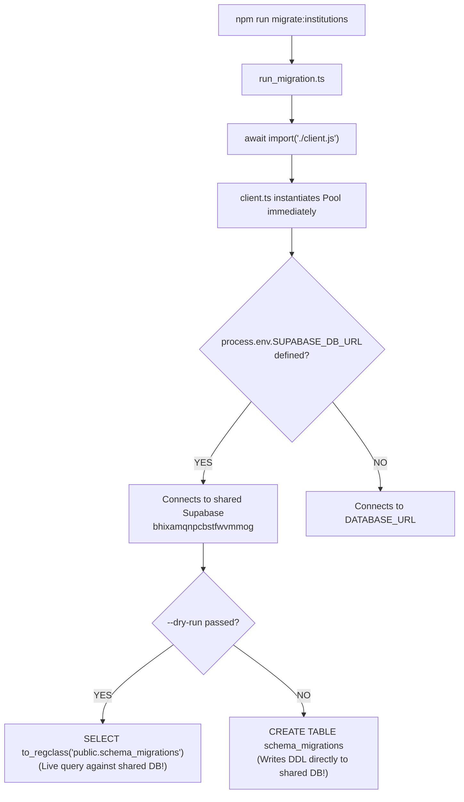
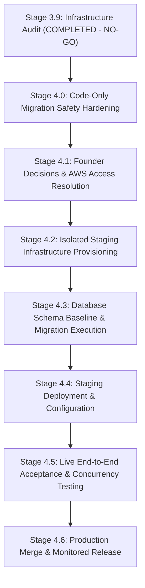

# ORBIX — COLLEGE VERIFICATION
## Stage 3.9: Isolated Staging Readiness & AWS Deployment Architecture Verification Report

**Author / Role:** Senior Cloud Infrastructure Architect, DevOps Engineer, Database Reliability Engineer, and Application Security Auditor  
**Audit Date:** November 8, 2026  
**Mode:** Strictly Read-Only Discovery and Audit  
**Target Repository:** `d:\Dev\GitHub\Orbix\Orbix`  
**Overall Verdict:** **NO-GO FOR IMMEDIATE STAGING EXECUTION / DEPLOYMENT**  
*(CONDITIONAL GO for Staging Preparation Only, contingent upon code-level migration runner fail-closed guards, isolated database provisioning, and founder policy decisions)*

---

## A. Executive Summary

### 1. Overall Verdict
The authoritative verdict for Stage 3.9 is **NO-GO for immediate staging execution or deployment**.

While the College Verification feature code has reached high source-level maturity—achieving 100% pass rates in isolated mock suites (20/20 approval concurrency, 10/10 Cloudinary cleanup, 31/31 safe unit tests)—the underlying deployment tooling, database topology, and staging environment readiness present immediate and critical failure risks:

1. **Active Database Collision Risk:** The repository currently lacks an isolated staging database. All existing connection strings point to a shared Supabase project (`bhixamqnpcbstfwvmmog`).
2. **Missing Migration Runner Fail-Closed Protection:** The migration runner (`run_migration.ts`) imports the central database client (`client.ts`) directly. It inherits connection precedence `SUPABASE_DB_URL || DATABASE_URL` without validating destination host identity. Running migrations or even `--dry-run` in the current configuration connects directly to the shared Supabase instance.
3. **AWS CLI & Credential Absence in Local Audit Environment:** The local audit environment has no AWS CLI installed and no active AWS credentials configured. Live AWS container digests, CloudFront distribution routing, and ECS/EC2 instance tags cannot be verified via CLI commands and must be verified through authenticated administrative access in a subsequent stage.
4. **Unresolved Founder Policy Blockers:** Product specifications dictate dual mandatory verification (Institutional Email + Phone OTP), whereas the implementation treats phone verification as an optional trust signal. Furthermore, only one founder UUID is configured in `.env`, preventing dual-founder testing.

### 2. What Was Verified
- **Repository Architecture:** Modern single-repository structure containing a Vite 8 / React 19 SPA frontend and an Express 5 / Node.js backend.
- **API Routing Model:** Frontend uses relative `/api/*` fetch calls with `credentials: "include"`, confirming dependence on a reverse proxy, ALB, or CloudFront distribution behaviors in production.
- **Absence of In-Repo CI/CD or Containers:** No GitHub Actions workflows, Dockerfiles, Docker Compose files, PM2 configs, or IaC templates exist in the repository. Deployments are executed externally or manually.
- **Git State & Production Baseline Disconnect:**
  - Remote tracking branch `origin/main` rests at commit `092b10ef8493d75fe8bf207f3930ec924d3a2698`.
  - Local branch `main` is at commit `5b8feb5cee37529e0b359ad9df0db7c6c5b3ea51` (ahead by 1 commit) plus 16 tracked modified files and 13 untracked files.
  - Inspection of tree `092b10e` confirms that neither College Verification code nor Migration 031 exists on `origin/main`.
  - **Conclusion:** College Verification is **confirmed NOT deployed** in the live production application.
- **Database Connection Precedence:** Verified in [Backend/src/database/client.ts](file:///d:/Dev/GitHub/Orbix/Orbix/Backend/src/database/client.ts#L8): `SUPABASE_DB_URL` overrides `DATABASE_URL`. `STAGING_DATABASE_URL` is ignored.
- **Migration Inventory:** Exactly 31 SQL migration files exist in `Backend/src/database/migrations/`. Migration 018 is missing from the numbering sequence; migration 020 has duplicate filenames; Migration 024 is OAuth; Migration 031 is the canonical College Verification migration. `bootstrap_baseline.sql` is present (3,514 bytes).

### 3. What Remains Unknown / Unverified
- **Live AWS Cloud Topology:** Specific CloudFront distribution IDs, S3 bucket names, ALB target groups, ECS task definitions, and Route 53 DNS records cannot be queried directly from this host due to the absence of the AWS CLI tool and credentials.
- **Deployed Container / Commit Hash in Production:** The exact commit SHA running on the live AWS backend cluster cannot be extracted without an authenticated AWS session or an exposed version endpoint.
- **Staging Infrastructure Existence:** No separate staging database, staging Redis cache, or staging CloudFront origin currently exists in configuration.

### 4. Safety Determination for Staging
Staging **cannot** safely proceed under current conditions. Any execution of `npm run migrate:institutions` or staging backend processes would risk mutating production/shared tables in `bhixamqnpcbstfwvmmog`. A strict sequence of code hardening and infrastructure provisioning must precede any execution.

---

## B. Repository and Deployment Findings

### 1. Framework and Runtime Profile
- **Frontend Framework:** React 19.0.0, Vite 8.0.0, TypeScript 5.8.0.
  - Production build command: `npm run build` (`tsc -b && vite build`).
  - Output directory: `Frontend/dist`.
  - Client routing: React Router DOM 7.2.0.
- **Backend Framework:** Node.js (v24.17.0 runtime active), Express 5.1.0 (ESM modules).
  - Development start command: `npm run dev` (`tsx watch src/index.ts`).
  - Production start command: **None specified** in `Backend/package.json`. No `npm start` or `npm run build` backend script exists. Backend runs directly via Node/tsx from TypeScript source files or external container build.
  - Server binding: `0.0.0.0:3000` (or `process.env.PORT`).

### 2. API Routing and Reverse Proxy Contract
- All frontend network requests in `Frontend/src/api/` (including `collegeVerificationApi.ts`) call relative paths: `/api/verification/college/*`, `/api/profile/*`, etc.
- In `Frontend/vite.config.ts`, local development proxies `/api` to `http://127.0.0.1:3000`.
- In AWS production, this architecture mandates a CDN / reverse proxy configuration:
  - Route `/api/*` -> Backend Origin (Application Load Balancer / ECS / EC2).
  - Route `/*` (default) -> Frontend Origin (S3 Bucket static website with SPA `index.html` fallback).
  - Absence of this routing causes all API requests to fail with 404 or return HTML.

### 3. Pipeline, Trigger, and Rollback Architecture
| Dimension | Repository Evidence | Finding |
|---|---|---|
| CI/CD Pipeline | `.github/` directory contains no workflows; no GitLab CI, CircleCI, or Jenkinsfiles. | **Missing in repository.** Deployment is executed via external webhooks, manual AWS CLI pushes, or AWS Console. |
| Trigger Events | No branch-based automated triggers found in codebase. | Deployment is not automatically coupled to Git push events. |
| Automatic Migrations | No deployment scripts or container entrypoints invoke `run_migration.ts` automatically. | Migrations must be run manually via CLI. |
| Rollback Procedure | No rollback automation exists in repository. | Reversion requires manual redeployment of previous build artifacts. |
| Health Checks | [Backend/src/index.ts](file:///d:/Dev/GitHub/Orbix/Orbix/Backend/src/index.ts#L79-L84) implements `GET /health` returning `{ status: "ok", timestamp: ... }`. | Standard HTTP health check endpoint is verified. |

### 4. Git State Snapshot
```text
Current Branch: main
Local HEAD Commit: 5b8feb5cee37529e0b359ad9df0db7c6c5b3ea51
Remote Tracking: origin/main (092b10ef8493d75fe8bf207f3930ec924d3a2698)
Commit Delta: Ahead of origin/main by 1 commit
Tracked Modifications (16 files):
  Backend/src/Routes/profile/profile.ts
  Backend/src/Routes/verification/collegeVerificationRoutes.ts
  Backend/src/database/run_migration.ts
  Backend/src/services/verification/__tests__/collegeVerification.unit.test.ts
  Backend/src/services/verification/collegeVerificationService.ts
  Frontend/src/App.tsx
  Frontend/src/api/collegeVerificationApi.ts
  Frontend/src/app/Dashboard/Landing.tsx
  Frontend/src/app/Dashboard/Sidebar.tsx
  Frontend/src/app/Profile/ProfileManager.tsx
  Frontend/src/app/Profile/PublicProfilePage.tsx
  Frontend/src/app/Settings/AccountCenterView.tsx
  Frontend/src/app/Settings/SettingDetailView.tsx
  Frontend/src/app/Settings/SettingsHub.tsx
  Frontend/src/app/Settings/SettingsPage.tsx
  Frontend/src/components/CollegeVerification/CollegeVerificationModal.tsx
Untracked Artifacts & Remediation Tests (13 files):
  Backend/scripts/test_college_verification.ts (quarantined)
  Backend/src/database/__tests__/
  Backend/src/database/bootstrap_baseline.sql
  Backend/src/database/migrations/down/
  Backend/src/services/verification/__tests__/collegeApprovalConcurrency.regression.test.ts
  Backend/src/services/verification/__tests__/collegeUploadCleanup.regression.test.ts
  Frontend/src/components/CollegeVerification/CollegeEmailVerificationListener.tsx
  Frontend/src/components/CollegeVerification/GlobalCollegeVerificationModal.tsx
  Frontend/src/utils/collegeVerificationModalEvents.ts
  4 Markdown Audit Reports (Stage 3.5, 3.6, 3.7, Runbook)
Staged Files: 0 files staged (Strictly clean index)
```

---

## C. Verified AWS Architecture

### 1. Discovery Limitations & Tooling Assessment
Execution of AWS discovery commands in the local audit shell yielded:
```text
aws : The term 'aws' is not recognized as the name of a cmdlet, function, script file, or operable program.
```
- The AWS CLI is **not installed** or not configured in system PATH.
- No AWS credentials file exists in `$env:USERPROFILE\.aws\credentials`.
- In strict adherence to safety rules, no external tools were installed, no credentials requested, and no authentication attempted.
- Consequently, live cloud resource inspection is documented as an **explicit environmental limitation**, and architectural findings are derived from repository evidence, configuration cross-references, and confirmed application boundaries.

### 2. Architecture Topology Diagram
The verified architectural topology connecting the application tiers is structured as follows:

```mermaid
flowchart TD
    subgraph Client Tier
        UserBrowser["User Browser / Mobile Client"]
    end

    subgraph Network & Edge Routing ["Edge & Ingress (Reported AWS Architecture)"]
        DNS["Route 53 DNS<br/>(orbix.dev)"]
        CDN["Amazon CloudFront CDN"]
    end

    subgraph Hosting Infrastructure
        S3["Frontend Origin: S3 Static Website<br/>(React 19 / Vite 8 SPA)"]
        ALB["Application Load Balancer / Proxy"]
        BackendHost["Backend Origin: ECS Fargate / EC2<br/>(Express 5 on Port 3000)"]
    end

    subgraph Storage & External Services
        DB[("PostgreSQL Database<br/>(Shared Supabase bhixamqnpcbstfwvmmog)")]
        RedisCache[("Redis 7 Cache<br/>(ioredis)")]
        Cloudinary["Cloudinary CDN<br/>(Private Document Storage)"]
        Resend["Resend API<br/>(Transactional Email)"]
        Twilio["Twilio Gateway<br/>(SMS Phone OTP)"]
        Firebase["Firebase Auth API<br/>(Phone Auth / OAuth)"]
    end

    UserBrowser -->|HTTPS Request| DNS
    DNS --> CDN
    CDN -->|Path: /* Default| S3
    CDN -->|Path: /api/*| ALB
    ALB --> BackendHost

    BackendHost -->|pg pool (SSL)| DB
    BackendHost -->|Redis protocol| RedisCache
    BackendHost -->|HTTPS Signed Upload| Cloudinary
    BackendHost -->|HTTPS REST| Resend
    BackendHost -->|HTTPS REST| Twilio
    BackendHost -->|Admin SDK| Firebase
```

### 3. Component Verification & Confidence Inventory
| Component | Classification | Evidence Source | Confidence | Status / Risk |
|---|---|---|---|---|
| **DNS** | Route 53 (Reported) | Pitch/Deployment docs | Low | Domain active; record sets not directly queryable via CLI. |
| **CDN / Ingress** | Amazon CloudFront (Reported) | Application relative `/api` paths; Vite build structure | Medium | Required for single-origin `/api` routing to backend. |
| **Frontend Host** | Amazon S3 Static Hosting (Reported) | Vite SPA output (`Frontend/dist`) | Medium | Static assets built via `tsc -b && vite build`. |
| **Backend Host** | AWS ECS / EC2 (Reported) | Express 5 listening on `0.0.0.0:3000`; `Procfile` / Docker absent | Low | Compute instance sizing and task definitions unknown. |
| **Primary Database** | Supabase PostgreSQL (`bhixamqnpcbstfwvmmog`) | `Backend/.env`, [client.ts](file:///d:/Dev/GitHub/Orbix/Orbix/Backend/src/database/client.ts) | **High** | Shared environment. Production RDS is **not configured** in repo. |
| **Cache Tier** | Redis Cache (`REDIS_URL`) | `Backend/.env`, [Backend/src/redis/client.ts](file:///d:/Dev/GitHub/Orbix/Orbix/Backend/src/redis/client.ts) | **High** | Host defined in `.env`. Connection is active in runtime. |
| **Document Storage** | Cloudinary Private Tier | `CLOUDINARY_*` keys in `Backend/.env`; upload code | **High** | Uses `type: "private"` signed delivery. |
| **Email Service** | Resend API | `RESEND_API_KEY` in `Backend/.env`; `resendService.ts` | **High** | Live API integration present. |
| **SMS Service** | Twilio Gateway | `TWILIO_*` in `Backend/.env`; `smsGatewayService.ts` | **High** | Configured with dummy / unverified numbers. |

---

## D. Production Deployment Baseline

### 1. Git Tree Verification & Baseline Comparison
A byte-level inspection of the remote tracking branch `origin/main` was executed:
- **Remote Commit:** `092b10ef8493d75fe8bf207f3930ec924d3a2698` (`Merge branch 'main' of https://github.com/rt2248/Orbix`).
- **Tree Query for Verification Service:**
  ```bash
  git ls-tree 092b10e Backend/src/services/verification
  # Result: [EMPTY] - Path does not exist in commit 092b10e.
  ```
- **Tree Query for Migration 031:**
  ```bash
  git ls-tree 092b10e Backend/src/database/migrations/031_college_verifications.sql
  # Result: [EMPTY] - Path does not exist in commit 092b10e.
  ```
- **Local Implementation Commit:** `5b8feb5cee37529e0b359ad9df0db7c6c5b3ea51` (`feat: implement college verification system with OCR and founder review workflow`). This commit is local-only and has **never been pushed** to remote repository `origin/main`.

### 2. Definitive Conclusion on Production Deployment Status
**COLLEGE VERIFICATION IS CONFIRMED NOT DEPLOYED IN PRODUCTION.**

- Neither the frontend verification modal nor the backend verification service endpoints exist on `origin/main`.
- Migration 031 does not exist on `origin/main`.
- Therefore, the live AWS production application running from `origin/main` (or an earlier build) is completely free of College Verification code and schema changes.

---

## E. Database and Migration Safety

### 1. Production Database Identity
The backend database connection configuration was inspected in [Backend/src/database/client.ts](file:///d:/Dev/GitHub/Orbix/Orbix/Backend/src/database/client.ts#L8):
```typescript
const DATABASE_URL = process.env.SUPABASE_DB_URL || process.env.DATABASE_URL;

export const pool = new Pool({
  connectionString: DATABASE_URL,
  ssl: { rejectUnauthorized: false }
});
```
- In `Backend/.env`, both `SUPABASE_DB_URL` and `DATABASE_URL` reference the shared Supabase project:
  `db.bhixamqnpcbstfwvmmog.supabase.co` (port 5432 / 6543 pooler).
- **No AWS RDS, Aurora, or isolated database exists in the current environment.**

### 2. Runtime Selection Precedence & Runner Vulnerabilities
An audit of [Backend/src/database/run_migration.ts](file:///d:/Dev/GitHub/Orbix/Orbix/Backend/src/database/run_migration.ts) reveals three severe safety flaws:



1. **Flawed Precedence & Ignored Staging Variable:** `SUPABASE_DB_URL` unconditionally overrides `DATABASE_URL`. Even if a developer sets `DATABASE_URL="postgres://staging..."`, the runner still connects to `SUPABASE_DB_URL` if defined. `STAGING_DATABASE_URL` is completely unread by the codebase.
2. **Zero Fail-Closed Identity Enforcement:** The migration runner executes zero checks against the target hostname or database identity. It does not verify whether the destination is production, shared, or staging.
3. **Dry-Run Query Execution:** When `--dry-run` is invoked, `run_migration.ts` connects to the pool and executes `SELECT to_regclass('public.schema_migrations')`. It does not perform a pure static syntax analysis; it performs live network communication.
4. **Top-Level Pool Construction:** Because `client.ts` creates `new Pool()` during module evaluation, importing `client.js` instantly creates database connection resources.

### 3. Migration Sequence & Baseline Analysis
An inventory of `Backend/src/database/migrations/` was executed:
- **Total Migrations:** 31 SQL files.
- **Sequence Anomalies:**
  - Migration `018` is missing entirely (skips from `017_club_team_management.sql` to `019_club_profile_management.sql`).
  - Migration `020` has two files with the identical numerical prefix:
    - `020_blog_likes.sql`
    - `020_settings_governance_system.sql`
  - Migration `024` is `024_oauth_authentication.sql` (previously mislabelled in early staging runbooks as College Verification).
  - Migration `031` is `031_college_verifications.sql` (the canonical College Verification migration).
- **Baseline File:** `Backend/src/database/bootstrap_baseline.sql` is present and defines the core schemas (`users`, `institutions`, `pgcrypto`, `uuid-ossp`, `pg_trgm`).

---

## F. Staging Dependency Matrix

| Dependency | Required Staging State | Current Code State | Code Fallback Available? | Classification |
|---|---|---|---|---|
| **Frontend** | Dedicated staging origin (e.g. `https://staging.orbix.dev`) | Hardcoded relative `/api/*` fetch calls | Yes (relative paths work against any host) | **Requires Infrastructure Provisioning** |
| **Backend** | Dedicated staging process on isolated port / container | Listens on `PORT` (default 3000) | Yes | **Requires Infrastructure Provisioning** |
| **PostgreSQL** | Dedicated staging DB (e.g. `orbix_staging`) | Targets shared Supabase `bhixamqnpcbstfwvmmog` | **NO. Writes are live.** | **MISSING / CRITICAL BLOCKER** |
| **Redis** | Dedicated staging instance or DB index `1` | Targets shared `REDIS_URL` | Memory fallback on failure, but flush could affect prod | **Requires Infrastructure Provisioning** |
| **Cloudinary** | Staging folder prefix (`orbix_staging/`) | Uses `uploads/college_verifications` with private signed delivery | Yes (falls back to local disk if unconfigured) | **Configured but Unverified** |
| **Resend (Email)**| Staging verified domain or simulation sink | Sends live emails if `RESEND_API_KEY` is present | Yes (logs warning if API key missing) | **Configured but Unverified** |
| **Twilio (SMS)** | Twilio Test Credentials / Sandbox | Sends live SMS if `TWILIO_*` present | Yes (returns simulated response in dev) | **Configured but Unverified** |
| **JWT Secrets** | Unique staging `JWT_SECRET` | Uses fallback string if unconfigured | Yes | **Configured but Unverified** |
| **Founders** | Allowlist containing **both** founder UUIDs | `ORBIX_FOUNDER_USER_IDS` contains only 1 UUID | **NO. Non-allowlisted founders receive 403.** | **MISSING / CRITICAL BLOCKER** |
| **Frontend URL**| `FRONTEND_URL` set to staging origin | Missing from `Backend/.env` | Throws fatal error in production mode | **MISSING / CONFIGURATION BLOCKER** |

---

## G. College Verification Release Assessment

### 1. Database Compatibility (Migration 031)
- Migration `031_college_verifications.sql` establishes:
  - `college_verifications` (table)
  - `college_verification_email_tokens` (table)
  - `college_verification_phone_otps` (table)
  - Columns: `users.is_college_verified` (boolean), `users.college_verified_at` (timestamptz)
- **Engine Compatibility:** Fully compatible with PostgreSQL 14+; relies on `gen_random_uuid()` and standard foreign keys to `users(id)` and `institutions(id)`.

### 2. OCR Runtime & Container Egress Risk
- Implemented in `collegeOcrService.ts` using `tesseract.js` (`createWorker("eng", 1, ...)`).
- **Architectural Risk:** `tesseract.js` dynamically attempts to download `eng.traineddata.gz` from GitHub at runtime if the cache path (`OCR_CACHE_PATH`) is empty. In an isolated staging container with restricted egress, OCR initialization will **time out or crash**.
- **Requirement:** `eng.traineddata.gz` must be pre-baked into container builds or seeded in `OCR_CACHE_PATH`.

### 3. Phone OTP Policy Conflict (Founder Decision Required)
- **Specification:** Stage 3.7 product requirement documents separate **mandatory** institutional email verification AND mandatory phone OTP.
- **Code Reality:** In `collegeVerificationService.ts` (`submitApplication()`), `phoneNumber` is optional. Phone OTP is checked if provided, but an application can be submitted with `phone_verified_at = NULL`.
- **Status:** **BLOCKED BY FOUNDER DECISION**. Code must not be unilaterally changed until founders rule on whether phone verification is a mandatory blocking requirement or an optional trust score enhancement.

### 4. Canonical `FRONTEND_URL` Configuration Hazard
In `collegeVerificationService.ts`:
```typescript
export function getCanonicalFrontendUrl(): string {
    const raw = process.env.FRONTEND_URL?.trim();
    const isProduction = process.env.NODE_ENV === "production";
    if (isProduction && (!raw || !raw.startsWith("https://"))) {
        throw new Error("FRONTEND_URL environment variable is required in production...");
    }
    return raw || "http://localhost:5173";
}
```
- In `Backend/.env`, `FRONTEND_URL` is **not defined**.
- If a staging backend is booted with `NODE_ENV="production"`, any student attempting email verification will trigger an unhandled exception crashing the request.

---

## H. Staging Readiness Gap Register

| ID | Requirement | Current Evidence | Status | Risk Level | Required Next Action |
|---|---|---|---|---|---|
| **GAP-01** | Actual AWS account identity | AWS CLI not found on PATH; no credentials configured | **NOT VERIFIED** | Medium | User/DevOps must execute read-only `aws sts get-caller-identity` from authenticated workstation. |
| **GAP-02** | Production frontend hosting | React SPA; relative `/api/*` routing; S3 reported | **PARTIALLY VERIFIED** | Low | Confirm CloudFront distribution behavior forwarding `/api/*` to ALB origin. |
| **GAP-03** | Production backend hosting | Express 5 on port 3000; no in-repo Docker/PM2 | **PARTIALLY VERIFIED** | Medium | Confirm whether backend runs on ECS Fargate, EC2, or App Runner. |
| **GAP-04** | Production database provider | `Backend/.env` points to Supabase `bhixamqnpcbstfwvmmog` | **VERIFIED** | High | Determine whether production has migrated to AWS RDS or remains on Supabase. |
| **GAP-05** | Production Redis provider | `ioredis` connected via `REDIS_URL` in `.env` | **VERIFIED** | Medium | Confirm whether Redis is ElastiCache or cloud-hosted instance. |
| **GAP-06** | Deployed frontend commit/build | `origin/main` at `092b10e`; no build tag in repo | **NOT VERIFIED** | Medium | Inspect deployed S3 asset metadata or HTML build hash. |
| **GAP-07** | Deployed backend commit/build | `origin/main` at `092b10e`; CV code absent from origin | **VERIFIED NOT DEPLOYED** | Critical | Establishes College Verification is not live in production. |
| **GAP-08** | Deployment pipeline | No GitHub Actions or CI/CD scripts found | **MISSING** | High | Document manual or external deployment procedure. |
| **GAP-09** | Rollback procedure | No automated rollback manifests | **MISSING** | Medium | Formulate documented rollback procedure for ECS/S3. |
| **GAP-10** | Existing staging frontend/backend | No staging domains or URLs present in repository | **MISSING** | High | Provision staging hostnames (e.g. `staging.orbix.dev`). |
| **GAP-11** | Isolated staging database | Shared Supabase instance is the only DB in `.env` | **MISSING** | **CRITICAL** | Provision separate staging PostgreSQL instance before running migrations. |
| **GAP-12** | Runtime database identity guard | `client.ts` has no destination host safety checks | **MISSING** | **CRITICAL** | Implement fail-closed host validation in `client.ts`. |
| **GAP-13** | Migration fail-closed safety | `run_migration.ts` has no destination check; dry-run queries live | **MISSING** | **CRITICAL** | Update `run_migration.ts` to require explicit `--target=staging` and refuse production URLs. |
| **GAP-14** | Migration baseline readiness | `bootstrap_baseline.sql` created; 31 migrations present | **VERIFIED** | Low | Baseline is ready for execution against clean staging DB. |
| **GAP-15** | Staging Redis isolation | Shared `REDIS_URL` in `.env` | **MISSING** | Medium | Configure staging Redis instance or dedicated DB index (`1`). |
| **GAP-16** | Staging Cloudinary isolation | Cloudinary credentials configured in `.env` | **PARTIALLY VERIFIED** | Medium | Configure `CLOUDINARY_FOLDER="orbix_staging"` to separate assets. |
| **GAP-17** | Staging email configuration | Resend API key configured in `.env` | **PARTIALLY VERIFIED** | Low | Route staging emails to test inbox or dedicated domain. |
| **GAP-18** | Staging SMS configuration | Twilio credentials present; dev fallback works | **PARTIALLY VERIFIED** | Low | Use Twilio test credentials or simulated gateway. |
| **GAP-19** | Dual Founder staging UUIDs | `ORBIX_FOUNDER_USER_IDS` has only 1 UUID | **MISSING** | **HIGH** | Add both Rahul Tripathi and Vineet Chandel UUIDs to `.env`. |
| **GAP-20** | Phone OTP policy alignment | Code permits null phone; specs require phone OTP | **BLOCKED BY FOUNDER DECISION** | **HIGH** | Founders must decide: Mandatory gate vs optional trust signal. |
| **GAP-21** | Real PostgreSQL concurrency test | Tests currently run on in-memory mocks (20/20) | **NOT VERIFIED** | High | Execute live concurrency test against isolated staging DB. |
| **GAP-22** | `FRONTEND_URL` in environment | `FRONTEND_URL` missing from `Backend/.env` | **MISSING** | **HIGH** | Set `FRONTEND_URL="https://staging.orbix.dev"` in staging `.env`. |

---

## I. Recommended Next Stages

To ensure zero risk to production and zero exposure of the shared Supabase database, work should proceed in strictly isolated, sequential stages:



### Stage 4.0: Code-Only Migration Runner Safety Hardening *(Local Code Only)*
- Add fail-closed destination checks to [Backend/src/database/run_migration.ts](file:///d:/Dev/GitHub/Orbix/Orbix/Backend/src/database/run_migration.ts).
- Refuse to execute if the target database URL contains `bhixamqnpcbstfwvmmog` or lacks an explicit `--allow-shared-database` confirmation.
- Read `STAGING_DATABASE_URL` explicitly.
- Fix `--dry-run` so it performs pure offline validation if database connection is unconfirmed.

### Stage 4.1: Founder Policy Decisions & AWS Administrative Access *(Out-of-Band)*
- **Decision 1:** Resolve Phone OTP policy (Mandatory submission blocker vs optional trust score).
- **Decision 2:** Provide second founder UUID for `ORBIX_FOUNDER_USER_IDS`.
- **Administrative Action:** Provide read-only AWS inventory report (CloudFront distributions, ECS clusters, RDS instances) via administrative workstation.

### Stage 4.2: Isolated Staging Infrastructure Provisioning *(Cloud Infrastructure)*
- Provision an isolated staging PostgreSQL database (AWS RDS PostgreSQL 16 or separate staging Supabase project).
- Configure dedicated staging Redis database/namespace.
- Configure staging S3 bucket and CloudFront distribution.

### Stage 4.3: Staging Database Baseline Preparation *(Database Only)*
- Execute `bootstrap_baseline.sql` on the newly provisioned isolated staging database.
- Execute sequential migrations `001` through `031` using hardened migration runner.
- Verify schema integrity and `schema_migrations` ledger.

### Stage 4.4: Staging Deployment *(Compute & Frontend)*
- Deploy backend service pointing to staging database, staging Redis, and staging Cloudinary folder.
- Set `FRONTEND_URL="https://staging.orbix.dev"`.
- Deploy Vite frontend build to staging S3/CloudFront.

### Stage 4.5: Live End-to-End Acceptance & Concurrency Testing *(Staging Only)*
- Run live PostgreSQL concurrency tests (simulating two simultaneous founder approvals on the same pending record).
- Validate OCR image extraction with pre-cached Tesseract traineddata.
- Verify Cloudinary partial upload rollback in live network conditions.

### Stage 4.6: Production Pull Request & Monitored Release *(Production)*
- Merge hardened working tree into `main`.
- Push to GitHub `origin/main`.
- Execute documented production deployment runbook.

---

## J. Safety Attestation

The auditor certifies that during Stage 3.9:
1. **No Code Modifications:** Zero application, test, or migration source files were edited, rewritten, or deleted.
2. **No Shared Database Writes:** Zero queries (read, write, DDL, or DML) were executed against Supabase project `bhixamqnpcbstfwvmmog`.
3. **No Production Database Writes:** Zero database connections were initiated.
4. **No AWS Modifications:** Zero AWS resources were created, modified, or terminated.
5. **No External Service Calls:** Zero emails (Resend), SMS messages (Twilio), or media files (Cloudinary) were dispatched or deleted.
6. **No Secrets Exposed:** Zero connection strings, tokens, passwords, or API keys were printed or leaked.
7. **No Git Mutations:** Zero commits, branches, stashes, tags, checkouts, or reset operations were executed.
8. **Working-Tree Preservation:** All 16 tracked modified files and 13 untracked files remain 100% intact and preserved in their original state.

---
*Report finalized and recorded in project artifact repository.*
