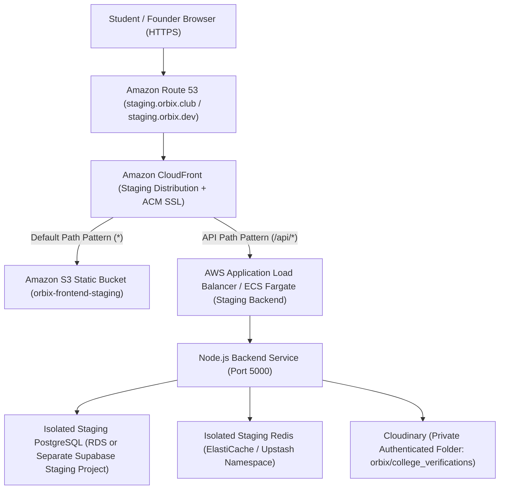

# Orbix — College Verification Staging Runbook

**Feature:** Institutional College Verification  
**Target Environment:** Isolated AWS Staging Environment  
**Document Version:** 2.2.0 (Reconciled & Audited Addendum)  
**Date:** 2026-11-08  
**Status:** DRAFT PROPOSED RUNBOOK — PENDING FOUNDER & DEVOPS INFRASTRUCTURE SIGN-OFF  
**Execution Clearance:** NOT APPROVED FOR EXECUTION UNTIL DEPENDENCIES IN SECTION 9 ARE RESOLVED  

---

## 1. Safety Policies & Non-Negotiable Boundaries

> [!CAUTION]
> **ABSOLUTE PROHIBITION ON SHARED DATABASE & PRODUCTION AWS WRITES:**  
> 1. Never point staging or migration tooling at the shared production Supabase database (`bhixamqnpcbstfwvmmog`).  
> 2. Never modify, restart, or deploy to existing live AWS production workloads.  
> 3. Staging must execute on dedicated, disposable AWS/PostgreSQL staging resources with complete data isolation.

### 1.1 Fail-Closed Database Identity Check

> [!WARNING]
> **Bypass Vulnerability Notice (Audited in Stage 3.7 Addendum):**  
> In `Backend/src/database/client.ts`, the database connection string is resolved as:  
> `const DATABASE_URL = process.env.SUPABASE_DB_URL || process.env.DATABASE_URL;`  
> - If an operator only verifies `$SUPABASE_DB_URL`, but `$DATABASE_URL` is set to the shared database, the application falls back to `$DATABASE_URL` and connects to the shared database.  
> - `STAGING_DATABASE_URL` is **not** consumed by `client.ts` unless explicitly assigned to `SUPABASE_DB_URL` or `DATABASE_URL`.  
> - The migration runner currently does **not** inspect database identity at runtime; safety assertions in shell scripts must check **both** variables and fail closed if any reference the shared database or if neither is set.

Before running any migration, bootstrap, or test tooling, the operator must execute this fail-closed validation check:

```bash
# Fail-closed check: Ensure connection string is designated for isolated staging and not shared production
CHECK_URL="${SUPABASE_DB_URL:-$DATABASE_URL}"

if [ -z "$CHECK_URL" ]; then
    echo "FATAL: Neither SUPABASE_DB_URL nor DATABASE_URL is set in environment!"
    echo "Aborting to prevent unconfigured startup."
    exit 1
fi

# Detect shared production Supabase project ref
if echo "$CHECK_URL" | grep -qi "bhixamqnpcbstfwvmmog"; then
    echo "FATAL: Target database is the production/shared Supabase instance (bhixamqnpcbstfwvmmog)!"
    echo "Aborting immediately to safeguard production data."
    exit 1
fi

# Detect production hostname patterns
if echo "$CHECK_URL" | grep -qiE "prod|production"; then
    echo "FATAL: Connection string appears to point to a production database!"
    echo "Aborting to protect production workloads."
    exit 1
fi

echo "✅ Target database verified safe for staging operations."
```

---

## 2. Reconciled AWS Staging Architecture

### 2.1 Separation of Confirmed, Reported, and Unknown Infrastructure

| Subsystem | Confirmed Production Baseline (Code Evidence) | Reported Production AWS Infrastructure | Proposed Staging Alternatives | Unknowns Requiring AWS Account Inspection |
| :--- | :--- | :--- | :--- | :--- |
| **Frontend** | Vite SPA in `Frontend/`; builds static bundle to `Frontend/dist`. Relative `/api/...` fetch calls. | User reported: hosted on AWS. Blog docs describe Nginx on EC2 and S3/CloudFront. | Dedicated S3 bucket + CloudFront staging distribution (or separate subpath). | Actual compute resource (S3 vs EC2 vs Amplify), CloudFront distribution ID, ACM certificate ARN. |
| **Backend** | Express Node.js (`Backend/src/index.ts`). Listens on `PORT` (defaults to 5000). | User reported: hosted on AWS. No Dockerfile or CDK manifests in repo. | Dedicated ECS Fargate Task or isolated staging EC2 instance behind ALB. | Compute service type (EC2 instance ID, ECS cluster/service, Elastic Beanstalk), task definition. |
| **API Routing** | Relative `/api/*` paths used across all frontend API modules. | CloudFront or Nginx proxy routing `/api/*` to backend. | CloudFront default `/*` -> S3; path pattern `/api/*` -> ALB backend origin. | ALB DNS name, listener rules, target group ARN, CORS headers configuration. |
| **Database** | Node `pg` Pool (`client.ts`) with SSL `rejectUnauthorized: false`. | Supabase `bhixamqnpcbstfwvmmog` configured in repo `.env`. | Dedicated isolated PostgreSQL (AWS RDS PostgreSQL 15+ or separate Supabase staging project). | Confirmation whether production AWS backend connects to Supabase or AWS RDS PostgreSQL. |
| **Redis** | `ioredis` client (`redis/client.ts`) parsing `REDIS_HOST`, `REDIS_PORT`, `REDIS_USERNAME`, `REDIS_PASSWORD`. | Redis host configured via environment. | Dedicated Upstash Redis DB or AWS ElastiCache micro instance. | ElastiCache replication group ID, VPC subnet, security group rules. |
| **File Storage** | Cloudinary private authenticated uploads (`folder: "orbix/college_verifications"`). | Cloudinary production cloud name and API credentials. | Dedicated Cloudinary sub-account or isolated staging folder (`orbix/staging_college_verifications`). | Cloudinary quota, backup retention rules, webhook endpoints. |
| **Email** | Resend API client (`resendService.ts`) with SMTP fallback. | `RESEND_FROM_EMAIL` on verified domain. | Resend staging test key / sandbox or local test SMTP server. | Resend production sending domain, DKIM/SPF DNS records. |
| **SMS** | Twilio client (`smsGatewayService.ts`) with console simulation fallback. | Twilio credentials or Firebase Phone Auth. | Built-in console simulation mode or Twilio staging sub-account. | Production Twilio phone number, regulatory DL/A2P registration. |
| **Deployment** | No CI/CD manifests (`.github/workflows`, `buildspec.yml`, `appspec.yml`) in repo. | Deployed to AWS via external script, manual SSH, or separate repository pipeline. | Scripted deployment runbook (this document) executed against staging. | Deployment mechanism, IAM deployment roles, artifact storage (ECR repository names). |

### 2.2 Staging Routing Topology Invariant



---

## 3. Environment Variables & Service Configuration Reconciliation

### 3.1 Backend Environment Variables

| Variable Name | Classification | Consumed By | Actual Code Behavior / Description |
| :--- | :--- | :--- | :--- |
| `SUPABASE_DB_URL` | **Required** | `Backend/src/database/client.ts` | Primary PostgreSQL connection string. Takes precedence over `DATABASE_URL`. |
| `DATABASE_URL` | Fallback | `Backend/src/database/client.ts` | Consumed only if `SUPABASE_DB_URL` is omitted. |
| `JWT_SECRET` | **Required** | `Backend/src/Routes/auth/auth.ts`, `collegeVerificationService.ts` | Secret key used for session cookie signing and HMAC document proxy signing. |
| `ORBIX_FOUNDER_USER_IDS` | **Required** | `Backend/src/middlewares/founder.middleware.ts` | Comma-separated list of exact UUIDs for **both founders** (`<FOUNDER_1_UUID>,<FOUNDER_2_UUID>`). Validated via strict regex. Email addresses rejected. |
| `FRONTEND_URL` | **Required** | `Backend/src/services/verification/collegeVerificationService.ts` | Canonical frontend domain (e.g. `https://staging.orbix.club`). Required in production for secure token links. |
| `NODE_ENV` | **Required** | Global | Must be set to `"production"` in staging to enforce production security behavior (prevents OTP leakage in JSON responses, enables secure cookies, disables local disk upload fallbacks). |
| `PORT` | Optional | `Backend/src/index.ts` | HTTP port for backend server (defaults to `5000`). |
| `REDIS_HOST` | Optional / Recommended | `Backend/src/redis/client.ts` | Hostname or IP of Redis server. (`REDIS_URL` is **ignored**). |
| `REDIS_PORT` | Optional / Recommended | `Backend/src/redis/client.ts` | Port of Redis server (defaults to `6379`). |
| `REDIS_USERNAME` | Optional | `Backend/src/redis/client.ts` | Redis ACL username (if configured). |
| `REDIS_PASSWORD` | Optional | `Backend/src/redis/client.ts` | Redis password (if configured). |
| `CLOUDINARY_CLOUD_NAME` | Optional (Prod Required) | `Backend/src/config/cloudinary.ts` | Cloudinary account name. In production, missing credentials throw hard errors. |
| `CLOUDINARY_API_KEY` | Optional (Prod Required) | `Backend/src/config/cloudinary.ts` | Cloudinary API key. |
| `CLOUDINARY_API_SECRET` | Optional (Prod Required) | `Backend/src/config/cloudinary.ts` | Cloudinary API secret (27-character string). |
| `RESEND_API_KEY` | Optional / Recommended | `Backend/src/services/email/resendService.ts` | Resend API key for institutional email verification. Falls back to console simulation if omitted. |
| `RESEND_FROM_EMAIL` | Optional / Recommended | `Backend/src/services/email/resendService.ts` | Verified sender address on Resend domain. Note: `EMAIL_FROM` is **not** consumed. |
| `TWILIO_ACCOUNT_SID` | Optional | `Backend/src/services/sms/smsGatewayService.ts` | Twilio Account SID for phone OTP SMS. Note: `FAST2SMS` is **not** consumed. |
| `TWILIO_AUTH_TOKEN` | Optional | `Backend/src/services/sms/smsGatewayService.ts` | Twilio Auth Token. |
| `TWILIO_PHONE_NUMBER` | Optional | `Backend/src/services/sms/smsGatewayService.ts` | Twilio sender phone number. |
| `TESSERACT_CACHE_PATH` | Optional | `Backend/src/services/verification/collegeOcrService.ts` | Custom path for OCR trained data cache (defaults to `os.tmpdir()/tesseract-cache`). |

### 3.2 Frontend Environment Variables

| Variable Name | Classification | Consumed By | Description |
| :--- | :--- | :--- | :--- |
| `VITE_API_URL` | Optional | `Frontend/src/api/` | Base URL for API calls. If omitted, frontend uses relative paths (`/api/...`), which is recommended with CloudFront reverse proxy. |

---

## 4. Pre-Deployment Staging Build Verification

Execute these verification commands locally or in the staging CI build environment:

```bash
# 1. Clean frontend production build
npm run build --prefix Frontend

# 2. Run isolated migration runner unit test suite (100% mocked, zero database writes)
npx tsx Backend/src/database/__tests__/runMigration.unit.test.ts

# 3. Run isolated college verification service unit test suite (31 tests, zero database pollution)
npx tsx --env-file=Backend/.env.staging Backend/src/services/verification/__tests__/collegeVerification.unit.test.ts
```

**Expected Results:**
- Frontend build succeeds with zero errors (approx. 5,128 modules transformed cleanly).
- Migration runner test suite reports: `Tests Completed: 11 passed, 0 failed`.
- College verification test suite reports: `SUMMARY: 31 PASSED, 0 FAILED`.

---

## 5. Fresh Staging Database Deployment Procedure

When deploying to a **newly provisioned, empty isolated staging database**:

### Step 5.1: Fail-Closed Identity Check & Baseline Bootstrap

Bootstrap required extensions (`pgcrypto`, `pg_trgm`, `uuid-ossp`) and core tables (`users`, `user_links`, `leaderboard_entries`, `user_notifications`, `email_verification_otps`, `schema_migrations`):

```bash
# Verify identity first
if echo "$SUPABASE_DB_URL" | grep -qi "bhixamqnpcbstfwvmmog"; then echo "ABORT: Shared DB!"; exit 1; fi

# Execute baseline bootstrap
psql "$SUPABASE_DB_URL" -f Backend/src/database/bootstrap_baseline.sql
```

### Step 5.2: Dry-Run Verification

Inspect pending migrations without writing to the database:

```bash
npx tsx --env-file=Backend/.env.staging Backend/src/database/run_migration.ts --dry-run
```

**Expected Output:**
```
Found 31 pending migration(s): 001_institutions_schema.sql, ..., 031_college_verifications.sql
[Dry-Run] Skipped actual execution of pending migrations. (0 database writes performed)
```

### Step 5.3: Execute Full Migration Suite

Execute all 31 sequential migrations in natural numeric order within atomic transactions:

```bash
npx tsx --env-file=Backend/.env.staging Backend/src/database/run_migration.ts
```

### Step 5.4: Seed Institutions Directory

```bash
npx tsx --env-file=Backend/.env.staging Backend/data/seed_institutions.ts
```

**Post-Migration Schema Verification:**
```sql
SELECT version, applied_at FROM public.schema_migrations ORDER BY version;
-- Verifies all 31 migration versions are recorded.
```

---

## 6. Existing Staging Database Migration Adoption Procedure (`--adopt`)

If deploying to an **existing staging database** where historical tables already exist but `public.schema_migrations` was not initialized:

### Step 6.1: Read-Only Adoption Inspection

Inspect existing database tables and columns against migration signatures without writing any records:

```bash
npx tsx --env-file=Backend/.env.staging Backend/src/database/run_migration.ts --adopt
```

**Expected Output:**
- `Verified Adoptable`: Lists historical migrations whose schema objects are 100% present.
- `Divergent / Pending`: Lists migrations whose schema objects are partially present or missing.
- `[Adoption Inspection Only] No records were written to schema_migrations.`

### Step 6.2: Confirmed Adoption Recording

Acquire advisory lock and transactionally record verified adoptable migrations in `schema_migrations`:

```bash
npx tsx --env-file=Backend/.env.staging Backend/src/database/run_migration.ts --adopt --confirm
```

### Step 6.3: Apply College Verification Migration (031)

Run only the pending College Verification migration:

```bash
npx tsx --env-file=Backend/.env.staging Backend/src/database/run_migration.ts --file=031_college_verifications.sql
```

---

## 7. Staging Backup, Recovery & Rollback Strategy

> [!WARNING]
> **AUDIT CORRECTION ON BACKUPS:**  
> Schema-only exports (`--data=false`) are **NOT** recoverable backups. They contain only DDL statements and discard all user data, authentication records, and test state. Furthermore, Supabase CLI commands (`supabase db dump`) cannot be used against generic AWS RDS PostgreSQL instances.  
> Do NOT use `DROP TABLE ... CASCADE` scripts in staging or production, as cascading drops destroy foreign keys and dependent tables across unrelated features.

### 7.1 Complete Recoverable Pre-Deployment Backup Procedure

Before applying migration `031`, create a complete, recoverable backup (schema AND data):

#### Option A: AWS RDS PostgreSQL Managed Snapshot (Recommended for AWS RDS)
```bash
# Create manual RDS DB snapshot prior to migration execution
aws rds create-db-snapshot \
    --db-instance-identifier orbix-staging-db \
    --db-snapshot-identifier pre-031-college-verification-$(date +%Y%m%d%H%M%S)

# Wait for snapshot availability
aws rds wait db-snapshot-completed \
    --db-snapshot-identifier pre-031-college-verification-*
```

#### Option B: Full PostgreSQL Logical Dump (`pg_dump` with Data)
```bash
# Capture full custom-format dump containing schema AND data
pg_dump \
    --format=custom \
    --no-owner \
    --no-privileges \
    -d "$SUPABASE_DB_URL" \
    -f staging_pre_031_full_backup.dump

# Verify dump file integrity (non-zero size and readable table catalog)
pg_restore --list staging_pre_031_full_backup.dump | head -n 20
```

### 7.2 Tested Restore Procedure

If migration `031` or application validation fails and a full database restore is required:

#### For AWS RDS:
Restore from the pre-deployment DB snapshot using point-in-time recovery or snapshot restore to a fresh instance and re-point the staging connection string.

#### For PostgreSQL (`pg_restore`):
```bash
# Terminate existing active backend pool connections
psql "$SUPABASE_DB_URL" -c "
SELECT pg_terminate_backend(pid) 
FROM pg_stat_activity 
WHERE datname = current_database() AND pid <> pg_backend_pid();"

# Restore full database schema and data cleanly
pg_restore \
    --clean \
    --if-exists \
    --no-owner \
    --no-privileges \
    -d "$SUPABASE_DB_URL" \
    staging_pre_031_full_backup.dump

# Post-Restore Validation Query: Verify table counts and baseline integrity
psql "$SUPABASE_DB_URL" -c "
SELECT count(*) AS users_count FROM public.users;
SELECT count(*) AS migrations_count FROM public.schema_migrations;"
```

### 7.3 Secondary Strategy: Prepared Down-Migration (Human Review Only)

If an in-place rollback of migration `031` is strictly mandated without restoring the entire database snapshot, a non-cascading down-migration has been prepared at [Backend/src/database/migrations/down/031_college_verifications_down.sql](file:///d:/Dev/GitHub/Orbix/Orbix/Backend/src/database/migrations/down/031_college_verifications_down.sql).

**Application Version Compatibility Rule:**  
Before executing any down-migration, the backend application service must **first be rolled back to the commit preceding College Verification (`092b10e` or confirmed AWS deployment baseline)**.  
*(Note: Rolling back to `5b8feb5` does not remove College Verification code because `5b8feb5` is the commit that introduced it).*

---

## 8. Comprehensive Staging Acceptance & Security Test Matrix

| # | Category | Test Case | Preconditions | Action | Expected Result | Evidence to Collect | Environment |
| :--- | :--- | :--- | :--- | :--- | :--- | :--- | :--- | :--- |
| **1** | **Student Submission** | Modal Discovery | Logged-in unverified student | Navigate to Dashboard, Sidebar, Profile, Settings | "Verify Account" badge / CTA visible | UI screenshot | Local / Staging |
| **2** | **Student Submission** | Profile College Lock | User has profile college set | Open Verification Modal | Institution is pre-selected and locked | UI inspection | Local / Staging |
| **3** | **Student Submission** | File Size Limit | Modal open | Upload file >10MB | Rejection toast: "Document exceeds 10MB limit" | UI toast log | Local / Staging |
| **4** | **Student Submission** | Invalid MIME / Magic Bytes | Modal open | Rename `.txt` or corrupted file to `.png` | Rejection toast: "Invalid image file format" | Network 400 response | Local / Staging |
| **5** | **Student Submission** | Two-Sided ID Requirement | Modal open | Select "Student ID (Both Sides)", upload front only | Blocked with toast: "Front and back ID card images are required" | UI toast log | Local / Staging |
| **6** | **Student Submission** | OCR Auto-Extraction | Modal open | Upload legitimate ID card image | Student Name & Enrollment Number auto-populated in form | Form input state | Local / Staging |
| **7** | **Security / Storage** | Cloudinary Upload Failure & Partial Cleanup | Modal open, Cloudinary API keys invalidated or network interrupted during 2nd file upload | Upload front and back ID files | Request fails with 500/400; frontend displays clear error; operator audits Cloudinary media library for orphaned front ID asset | Error log & Cloudinary console audit | Staging |
| **8** | **Email Verification** | Format Validation | Modal open | Enter non-academic email (`test@gmail.com`) | Domain mismatch indicator or warning displayed | UI state | Local / Staging |
| **9** | **Email Verification** | Token Dispatch & Cooldown | Modal open | Click "Send Verification Link" twice within 60s | 1st: link dispatched; 2nd: 429 cooldown error | Network tab (429) | Staging / Local |
| **10** | **Email Verification** | Token Redemption | Active token dispatched | Click email link in browser | Captured by listener; modal shows "Email Verified" | `/verify-email-token` 200 | Staging / Local |
| **11** | **Email Verification** | Token Replay Attack | Token already redeemed | Re-click or re-post same token link | 400 Error: "Verification token has already been used" | Network tab (400) | Local / Staging |
| **12** | **Email Verification** | Token Expiry | Token expired (`expires_at < NOW()`) | Submit token to endpoint | 400 Error: "Verification token has expired" | Network tab (400) | Local / Staging |
| **13** | **Email Verification** | Cross-User Hijack Attempt | Token belongs to User A | User B attempts redemption | 403 Forbidden: "Belongs to a different user account" | Network tab (403) | Local / Staging |
| **14** | **Phone OTP** | Phone Normalization | Modal open | Enter valid 10-digit Indian phone (`9876543210`) | Normalized to `+919876543210` | Request payload | Local / Staging |
| **15** | **Phone OTP** | OTP Cooldown & Hourly Limit | Phone OTP dispatched | Request 2nd OTP within 60s, or >5 in 1 hr | 429 Too Many Requests | Network tab (429) | Local / Staging |
| **16** | **Phone OTP** | OTP Attempt Lockout | Pending phone OTP | Enter 5 incorrect 6-digit codes | Token marked expired; 400 "Too many incorrect attempts" | Network tab (400) | Local / Staging |
| **17** | **Phone OTP** | OTP Expiry | OTP expired (>10 min) | Submit code | 400: "Verification code has expired" | Network tab (400) | Local / Staging |
| **18** | **Founder Review** | Authorized Founder Access | User UUID in `ORBIX_FOUNDER_USER_IDS` | Navigate to `/internal/college-verifications` | Queue page renders with pending applications | UI page render | Staging / Local |
| **19** | **Founder Review** | Non-Founder Rejection | Regular user account | Navigate to `/internal/college-verifications` | 403 Forbidden or redirected | Network 403 / UI redirect | Staging / Local |
| **20** | **Security / Auth** | Cross-User Document Access | Authenticated regular student | Attempt GET `/api/internal/college-verifications/application/:id` or access `/document-proxy/:token` | 403 Forbidden ("Access restricted: Authorized Orbix founders only") | Network 403 response | Staging / Local |
| **21** | **Security / Auth** | Expired Signed Document URLs | Founder review queue | Request document preview URL, wait >300 seconds (TTL expiry) | Cloudinary signed URL or HMAC document proxy URL returns 403 Forbidden / expired error | HTTP 403 response | Staging / Local |
| **22** | **Security / Concurrency** | Concurrent Founder Approvals | Pending application | Founder 1 and Founder 2 submit approval at exact same millisecond | DB transaction executes cleanly; application marked `APPROVED`; users table updated once | Server log & DB row audit | Staging |
| **23** | **Founder Review** | HMAC Proxy Tampering | Signed image URL | Modify HMAC token query parameter | 403 Forbidden / Tampered payload | Network 403 | Staging / Local |
| **24** | **Founder Review** | Mandatory Rejection Reason | Application review modal | Click Reject without entering reason | 400: "A clear rejection reason is mandatory" | Network tab (400) | Staging / Local |
| **25** | **Founder Review** | Rejection Workflow | Rejection submitted | Check student modal | Status `REJECTED`, reason shown, "Update & Resubmit" active | UI state | Staging / Local |
| **26** | **Founder Review** | Approval Workflow | Approval submitted | Founder clicks approve | Status `APPROVED`, user `is_college_verified = true` | DB & UI state | Staging / Local |
| **27** | **College Change** | Approval Invalidation & Lifecycle | User is approved | Change college in Profile Manager | `is_college_verified` resets to false; verification status changes to `INVALIDATED` | DB state / UI | Staging / Local |
| **28** | **College Change** | 72-Hour Cooldown Boundary | College updated | Attempt to update college again at 71h59m vs 72h01m | Blocked at 71h59m with 400 error; permitted after 72 hours elapsed | Network 400 vs 200 | Staging / Local |
| **29** | **College Change** | Switch Back to Original College | College changed, 72h elapsed | Change college back to original institution | Status remains `INVALIDATED`; previous approval NOT restored; requires new application | UI & DB state | Staging / Local |
| **30** | **Account Controls** | Club-Account Restrictions | Logged-in club account (`accountType: "club"`) | Navigate to Dashboard, Sidebar, Settings | College Verification CTAs hidden; modal does not render (`null`) | UI inspection | Staging / Local |
| **31** | **Client Security** | Account Switching & Modal Cleanup | Modal open with uploaded files | Switch user account or sign out | Modal closes immediately, state resets, object URLs revoked | Browser memory / DOM inspection | Staging / Local |
| **32** | **Public Showcase** | Verified Badge Visibility | User is approved | Visit `/profile/u/:username` | Green verified college checkmark rendered next to institution | Public UI | Staging / Local |
| **33** | **Public Showcase** | Immediate Public Badge Removal | User verification invalidated | Visit `/profile/u/:username` | Badge immediately removed; displays "Verified Directory" or "Re-verify" owner CTA | Public UI | Staging / Local |
| **34** | **Cache Sync** | Cache Invalidation | User approved or revoked | Query profile API | Redis cache purged (`deleteUserDetailsCache`), returns fresh data | Cache log | Staging / Local |

---

## 9. Pending Infrastructure & Founder Dependencies

Before executing this runbook on staging, the following items **must be confirmed by the founders and DevOps**:

1. **Staging Database Connection String:** Provide isolated staging PostgreSQL connection string (guaranteed not `bhixamqnpcbstfwvmmog`).
2. **Founder Account UUIDs (Both Founders):** Create or designate staging user accounts for both founders (Rahul Tripathi and Vineet Chandel), query their database UUIDs (`SELECT id, email FROM users WHERE ...`), and configure `ORBIX_FOUNDER_USER_IDS="<UUID_1>,<UUID_2>"`. (Never invent placeholder UUIDs).
3. **Live AWS Deployed Baseline Commit:** Confirm whether commit `092b10e` or another specific release tag corresponds to the currently running AWS deployment.
4. **Staging AWS Infrastructure Topology:** Confirm whether staging backend runs on ECS Fargate or EC2, and confirm CloudFront path pattern routing `/api/*` to the backend.
5. **Product Decision on Phone Verification:** Confirm whether phone OTP is an **optional trust signal** (current code) or a **mandatory blocking requirement** (original specification).
