# ORBIX PLATFORM MASTER ARCHITECTURE & CODEBASE GUIDE
**Document Classification:** Authoritative Technical Knowledge Base & Engineering Reference  
**Project Name:** Orbix (Orbix Developer Ecosystem & Campus Platform)  
**Document File:** `PROJECT_CODEBASE_MASTER_GUIDE.md`  
**Analysis Scope:** Complete Repository (Frontend, Backend, Database Schemas, Migrations 001–065, Service Layers, Algorithms, Background Workers, Queues, Security Protocols, and Documentation Modules)  
**Generation Date:** November 2026  
**Repository Coverage Status:** 100% Reverse-Engineered & Cross-Verified Against Production Source  
**Target Audiences:** Engineering Teams, Technical Leads, System Architects, Security Auditors, and Documentation/README Authors  

---

### Important Architectural Limitations & Codebase Preflight Notes
1. **Source of Truth Priority:** The authoritative implementation details in this guide are derived strictly from active TypeScript source code, database DDL (`schema_production_complete.sql` and migrations `001_...` to `065_...`), and registered Express/React router endpoints. In-app documentary pages (e.g., `AlgorithmDocumentary.tsx`, `LikesEventSharingDocumentary.tsx`) provide verified domain architecture context.
2. **Automated Test Suite State:** Automated unit and end-to-end test suites were previously pruned (`git commit 62a93be: chore: remove test files, test suites, and unused markdown files`). Code quality, schema safety, and contract stability are currently enforced via strict TypeScript compilation (`tsc -b`), ESLint 10 with TypeScript-ESLint rules, database migration assertion scripts, and runtime validator classes (`SignupValidator`, `ClubRegistrationValidator`, `ProjectValidator`, `weakPatterns`).
3. **Environment Security:** No production secrets, API credentials, or passwords are reproduced within this document. All referenced secrets represent symbolic environment variables documented in `.env.example` templates.
4. **Account Segregation Architecture:** The platform strictly enforces an architectural boundary between `personal` developer accounts and `club` accounts. A single user session cannot simultaneously hold personal profile authority and club administration permissions without authenticating through dedicated portal workflows.

---

# TABLE OF CONTENTS

- [SECTION 1 — Project Overview](#section-1--project-overview)
- [SECTION 2 — Repository Structure](#section-2--repository-structure)
- [SECTION 3 — Complete Technology Stack](#section-3--complete-technology-stack)
- [SECTION 4 — High-Level System Architecture](#section-4--high-level-system-architecture)
- [SECTION 5 — Frontend Architecture](#section-5--frontend-architecture)
- [SECTION 6 — Backend Architecture](#section-6--backend-architecture)
- [SECTION 7 — Complete Feature Documentation](#section-7--complete-feature-documentation)
- [SECTION 8 — Algorithm and Business Logic Encyclopedia](#section-8--algorithm-and-business-logic-encyclopedia)
- [SECTION 9 — Complete API Documentation](#section-9--complete-api-documentation)
- [SECTION 10 — Database Architecture](#section-10--database-architecture)
- [SECTION 11 — Authentication and Authorization](#section-11--authentication-and-authorization)
- [SECTION 12 — Redis, Caching, Queues and Background Jobs](#section-12--redis-caching-queues-and-background-jobs)
- [SECTION 13 — External Integrations](#section-13--external-integrations)
- [SECTION 14 — File and Media Management](#section-14--file-and-media-management)
- [SECTION 15 — Security Architecture](#section-15--security-architecture)
- [SECTION 16 — Application Data Flows](#section-16--application-data-flows)
- [SECTION 17 — Infrastructure and Deployment Architecture](#section-17--infrastructure-and-deployment-architecture)
- [SECTION 18 — Environment Variables and Configuration](#section-18--environment-variables-and-configuration)
- [SECTION 19 — Error Handling, Reliability and Performance](#section-19--error-handling-reliability-and-performance)
- [SECTION 20 — Testing and Quality Assurance](#section-20--testing-and-quality-assurance)
- [SECTION 21 — Module Dependencies and Internal Communication](#section-21--module-dependencies-and-internal-communication)
- [SECTION 22 — Developer Setup and Local Execution](#section-22--developer-setup-and-local-execution)
- [SECTION 23 — Current Implementation Status and Technical Gaps](#section-23--current-implementation-status-and-technical-gaps)
- [SECTION 24 — Existing Documentation Audit](#section-24--existing-documentation-audit)
- [SECTION 25 — README Preparation Handoff](#section-25--readme-preparation-handoff)
- [APPENDIX — Final Review & Verification Sign-Off](#appendix--final-review--verification-sign-off)

---

# SECTION 1 — Project Overview

### 1.1 Non-Technical Overview
**Orbix** is a unified developer identity ecosystem and campus engineering platform. It bridges the gap between individual student achievements and institutional recognition. In the modern developer ecosystem, students solve coding problems on LeetCode, compete in Codeforces contests, contribute to open-source software on GitHub, and publish technical articles on Medium or Substack. However, these accomplishments remain fragmented across multiple platforms, making it difficult for university clubs, campus recruiters, and academic institutions to evaluate real-world engineering competence.

Orbix solves this problem by providing:
1. **A Single Developer Identity Card:** Automatically synchronizes and unifies performance metrics from 16 major competitive programming, open-source, and technical writing platforms into a standardized, tamper-resistant developer identity.
2. **The Orbix Score & Leaderboards:** Computes a normalized, anti-gaming score (0 to 10,000 points) using diminishing-returns mathematical modeling across six canonical skill pillars, powering both institutional campus leaderboards and a global ranking system.
3. **Institutional Club Ecosystem & Team Workspaces:** Offers university engineering chapters and student clubs a dedicated management suite containing digital event registration with dynamic branching forms, live check-in terminal with camera barcode/QR scanning, an automated Certificate Studio with cryptographic verification, and a collaborative Slack/Discord-style Team Workspace.
4. **Verified Student Trust & Academic Integrity:** Implements multi-channel identity verification including academic document OCR analysis, institutional email verification (`.edu`), phone OTP authentication, and automated safeguards against fraudulent college affiliations.

### 1.2 Technical Architecture Summary
From an engineering standpoint, Orbix is a distributed full-stack application built with **React 19** on the frontend and **Node.js (Express 5) with TypeScript** on the backend. The core storage tier consists of an ACID-compliant **PostgreSQL 14+** database managing 131 relational tables and a high-performance **Redis** tier handling token blacklists, sliding-window rate limiters, session caches, and **BullMQ** job queues. Asynchronous background workers handle transactional email outboxes, campus event broadcasts, automated 7-day account deletion purges, and monthly peer-recognition budget reconciliations.

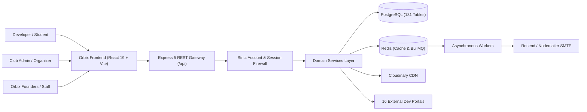

---

# SECTION 2 — Repository Structure

The project is structured as a monorepo-style repository containing two primary directories: `Frontend` and `Backend`.

```text
Orbix/
├── .gitignore
├── Backend/
│   ├── .env.example                       # Documented backend environment template
│   ├── data/
│   │   ├── aishe_raw_directory.csv        # Comprehensive Ministry of Education AISHE college dataset
│   │   ├── analyze_aishe.ts               # AISHE dataset integrity analyzer
│   │   ├── ingest_comprehensive_directory.ts # Script to ingest national colleges into PostgreSQL
│   │   ├── institutions_seed.json         # Standardized seed fixtures for university directories
│   │   └── seed_institutions.ts           # PostgreSQL seeder for institutions & aliases
│   ├── package.json                       # Backend dependencies & runtime scripts
│   ├── scripts/
│   │   ├── apply_certificate_studio_migration.ts
│   │   ├── apply_dynamic_form_migration.ts
│   │   ├── apply_merge_provenance_migration.ts
│   │   ├── apply_migration_050.ts
│   │   ├── apply_migration_054.ts
│   │   ├── apply_phase6_scalability_migration.ts
│   │   ├── apply_phase_02_recognition_migration.ts
│   │   ├── apply_phase_05_tasks_migration.ts
│   │   ├── apply_phase_06_files_migration.ts
│   │   ├── apply_phase_07_notifications_migration.ts
│   │   ├── apply_phase_08_dashboard_migration.ts
│   │   ├── apply_phase_16_verification_wallet_migration.ts
│   │   ├── apply_phase_17_database_design_and_version_management.ts
│   │   ├── apply_private_projects_migration.ts
│   │   ├── apply_projects_migration.ts
│   │   └── generate_production_schema.ts  # Introspects DB to generate schema_production_complete.sql
│   ├── seed_leaderboard.ts                # Benchmarking seed script with legendary competitive coders
│   ├── src/
│   │   ├── config/                        # Cloudinary and Firebase Admin SDK initializations
│   │   ├── constants/                     # Avatar dimensions, limits, and system constants
│   │   ├── controllers/                   # Route orchestration (blog, events, workspace)
│   │   ├── database/
│   │   │   ├── bootstrap_baseline.sql     # Baseline schema bootstrap
│   │   │   ├── client.ts                  # PostgreSQL pg.Pool wrapper and health check
│   │   │   ├── config.ts                  # Connection parameters & SSL validation
│   │   │   ├── migrations/                # 65 sequential migration scripts (001 to 065)
│   │   │   ├── models/                    # SQL table definition blueprints
│   │   │   └── schema_production_complete.sql # 5,658-line consolidated production DDL
│   │   ├── index.ts                       # Server bootstrap, middleware pipeline & shutdown
│   │   ├── middlewares/                   # auth.middleware, formSecurity, founder, staff
│   │   ├── queues/                        # BullMQ queue registrations (workspaceQueues.ts)
│   │   ├── redis/                         # ioredis client, key namespaces, caches, rate limiters
│   │   ├── repositories/                  # Low-level data access (workspaceRepository.ts: 421 KB)
│   │   ├── Routes/                        # Centralized routing tree organized by feature domain
│   │   ├── scoring/                       # orbixScore.ts & clubCredibilityEngine.ts
│   │   ├── services/                      # 40+ business logic services (auth, club, email, resume, workspace)
│   │   ├── types/                         # Shared backend interfaces (workspace, forms, certificates)
│   │   ├── utils/                         # Form sanitizers, security helpers, rating system mappings
│   │   ├── validators/                    # SignupValidator, SigninValidator, ProjectValidator, weakPatterns
│   │   └── workers/                       # BullMQ workers: email, campaign fanout, outbox, recognition
│   ├── tsconfig.json
│   └── uploads/                           # Temporary staging directory for local file processing
└── Frontend/
    ├── .env.example                       # Documented client environment template
    ├── eslint.config.js                   # Flat ESLint configuration
    ├── index.html                         # SPA HTML entry point
    ├── package.json                       # Frontend dependencies & build commands
    ├── public/                            # Static assets, SVG icons, and sample resumes
    ├── src/
    │   ├── api/                           # Axios/fetch API modules (workspaceApi, collegeEventsApi, etc.)
    │   ├── app/                           # Authenticated dashboard, club, workspace, and internal views
    │   ├── App.tsx                        # Root router, Code-split lazy routes, protected route guards
    │   ├── components/                    # UI component library, modals, form inputs, media crop panels
    │   ├── context/                       # ToastContext and loading UI context providers
    │   ├── data/                          # docsRegistry.ts and static navigation mappings
    │   ├── hooks/                         # React custom hooks (useBlogLikes, useHeadings, useActiveHeading)
    │   ├── index.css                      # Tailwind base, utilities, and neo-brutalist styling variables
    │   ├── LandingPages/                  # Public landing, marketing, blog, docs, and authentication views
    │   ├── main.tsx                       # React 19 bootstrap and DOM root mount
    │   ├── ProtectedRoute.tsx             # Strict role-based routing guards (Personal vs Club)
    │   ├── services/                      # Client-side analytics and helper integrations
    │   ├── store/                         # Redux Toolkit store and 11 feature slices
    │   ├── types/                         # Client-side TypeScript contracts
    │   └── utils/                         # Client-side string, math, and date helpers
    ├── tailwind.config.js                 # Custom styling configurations and color palettes
    ├── tsconfig.app.json                  # Application TypeScript config
    ├── tsconfig.node.json                 # Build tooling TypeScript config
    └── vite.config.ts                     # Vite build configuration, plugins, and proxy rules
```

---

# SECTION 3 — Complete Technology Stack

| Category | Technology | Version | Location / Module Used | Problem Solved / Architectural Role |
|---|---|---|---|---|
| **Frontend Framework** | React | 19.2.8 | `Frontend/src/` | Component-based UI with concurrent rendering and modern hook primitives |
| **Frontend Build Tool** | Vite | 8.3.0 | `Frontend/vite.config.ts` | Ultra-fast HMR and optimized production ES modules bundler |
| **State Management** | Redux Toolkit | 2.13.0 | `Frontend/src/store/` | Centralized global application state across 11 domain slices (`userSlice`, `clubSlice`, `networkSlice`, etc.) |
| **Routing** | React Router DOM | 7.18.4 | `Frontend/src/App.tsx` | Client-side declarative routing, protected boundaries, and nested layout redirection |
| **Styling & Design** | Tailwind CSS | 3.4.19 | `Frontend/tailwind.config.js` | Utility-first neo-brutalist UI architecture with custom border shadows and tokens |
| **Animation** | Framer Motion | 14.1.0 | `Frontend/src/components/` | Physics-based spring animations for modals, card flips, and responsive layout shifts |
| **Backend Runtime** | Node.js (ESM) | v20+ | `Backend/` | Asynchronous event-driven JavaScript server environment with native ESM imports |
| **Backend Framework** | Express | 5.2.1 | `Backend/src/index.ts` | Robust HTTP routing engine with modern promise-handling middleware architecture |
| **Language** | TypeScript | 7.0.2 / 6.0.2 | Entire Repository | End-to-end static type safety, interface enforcement, and contract compilation |
| **Primary Database** | PostgreSQL | 14+ / Supabase | `Backend/src/database/` | ACID-compliant relational data store with 131 tables, foreign keys, and indexes |
| **Database Client** | `pg` (node-postgres) | 8.23.1 | `Backend/src/database/client.ts` | High-throughput connection pooling with parameterized query execution |
| **In-Memory Cache** | Redis / `ioredis` | 6.0.0 | `Backend/src/redis/` | Sub-millisecond data caching, sliding-window rate limiters, and session blacklists |
| **Background Queues** | BullMQ | 6.7.2 | `Backend/src/queues/` | Redis-backed distributed task queue for emails, notifications, and ledger events |
| **Image & Cloud Media** | Cloudinary SDK | 2.11.0 | `Backend/src/config/cloudinary.ts` | Signed direct uploads, private document storage, and dynamic on-the-fly transformations |
| **Vector PDF Engine** | `pdf-lib` | 1.17.1 | `Backend/.../certificatePdfService.ts` | Deterministic, pure-JS vector PDF certificate generation with embedded QR codes |
| **Document Parsing** | `pdf-parse`, `mammoth` | 2.4.5 / 1.13.0 | `Backend/.../documentParser.ts` | Selectable text AST extraction from PDF and DOCX student resumes |
| **Optical Character Rec.** | Tesseract.js | 7.0.0 | `Backend/.../collegeOcrService.ts` | Automated OCR extraction for student college ID cards and ERP screenshots |
| **Transactional Email** | Resend SDK & Nodemailer | 6.35.0 / 10.5.0 | `Backend/.../resendService.ts` | Multi-provider fault-tolerant email infrastructure with automatic fallback and DLQ |
| **SMS Verification** | Twilio REST API | Native HTTP | `Backend/.../smsGatewayService.ts` | Global E.164 phone OTP verification for institutional college requests |
| **Client QR Scanner** | `jsqr` | 1.4.0 | `Frontend/.../ClubEventCheckinTerminal.tsx` | Real-time browser video stream frame processing for event check-in passes |
| **QR Code Generator** | `qrcode` | 1.5.4 | Frontend & Backend | Cryptographic credential URL generation for certificates and digital passes |
| **Authentication / Crypto** | `bcrypt`, `jsonwebtoken` | 6.0.0 / 9.0.3 | `Backend/src/Routes/auth/` | Bcrypt password hashing (12 rounds) and HMAC-SHA256 JWT signing/validation |
| **Content Sanitization** | DOMPurify | 3.4.17 | `Frontend/src/` | Client-side DOM sanitization against persistent cross-site scripting (XSS) |
| **Mathematical Rendering**| KaTeX & Rehype-KaTeX | 0.16.21 / 7.0.1 | `Frontend/src/` | High-speed TeX mathematical formula rendering in documentation and algorithm views |

---

# SECTION 4 — High-Level System Architecture

### 4.1 Global Architectural Overview
Orbix operates on a decoupled client-server model communicating via a RESTful API mounted exclusively under the `/api` prefix. The backend enforces complete isolation between the **Personal Student Context** and the **Club / Institutional Context**.

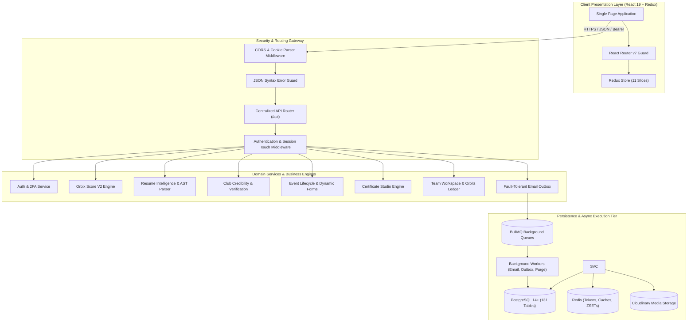

### 4.2 Security & Strict Portal Isolation Model
A core architectural pillar of Orbix is the separation of **Personal Developer Accounts** (`account_type = 'personal'`) and **Verified Club Accounts** (`account_type = 'club'`). 
- Personal users authenticate and receive a JWT granting access to `/dashboard`, `/profile`, `/resume`, `/projects`, and `/workspace/:clubId` (as an invited team member).
- Club entities authenticate via dedicated club handles and access `/club/dashboard`, `/club/events`, `/club/certificates`, and `/club/inbox`.
- Attempting to cross these boundaries triggers deterministic HTTP 403 / 401 exceptions on the backend and redirects to specialized isolation notices on the frontend (`ClubProtectedRoute` in `ProtectedRoute.tsx`).

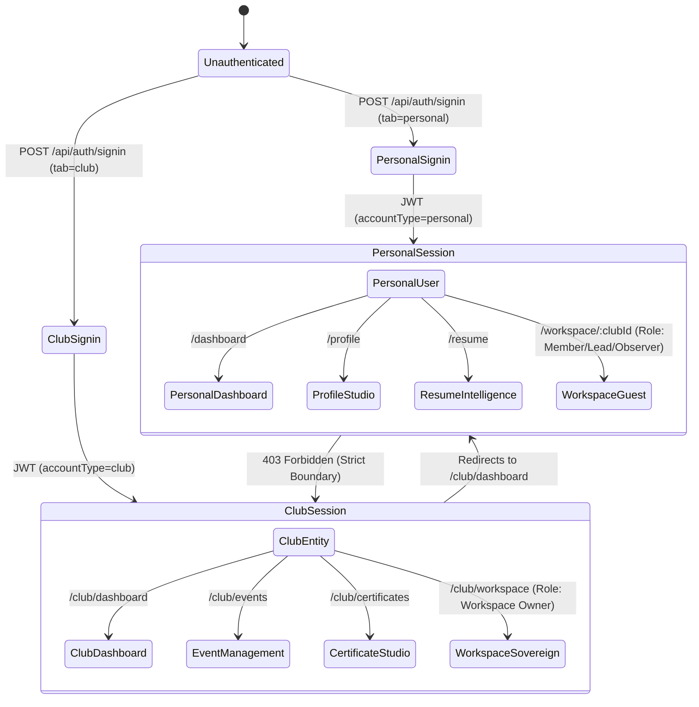

---

# SECTION 5 — Frontend Architecture

### 5.1 Application Entry & Root Initialization
The frontend entry point is `Frontend/src/main.tsx`, which mounts the root `<App />` component inside a React 19 StrictMode tree wrapped in a Redux Toolkit `<Provider store={store}>`.

The primary orchestrator is `Frontend/src/App.tsx`. Upon initial load or browser refresh, `App.tsx` executes:
```typescript
useEffect(() => {
    dispatch(fetchUserProfile());
}, [dispatch]);
```
This dispatches an asynchronous Redux thunk (`fetchUserProfile`) to `GET /api/profile/me`. If a valid HTTP-only cookie or authorization token exists, the Redux store populates user identity, verification status, and account type prior to route resolution.

### 5.2 Routing & Code-Splitting Architecture
To ensure high performance and sub-second initial page loads, all routes outside the public landing page (`MainLanding`) are asynchronously loaded using `React.lazy()` and wrapped in a suspense boundary:
```typescript
<Suspense fallback={<div className="min-h-screen bg-[#FAF6EE] flex items-center justify-center"><OrbixLoader size="lg" /></div>}>
```
The application defines three route categories:
1. **Public Marketing & Documentation:** `/`, `/pricing`, `/customers`, `/support`, `/privacy`, `/terms`, `/docs/*`, `/blogs/*`, `/profile/u/:username`, `/clubs/:slug`, `/verify/:credentialCode`.
2. **Authenticated Student Routes (`<ProtectedRoute />`):** `/dashboard`, `/profile`, `/resume`, `/projects`, `/wallet`, `/certificates`, `/workspace`, `/settings`.
3. **Dedicated Club Routes (`<ClubProtectedRoute />`):** `/club/dashboard`, `/club/status`, `/club/events`, `/club/events/:id/checkin`, `/club/certificates`, `/club/analytics`, `/club/inbox`, `/club/settings`.

### 5.3 Redux State Management Hierarchy
The Redux store (`Frontend/src/store/index.ts`) coordinates 11 modular feature slices:
- `userSlice.ts`: Authenticated user session, profile data, account type, club verification flags, and global signout.
- `clubSlice.ts`: Current club profile, application status, reviewer queue, and credibility metrics.
- `clubEventsSlice.ts`: Club-hosted events, draft configurations, attendee applications, and check-in rosters.
- `eventsSlice.ts`: 3-month rolling multi-platform competitive programming contest calendar.
- `networkSlice.ts`: Peer relationships, connection requests, and blocklist states.
- `developmentSlice.ts` & `developmentAnalyticsSlice.ts`: GitHub commits, PRs, language breakdowns, and repository statistics.
- `contestsSlice.ts`: Contest performance history across Codeforces, LeetCode, CodeChef, and AtCoder.
- `practiceAnalyticsSlice.ts`: Topic-wise problem distribution, difficulty ladders, and practice streaks.
- `submissionsSlice.ts`: Unified problem submission activity log.
- `badgesSlice.ts`: Earned platform badges and achievement calculations.

### 5.4 Adaptive Image Editing & Cropping System
Located in `Frontend/src/components/media/`, Orbix implements a client-side media manipulation system based on `IMAGE_PLACEMENTS_SPEC.md`:
- `AdaptiveImageEditorModal.tsx`: Non-destructive modal supporting aspect ratio framing, multi-scale zooming (0.5x to 3.5x), fine angle rotation, vertical/horizontal flipping, color adjustments (brightness, contrast, saturation), and safe-area margin guides.
- `imageCanvasUtils.ts`: Uses Offscreen Canvas APIs to render pixel-perfect image representations, producing WebP or PNG blobs directly in the browser.
- **Placement Configurations (`imagePlacementConfigs.ts`):** Defines strict specifications for all platform placements:
  - `user_avatar` (1:1 square, circular mask, 112x112 rendering)
  - `user_cover` (3:1 wide, max 1600px width)
  - `club_logo` (1:1 square & rounded-2xl)
  - `club_banner` (2.6:1 landscape, safe zone indicator preventing overlapping logo occlusion)
  - `event_banner` (Multi-ratio: 2.4:1 hero, 16:9 standard, 4:5 editorial poster, 9:16 story pass)
  - `form_header` (3.75:1 ultra-wide header)

---

# SECTION 6 — Backend Architecture

### 6.1 Server Bootstrap & Lifecycle Management
The backend entry point is `Backend/src/index.ts`. Initialization follows a strict sequential lifecycle:
1. **Environment Initialization:** Native `process.loadEnvFile()` loads `.env` configuration.
2. **Express Pipeline Configuration:** Configures CORS with origin reflection and credential allowance, parses HTTP-only cookies with `cookie-parser`, and registers `express.json()` with an explicit payload syntax error trap.
3. **Centralized API Router:** All feature routes are mounted exclusively under `const apiRouter = express.Router()` and bound to `/api`.
4. **Database Verification:** `testDatabaseConnection()` tests PostgreSQL pool connectivity.
5. **Background Workers Initialization:**
   - `startAccountPurgeWorker()`: Automated 7-day account deletion cleaner.
   - `startEmailWorkers()`: BullMQ email delivery queue processors.
   - `startCampaignFanoutWorker()`: Event broadcast fan-out processor.
   - `startEmailOutboxDispatcher()`: Transactional outbox polling loop (runs every 3 seconds).
6. **Graceful Shutdown Hooks:** Handlers for `SIGTERM` and `SIGINT` cleanly close the outbox dispatcher, stop BullMQ workers, and disconnect Redis clients before terminating `process.exit(0)`.

### 6.2 Middleware Execution Pipeline
Every incoming request traverses the middleware hierarchy:
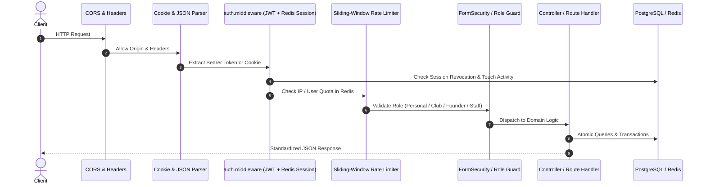

---

# SECTION 7 — Complete Feature Documentation

### 7.1 Student Developer Identity & Public Profile
- **Purpose:** Provide developers with an authoritative digital portfolio consolidating verified metrics, project showcases, and competition rankings.
- **Frontend:** `Frontend/src/app/Profile/ProfileManager.tsx`, `PublicProfilePage.tsx`, `GetTheCardModal.tsx`, `HireMeModal.tsx`.
- **Backend:** `Backend/src/Routes/profile/profile.ts`, `photo.ts`, `resume.ts`.
- **Database Tables:** `users`, `user_links`, `leaderboard_entries`, `user_projects`, `recruiter_messages`.
- **Logic & Flow:** Aggregates linked accounts, pulls real-time ratings, computes the Orbix Score V2, and renders a shareable digital card. Users can toggle visibility between **Public** and **Private** modes (`Backend/src/Routes/account/privacyRoutes.ts`). In private mode, recruiter inquiries are disabled, platform ratings are hidden from guests, and the profile is omitted from public search listings.
- **Status:** **Implemented**

### 7.2 The Orbix Score & Multi-Platform Leaderboard
- **Purpose:** Rank developers objectively on a scale of 0 to 10,000 using deterministic mathematical modeling across six canonical pillars.
- **Frontend:** `Frontend/src/app/Leaderboard/LeaderboardPage.tsx`, `LeaderboardTable.tsx`, `LeaderboardPodium.tsx`, `AlgorithmModal.tsx`.
- **Backend:** `Backend/src/Routes/leaderboard/leaderboard.ts`, `Backend/src/scoring/orbixScore.ts`.
- **Database Tables:** `leaderboard_entries`, `institutions`, `users`.
- **Logic & Flow:** Evaluates problem solving across 12 CP platforms, contest ratings across official tiers, GitHub open-source contributions, repository stars, active coding consistency, and technical writing. Supports filtering by global standings, college rankings, and individual institutional leaderboards.
- **Status:** **Implemented**

### 7.3 AISHE College Directory & Institutional Management
- **Purpose:** Map every student and club to a verified Indian higher education institution recognized by the Ministry of Education.
- **Frontend:** `Frontend/src/components/CollegeAutocomplete.tsx`, `RequestCollegeModal.tsx`.
- **Backend:** `Backend/src/Routes/institutions/institutions.ts`, `Backend/data/ingest_comprehensive_directory.ts`.
- **Database Tables:** `institutions`, `institution_aliases`, `institution_verification_requests`.
- **Logic & Flow:** Backed by the national All India Survey on Higher Education (AISHE) dataset. Performs fuzzy trigram searching (`pg_trgm`) across official names, states, districts, and aliases.
- **Status:** **Implemented**

### 7.4 Institutional Club Verification & Reviewer Console
- **Purpose:** 5-stage verification protocol preventing campus club squatting and granting verified status to genuine campus chapters.
- **Frontend:** `Frontend/src/LandingPages/Auth-Pages/Signup/ClubRegistrationModal.tsx`, `ClubStatusPage.tsx`, `ClubReviewerQueuePage.tsx`.
- **Backend:** `Backend/src/Routes/club/club.ts`, `Backend/src/validators/ClubRegistrationValidator.ts`.
- **Database Tables:** `verified_clubs`, `club_verification_requests`, `club_coordinators`.
- **Logic & Flow:** Requires club registration with coordinator details, phone OTP, and academic document proof. Staff reviewers audit applications against a 4-pillar rubric (Institutional Registry, Official College Outreach, Online Footprint, Coordinator Identity). Once approved, the club's account status transitions to `approved`, activating its dedicated dashboard.
- **Status:** **Implemented**

### 7.5 Team Workspace Suite (Slack / Discord / Linear for Campus Clubs)
- **Purpose:** Full-featured operational workspace for verified student clubs to organize departments, tasks, real-time messaging, files, and peer recognition.
- **Frontend:** `Frontend/src/app/Club/ClubDashboardPage.tsx`, `Frontend/src/api/workspaceApi.ts`.
- **Backend:** `Backend/src/Routes/workspace/workspaceRoutes.ts`, `Backend/src/repositories/workspaceRepository.ts`, `Backend/src/services/workspace/`.
- **Database Tables:** `team_workspaces`, `workspace_departments`, `workspace_members`, `workspace_roles`, `workspace_channels`, `workspace_messages`, `workspace_tasks`, `workspace_files`, `workspace_recognition_ledger`.
- **Subsystems:**
  - **Departments:** Hierarchical organization (Technical, Design, Events, PR, Logistics) with member assignments and transfer tracking.
  - **RBAC Roles & Permissions:** Owner, Admin, Dept Lead, Member, Guest, Observer with granular bitwise/boolean capability overrides.
  - **Channels & Messaging:** Text, Announcement, Voice/Stage channels with threading, reactions, mentions, and event broadcasting.
  - **Task Management:** Kanban board with custom statuses, priority tags, assignees, submissions, reviews, and activity history.
  - **Files & Assets:** Document repository with Cloudinary storage, category grouping, and access controls.
  - **Orbits Recognition Ledger:** Peer-to-peer appreciation system where members distribute monthly allocated "Orbits" points, tracked via an immutable double-entry ledger.
- **Status:** **Implemented**

### 7.6 Dynamic Event Registration & Custom Form Engine
- **Purpose:** Typeform/Google Forms replacement enabling clubs to build dynamic registration forms with quizzes, branching logic, and custom file uploads.
- **Frontend:** `Frontend/src/app/Events/DynamicEventRegistrationModal.tsx`, `PublicEventRegistrationPage.tsx`.
- **Backend:** `Backend/src/Routes/events/eventFormRoutes.ts`, `Backend/src/services/club/clubEventFormService.ts`.
- **Database Tables:** `club_event_forms`, `club_event_form_versions`, `club_event_registrations`, `club_event_response_drafts`.
- **Logic & Flow:** Supports 11 question types, section branching, auto-saving drafts, anti-formula injection sanitization, and full versioning with rollback support.
- **Status:** **Implemented**

### 7.7 Event Lifecycle, Rounds Engine & Applications Roster
- **Purpose:** Multi-stage competition management for hackathons and contests (e.g., Round 1: Screening Quiz -> Round 2: Prototype Code Submission -> Round 3: Live Judging).
- **Frontend:** `Frontend/src/app/Club/ClubEventDetailPage.tsx`, `EventApplicationsModal.tsx`.
- **Backend:** `Backend/src/Routes/events/eventLifecycleRoutes.ts`, `eventStageService.ts`, `eventSubmissionService.ts`, `eventEvaluationService.ts`.
- **Database Tables:** `club_event_stages`, `club_event_stage_forms`, `club_event_stage_submissions`, `club_event_judging_criteria`, `club_event_judges`, `club_event_evaluations`, `club_event_stage_advancements`.
- **Logic & Flow:** Organizers define stages with start/end schedules. Submissions can be reviewed by assigned judges using weighted rubrics. High-scoring candidates are advanced to subsequent rounds with automated email notifications.
- **Status:** **Implemented**

### 7.8 Live Check-in Terminal & Ticket Scanner
- **Purpose:** On-site event check-in terminal scanning digital attendee passes via device cameras or hardware barcode scanners.
- **Frontend:** `Frontend/src/app/Club/ClubEventCheckinTerminal.tsx`.
- **Backend:** `Backend/src/Routes/club/club.ts` (`POST /api/club/events/:eventId/checkin-verify`).
- **Database Tables:** `club_event_registrations`, `club_events`.
- **Logic & Flow:** Uses `jsQR` to decode ticket QR codes from browser video streams. Verifies ticket authenticity against PostgreSQL, displays attendee details, marks check-in status, and generates a personalized social share card.
- **Status:** **Implemented**

### 7.9 Certificate Studio & Verification Wallet
- **Purpose:** Pure-vector PDF certificate generation with automated variable binding, dynamic batch issuance, and public cryptographic verification.
- **Frontend:** `Frontend/src/app/Club/ClubCertificateStudioModal.tsx`, `Frontend/src/app/Certificates/UserCertificateWalletView.tsx`, `PublicCertificateVerifyPage.tsx`.
- **Backend:** `Backend/src/Routes/club/clubCertificateRoutes.ts`, `certificatePdfService.ts`, `certificateIssuanceService.ts`.
- **Database Tables:** `certificate_templates`, `certificate_batches`, `club_certificates`, `certificate_audit_logs`.
- **Logic & Flow:** Club leads design certificate templates using visual controls. Certificates are rendered using `pdf-lib` and `qrcode`, calculating a cryptographic SHA-256 hash. Students receive certificates in their private wallet and can share public verification links (`/verify/certificate/:credentialCode`).
- **Status:** **Implemented**

### 7.10 Likes & Event Sharing Subsystem
- **Purpose:** Social engagement system for blog appreciation and college event distribution with anti-inflation accounting rules.
- **Frontend:** `Frontend/src/components/events/EventShareModal.tsx`, `EventActionRow.tsx`.
- **Backend:** `Backend/src/Routes/events/eventEngagementRoutes.ts`, `Backend/src/Routes/blog/blogRoutes.ts`, `eventEngagementService.ts`.
- **Database Tables:** `blog_likes`, `club_event_likes`, `club_event_shares`.
- **Logic & Flow:** Supports 3 sharing actions: Internal Peer Connection Invitation, External Native Share Sheet, and Copy Link. Implements anti-inflation rules where internal invitations and native share sheets increment public counters, link copying is tracked only as an operational metric, and club self-shares are excluded from public totals.
- **Status:** **Implemented**

### 7.11 Resume Intelligence & Consent-Driven Profile Sync
- **Purpose:** Deterministic 7-dimension resume scoring, ATS audit, entity extraction, and consent-driven profile synchronization.
- **Frontend:** `Frontend/src/app/Resume/ResumeManager.tsx`.
- **Backend:** `Backend/src/Routes/profile/resume.ts`, `resumeIntelligence.ts`, `Backend/src/services/resume/`.
- **Database Tables:** `user_resumes`, `resume_analyses`, `resume_profile_sync_reviews`.
- **Logic & Flow:** Parses PDF/DOCX resumes into plain text ASTs, extracts entities with provenance tags (`STATED`, `INFERRED`, `VERIFIED`), and computes a 0-100 score across 7 weighted dimensions. Allows users to selectively review and sync extracted skills, projects, and bio details into their public profile.
- **Status:** **Implemented**

### 7.12 Project Showcase & GitHub Intelligence Merge Engine
- **Purpose:** Showcase developer projects with automatic repository metadata extraction, statistics synchronization, and 3-way merge protection.
- **Frontend:** `Frontend/src/app/Projects/ProjectsManagementView.tsx`, `ProjectModal.tsx`, `ProjectSyncDiffModal.tsx`.
- **Backend:** `Backend/src/Routes/projects/projectRoutes.ts`, `projectService.ts`, `projectMergeEngine.ts`.
- **Database Tables:** `user_projects`, `user_github_installations`.
- **Logic & Flow:** Analyzes public or private repositories via GitHub APIs or GitHub Apps. Computes field-by-field diffs and ensures manual user edits are preserved while repository metrics (stars, forks, languages) are automatically updated.
- **Status:** **Implemented**

### 7.13 Student College Verification & Founder Review Console
- **Purpose:** Multi-channel identity verification establishing institutional student affiliation.
- **Frontend:** `Frontend/src/components/CollegeVerification/CollegeVerificationModal.tsx`, `Frontend/src/app/Internal/FounderCollegeVerificationsPage.tsx`.
- **Backend:** `Backend/src/Routes/verification/collegeVerificationRoutes.ts`, `collegeVerificationService.ts`, `collegeOcrService.ts`.
- **Database Tables:** `college_verifications`, `college_verification_email_tokens`, `college_verification_phone_otps`.
- **Logic & Flow:** Students upload college ID cards or ERP screenshots. Tesseract.js extracts roll numbers and college names. Dual OTPs are sent to student college emails and mobile phones. Authorized founders review queued applications. If an approved student changes their institution, their verification badge is revoked and locked for a 72-hour security period.
- **Status:** **Implemented**

### 7.14 Security, Sessions & Account Governance
- **Purpose:** Enterprise-grade security controls, 2FA setup, active session tracking, and GDPR-compliant data export/purge workflows.
- **Frontend:** `Frontend/src/app/Settings/AccountCenterView.tsx`, `ManageAccountView.tsx`, `PasswordSecurityView.tsx`.
- **Backend:** `Backend/src/Routes/session/sessionRoutes.ts`, `accountGovernanceRoutes.ts`, `manageAccountsRoutes.ts`.
- **Database Tables:** `user_sessions`, `account_security_events`, `account_deletion_requests`, `account_data_exports`.
- **Logic & Flow:** Tracks active devices with IP masking and user-agent parsing. Users can remotely terminate sessions. Deletion requests initiate a 7-day grace period during which users can cancel deletion before an automated hourly background worker permanently purges their data.
- **Status:** **Implemented**

### 7.15 Help Center, FAQs & Support Ticketing
- **Purpose:** In-app customer support ticketing system with category classification and staff triage.
- **Frontend:** `Frontend/src/app/Settings/HelpCenterView.tsx`, `Frontend/src/LandingPages/Support/Landing.tsx`.
- **Backend:** `Backend/src/Routes/help/helpRoutes.ts`.
- **Database Tables:** `help_tickets`, `help_ticket_messages`, `help_ticket_attachments`, `help_faqs`, `help_faq_feedback`.
- **Logic & Flow:** Authenticated users create tickets with priority levels. Staff members triage, reply, and update ticket statuses (`open`, `in_progress`, `resolved`, `closed`).
- **Status:** **Implemented**

---

# SECTION 8 — Algorithm and Business Logic Encyclopedia

### 8.1 Orbix Score V2 Ranking Algorithm
- **Purpose:** Compute a standardized, anti-cheat developer score (0 to 10,000 points) based on six canonical pillars using concave diminishing returns curves.
- **Location:** `Backend/src/scoring/orbixScore.ts`
- **Inputs:** Solved problem counts by difficulty, platform ratings, rated contest counts, open-source PRs/issues, repository stars/forks, active coding days, streak length, and published technical articles.
- **Mathematical Formulations:**
  - **Concave Saturation Function:**
    $$S(x, \lambda) = 100 \times \left(1 - e^{-x / \lambda}\right)$$
  - **Pillar 1: Problem Solving (35% weight / 3,500 pts max):**
    $$\text{RawPoints} = 1 \cdot E + 3 \cdot M + 6 \cdot H + 2 \cdot U$$
    $$\text{Subscore}_1 = 100 \times \left(1 - e^{-\text{RawPoints} / 1400}\right)$$
  - **Pillar 2: Contest Performance (20% weight / 2,000 pts max):**
    Composite rating normalizing top platform ratings:
    $$\text{RatingNorm} = 0.75 \cdot \text{BestNorm} + 0.25 \cdot \text{SecondBestNorm}$$
    Rated contest count scaling:
    $$\text{ContestSubscore} = \min\left(100, 0.85 \cdot \text{RatingNorm} + 0.15 \cdot \text{Diminishing}(\text{Contests}, 40)\right)$$
  - **Pillar 3: Open-Source Contributions (20% weight / 2,000 pts max):**
    Evaluates merged PRs (weight 12), open PRs (weight 3), resolved issues (weight 5), code reviews (weight 6), and external repos (weight 8) through saturation ($\lambda = 320$) plus a 5-point milestone bonus.
  - **Pillar 4: Repository Quality (10% weight / 1,000 pts max):**
    Non-linear star scaling ($\lambda = 60$), fork scaling ($\lambda = 30$), and language diversity multipliers.
  - **Pillar 5: Consistency & Active Days (10% weight / 1,000 pts max):**
    Active day density ($\lambda = 180$), trailing 30-day activity ($\lambda = 24$), and consecutive daily streak.
  - **Pillar 6: Technical Writing (5% weight / 500 pts max):**
    Published articles on Medium/Substack ($\lambda = 15$) and verified followers/claps.
- **Total Composite Score:**
  $$\text{TotalScore} = \sum_{i=1}^{6} \left(\text{Subscore}_i \times \text{Weight}_i \times 100\right)$$
- **Complexity:** Time: $O(P + C)$ where $P$ is platforms and $C$ is contests. Space: $O(1)$.
- **Status:** **Implemented**

### 8.2 Club Credibility Bayesian Reputation Engine
- **Purpose:** Assess club reliability (0 to 100) using Bayesian dynamic priors, evidence weighting, and repeat-incident compounding.
- **Location:** `Backend/src/scoring/clubCredibilityEngine.ts`
- **Inputs:** Event completion rubrics (delivery, schedule, communication, verified experience), cancellation notices, registrations, verified attendees, and history of past incidents within 365 days.
- **Mathematical Formulations:**
  - **Dynamic Evidence Weight ($W_i$):**
    $$W_i = \min\left(\text{Cap}, B \times S \times A \times V \times T \times P\right)$$
    - $B$: Base weight (Completed=1.0, Cancelled=1.5, Deleted with registrants=2.0, Unpublish to draft=1.2).
    - $S$: Scope factor (Campus=1.0, Pan-India=1.2).
    - $A$: Participant reach factor: $A = \min(1.5, \max(0.8, 0.8 + 0.2 \ln(1 + \text{regs} + \text{attendees})))$.
    - $V$: Advance notice factor for cancellations ($>7$ days: $0.6\times$; $3\text{--}6$ days: $0.9\times$; $24\text{--}72$ hours: $1.2\times$; $<24$ hours: $1.6\times$).
    - $T$: Streak bonus for consecutive completed events ($1.0 + 0.05 \times \min(10, \text{streak})$).
    - $P$: Repeat negative incident compounding ($1.0 + 0.25 \times \text{incidents}_{\le 365d}$).
  - **Bayesian Posterior Score:**
    $$\text{Score} = \frac{(S_0 \cdot W_0) + \sum (Q_i \cdot W_i)}{W_0 + \sum W_i}$$
    where prior score $S_0 = 50.0$ and prior weight $W_0 = 10.0$.
  - **Blend:** Final score is a weighted blend: $70\%$ Lifetime Score + $30\%$ Recent 365-Day Score.
- **Status:** **Implemented**

### 8.3 Deterministic 7-Dimension Resume Scoring Engine
- **Purpose:** Objectively evaluate student resume competitiveness and recruiter readiness without stochastic drift.
- **Location:** `Backend/src/services/resume/scoringEngine.ts`
- **Inputs:** Structured resume facts extracted via AST parser.
- **Dimension Weights:**
  1. Impact & Quantifiable Metrics: $25\%$
  2. Technical Depth & Stack Modernity: $20\%$
  3. Target Role Alignment: $20\%$
  4. ATS Format & Section Structure: $10\%$
  5. Action Writing & Bullet Clarity: $10\%$
  6. Verified Coding Profiles & Hyperlinks: $10\%$
  7. Contact Information & Completeness: $5\%$
- **Formulation:**
  $$\text{ResumeScore} = \frac{\sum (\text{DimensionScore}_i \times \text{Weight}_i)}{\sum \text{AssessedWeights}}$$
- **Status:** **Implemented**

### 8.4 Anti-Inflation Event Share Count Accounting
- **Purpose:** Prevent artificial inflation of event viral metrics through repetitive link copying or organizer self-sharing.
- **Location:** `Backend/src/services/events/eventEngagementService.ts`
- **Rules & Semantics:**
  - `internal` share (direct peer invitations) $\to$ Increments public share count ($+1$).
  - `external` share (native OS share sheet) $\to$ Increments public share count ($+1$).
  - `copy_link` action $\to$ Tracked only as operational metric `linkCopies`; does **NOT** increment public share count ($+0$).
  - Club organizer accounts sharing their own events $\to$ Tracked for internal analytics but excluded from public counts ($+0$).
- **Status:** **Implemented**

### 8.5 Three-Way Project Synchronization & Merge Engine
- **Purpose:** Reconcile fresh GitHub repository metadata with student project records while guaranteeing that manual user overrides are never silently overwritten.
- **Location:** `Backend/src/services/project/projectMergeEngine.ts`
- **Logic:** Compares `currentValue` against `lastExtractedValue` and fresh `extractedValue`. If `currentValue !== lastExtractedValue`, the field is flagged as `user_overridden` with recommended action `preserve_user_edit`. Objective repository statistics (stars, forks, primary language) are updated automatically.
- **Status:** **Implemented**

### 8.6 Cryptographic PDF Vector Sanitization & SHA-256 Hashing
- **Purpose:** Produce deterministic, tamper-evident PDF certificates compatible with standard PDF readers.
- **Location:** `Backend/src/services/club/certificatePdfService.ts`
- **Logic:** Transliterates Unicode styling, decomposes accents via NFKD normalization, and encodes characters into standard WinAnsi byte sequences. Generates a QR code linking to the verification URL and computes an immutable SHA-256 hash of the final PDF buffer committed to the database.
- **Status:** **Implemented**

---

# SECTION 9 — Complete API Documentation

### 9.1 Authentication & Accounts (`/api/auth`)
| Method | Route | Purpose | Auth | Parameters / Body | Responses / Status |
|---|---|---|---|---|---|
| `POST` | `/api/auth/signup/send-email-otp` | Send signup verification OTP | Public | `{ email, username? }` | `200 { success: true }`, `400`, `409`, `429` |
| `POST` | `/api/auth/signup/verify-email-otp` | Validate signup OTP | Public | `{ email, otp }` | `200 { verified: true, token }`, `400` |
| `POST` | `/api/auth/signup` | Register new user account | Public | `{ firstname, email, username, password, college, otpToken }` | `201 { success: true, user }`, `400`, `409` |
| `POST` | `/api/auth/signin` | Authenticate credentials & issue JWT | Public | `{ emailOrUsername, password, accountType? }` | `200 { success: true, user, token }`, `401`, `429` |
| `POST` | `/api/auth/refresh` | Refresh access token via session cookie | Public | Cookie: `refreshToken` | `200 { success: true, token }`, `401` |
| `POST` | `/api/auth/signout` | Revoke active session & clear cookies | Authenticated | None | `200 { success: true }` |
| `GET` | `/api/auth/me` | Fetch active user identity & profile | Authenticated | None | `200 { success: true, user }`, `401` |
| `POST` | `/api/auth/2fa/verify-login` | Verify secondary TOTP/email OTP | Public | `{ tempToken, otp }` | `200 { success: true, token }`, `401` |
| `POST` | `/api/auth/password/change` | Change password with current credential | Authenticated | `{ currentPassword, newPassword }` | `200 { success: true }`, `400`, `401` |

### 9.2 OAuth 2.0 Integration (`/api/auth`)
| Method | Route | Purpose | Auth | Parameters / Body | Responses |
|---|---|---|---|---|---|
| `GET` | `/api/auth/google` | Initiate Google OAuth 2.0 flow | Public | Query: `redirect_uri` | `302 Redirect to Google Consent` |
| `GET` | `/api/auth/google/callback` | Handle Google OAuth code callback | Public | Query: `code, state` | `302 Redirect to /auth/callback` |
| `GET` | `/api/auth/github` | Initiate GitHub OAuth authorization | Public | Query: `redirect_uri` | `302 Redirect to GitHub` |
| `GET` | `/api/auth/github/callback` | Handle GitHub OAuth code callback | Public | Query: `code, state` | `302 Redirect to /auth/callback` |

### 9.3 Developer Profiles & Portals (`/api/profile`, `/api/portals`)
| Method | Route | Purpose | Auth | Parameters / Body | Responses |
|---|---|---|---|---|---|
| `GET` | `/api/profile/me` | Retrieve full private profile details | Authenticated | None | `200 { profile, links, metrics }` |
| `PUT` | `/api/profile` | Update profile fields (bio, college, etc.) | Authenticated | JSON payload | `200 { success: true, profile }`, `400` |
| `GET` | `/api/profile/public/:username` | Retrieve public developer profile | Optional | Param: `username` | `200 { profile }`, `404` |
| `POST` | `/api/profile/photo/upload-signature` | Generate Cloudinary signed upload intent | Authenticated | `{ folder, timestamp }` | `200 { signature, apiKey, timestamp }` |
| `POST` | `/api/profile/photo/confirm` | Confirm uploaded avatar commit | Authenticated | `{ publicId, secureUrl, version }` | `200 { success: true, avatarUrl }` |
| `GET` | `/api/portals/fetch` | Fetch live data from developer portal | Public | Query: `portal, username` | `200 { success: true, stats, difficulty }` |
| `POST` | `/api/portals/save` | Link developer platform account | Authenticated | `{ portal, username }` | `200 { success: true }`, `400` |
| `DELETE` | `/api/portals/:portal` | Disconnect developer platform | Authenticated | Param: `portal` | `200 { success: true }` |

### 9.4 Leaderboard & Scoring (`/api/leaderboard`)
| Method | Route | Purpose | Auth | Parameters / Body | Responses |
|---|---|---|---|---|---|
| `GET` | `/api/leaderboard` | Get paginated global leaderboard | Optional | Query: `page, limit, search, collegeId` | `200 { users, total, page, totalPages }` |
| `GET` | `/api/leaderboard/colleges/participating` | Get colleges represented on leaderboard | Public | None | `200 { colleges: [...] }` |
| `GET` | `/api/leaderboard/colleges/:collegeId` | Get college-specific standings | Optional | Param: `collegeId`, Query: `page` | `200 { college, standings }` |
| `GET` | `/api/leaderboard/rank/:username` | Get exact user leaderboard ranking | Public | Param: `username` | `200 { rank, score, percentile }` |
| `POST` | `/api/leaderboard/sync` | Re-sync user score from connected portals | Authenticated | None | `200 { success: true, newScore }` |

### 9.5 Club Management & Events (`/api/club`, `/api/events`)
| Method | Route | Purpose | Auth | Parameters / Body | Responses |
|---|---|---|---|---|---|
| `POST` | `/api/club/register` | Register new university club | Optional | Coordinator details & college ID | `201 { success: true, clubId }`, `400` |
| `GET` | `/api/club/events` | List events hosted by club | Club Account | None | `200 { events: [...] }` |
| `POST` | `/api/club/events` | Create new club event | Club Account | Event title, dates, scope, banner | `201 { event }`, `400` |
| `PATCH` | `/api/club/events/:eventId` | Update event configuration | Club Account | Updated fields | `200 { event }`, `404` |
| `POST` | `/api/club/events/:eventId/checkin-verify` | Validate ticket & check in attendee | Club Account | `{ ticketCode }` | `200 { verified: true, attendee }` |
| `POST` | `/api/events/:eventId/register` | Register student for campus event | Authenticated | Form answers payload | `200 { registered: true, ticketCode }` |
| `POST` | `/api/events/:eventId/likes` | Toggle like on an event | Authenticated | None | `200 { liked: boolean, likeCount }` |
| `POST` | `/api/events/:eventId/shares` | Record event share / invite peer | Optional | `{ shareType, recipientUserId? }` | `200 { shareCount, outcomes }` |

### 9.6 Team Workspace (`/api/club/workspace`)
| Method | Route | Purpose | Auth | Parameters / Body | Responses |
|---|---|---|---|---|---|
| `GET` | `/api/club/workspace` | Get workspace root & current member role | Authenticated | Query: `clubId?` | `200 { workspace, member, channels }` |
| `GET` | `/api/club/workspace/departments` | List workspace departments | Authenticated | Query: `clubId?` | `200 { departments: [...] }` |
| `POST` | `/api/club/workspace/departments` | Create new department | Workspace Lead | `{ name, description }` | `201 { department }` |
| `GET` | `/api/club/workspace/channels` | List chat & announcement channels | Authenticated | Query: `clubId?` | `200 { channels: [...] }` |
| `POST` | `/api/club/workspace/channels` | Create communication channel | Workspace Lead | `{ name, categoryId, isPrivate }` | `201 { channel }` |
| `GET` | `/api/club/workspace/tasks` | Get workspace task board | Authenticated | Query: `clubId?, departmentId?` | `200 { tasks: [...] }` |
| `POST` | `/api/club/workspace/tasks` | Create task assignment | Authenticated | `{ title, description, assigneeId }` | `201 { task }` |
| `POST` | `/api/club/workspace/recognition/awards` | Award Orbits points to team member | Authenticated | `{ recipientUserId, orbits, note }` | `200 { success: true, awardId }` |
| `GET` | `/api/club/workspace/recognition/summary` | Get user Orbits budget & balance | Authenticated | Query: `clubId?` | `200 { budget, balance, history }` |

### 9.7 Certificate Studio (`/api/club/certificates`)
| Method | Route | Purpose | Auth | Parameters / Body | Responses |
|---|---|---|---|---|---|
| `GET` | `/api/club/certificates/templates` | List certificate design templates | Club Account | None | `200 { templates: [...] }` |
| `POST` | `/api/club/certificates/templates` | Create visual certificate template | Club Account | Template canvas JSON | `201 { template }` |
| `POST` | `/api/club/certificates/issue-batch` | Issue certificates to event attendees | Club Account | `{ eventId, templateId, recipients }` | `202 { batchId, queuedCount }` |
| `GET` | `/api/club/certificates/verify/:credentialCode` | Public certificate verification | Public | Param: `credentialCode` | `200 { verified: true, certificate }` |
| `GET` | `/api/club/certificates/user/wallet` | Fetch student certificate wallet | Authenticated | None | `200 { certificates: [...] }` |

### 9.8 College Verification & Founder Review (`/api/verification/college`)
| Method | Route | Purpose | Auth | Parameters / Body | Responses |
|---|---|---|---|---|---|
| `GET` | `/api/verification/college/status` | Get student verification status | Student Account | None | `200 { status, college, channels }` |
| `POST` | `/api/verification/college/apply` | Submit student verification request | Student Account | Multipart form (ID card / ERP file) | `201 { applicationId, ocrData }` |
| `POST` | `/api/verification/college/email/send` | Send token to institutional email | Student Account | `{ institutionalEmail }` | `200 { sent: true }`, `400` |
| `GET` | `/api/verification/college/email/verify` | Verify institutional email token | Student Account | Query: `token` | `200 { emailVerified: true }` |
| `POST` | `/api/verification/college/phone/send-otp` | Send Twilio SMS to phone | Student Account | `{ phoneNumber }` | `200 { sent: true }` |
| `POST` | `/api/verification/college/phone/verify-otp` | Validate phone SMS OTP | Student Account | `{ phoneNumber, otp }` | `200 { phoneVerified: true }` |
| `GET` | `/api/internal/college-verifications/queue` | List applications for founder audit | Founder Account | Query: `status, page, limit` | `200 { queue, total }` |
| `POST` | `/api/internal/college-verifications/application/:id/approve` | Approve student college verification | Founder Account | `{ notes? }` | `200 { approved: true }` |
| `POST` | `/api/internal/college-verifications/application/:id/reject` | Reject application with reason code | Founder Account | `{ reasonCode, rejectionReason }` | `200 { rejected: true }` |

---

# SECTION 10 — Database Architecture

### 10.1 Database Overview
Orbix is powered by an enterprise **PostgreSQL 14+** schema managing **131 relational tables**, configured via `Backend/src/database/schema_production_complete.sql` and initialized with extensions:
- `"uuid-ossp"` & `"pgcrypto"`: Cryptographic UUID generation (`gen_random_uuid()`).
- `"pg_trgm"`: Trigram string indexing for fuzzy searching across the AISHE college directory.

Connection pooling is managed by `pg.Pool` (`Backend/src/database/client.ts`) with maximum pool size, idle connection timeouts, and connection timeout safeguards.

### 10.2 Core Entity-Relationship Diagram
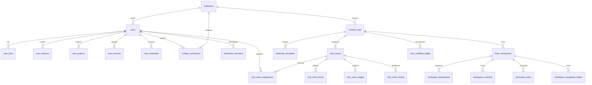

### 10.3 Core Tables Schema Specification

#### 1. `users`
- Stores primary account identities for both personal developers and club managers.
- **Columns:** `id` (UUID, PK), `firstname` (VARCHAR), `middlename` (VARCHAR), `lastname` (VARCHAR), `email` (VARCHAR, UNIQUE), `username` (VARCHAR, UNIQUE), `password` (VARCHAR, bcrypt hash), `college` (VARCHAR), `college_id` (UUID, FK $\to$ `institutions`), `verified_college` (BOOLEAN), `account_type` (VARCHAR: `personal` \| `club` \| `admin`), `verified_club` (BOOLEAN), `club_status` (VARCHAR: `none` \| `pending` \| `approved` \| `rejected`), `two_factor_enabled` (BOOLEAN), `profile_photo_url` (TEXT), `created_at` (TIMESTAMPTZ).
- **Key Constraints:** `users_email_key`, `users_username_key`.

#### 2. `institutions`
- National registry of universities, colleges, and polytechnics derived from the Ministry of Education AISHE directory.
- **Columns:** `id` (UUID, PK), `name` (VARCHAR, Indexed), `state` (VARCHAR), `district` (VARCHAR), `aishe_code` (VARCHAR, UNIQUE), `institution_type` (VARCHAR), `website` (VARCHAR), `is_verified` (BOOLEAN).
- **Indexes:** Trigram GIN index on `name` for high-speed autocomplete.

#### 3. `verified_clubs`
- Sovereign university club chapters chartered under verified institutions.
- **Columns:** `id` (UUID, PK), `name` (VARCHAR), `slug` (VARCHAR, UNIQUE), `college_id` (UUID, FK $\to$ `institutions`), `college_name` (VARCHAR), `auth_user_id` (UUID, FK $\to$ `users`), `description` (TEXT), `logo_url` (TEXT), `banner_url` (TEXT), `credibility_score` (NUMERIC, Default 50.0), `status` (VARCHAR: `active` \| `suspended`).

#### 4. `club_events`
- Competitions, hackathons, and workshops organized by clubs.
- **Columns:** `id` (UUID, PK), `club_id` (UUID, FK $\to$ `verified_clubs`), `title` (VARCHAR), `slug` (VARCHAR, UNIQUE), `description` (TEXT), `event_scope` (VARCHAR: `CAMPUS` \| `PAN_INDIA`), `start_time` (TIMESTAMPTZ), `end_time` (TIMESTAMPTZ), `location_type` (VARCHAR: `in_person` \| `virtual`), `venue` (TEXT), `banner_url` (TEXT), `is_published` (BOOLEAN), `status` (VARCHAR: `DRAFT` \| `PUBLISHED` \| `LIVE` \| `COMPLETED` \| `CANCELLED`).

#### 5. `club_event_forms` & `club_event_form_versions`
- Dynamic registration forms attached to club events.
- **Columns (`club_event_forms`):** `id` (UUID, PK), `event_id` (UUID, FK $\to$ `club_events`), `club_id` (UUID), `structure` (JSONB: questions, sections, skip logic), `settings` (JSONB: quiz mode, deadlines, confirmation text), `current_version` (INT).
- **Columns (`club_event_form_versions`):** Immutable historical snapshots of published form schemas.

#### 6. `team_workspaces`
- Operational workspace container for verified clubs.
- **Columns:** `id` (UUID, PK), `club_id` (UUID, FK $\to$ `verified_clubs`, UNIQUE), `name` (VARCHAR), `slug` (VARCHAR, UNIQUE), `avatar_url` (TEXT), `settings` (JSONB), `created_at` (TIMESTAMPTZ).

#### 7. `workspace_recognition_ledger`
- Double-entry ledger recording all peer-to-peer Orbits awards.
- **Columns:** `id` (UUID, PK), `workspace_id` (UUID, FK $\to$ `team_workspaces`), `sender_user_id` (UUID, FK $\to$ `users`), `recipient_user_id` (UUID, FK $\to$ `users`), `orbits` (INT, $>0$), `category_id` (UUID), `note` (TEXT), `status` (VARCHAR: `ACTIVE` \| `REVERSED`), `created_at` (TIMESTAMPTZ).
- **Constraints & Indexes:** Immutable ledger; reversals create paired offsetting transactions rather than deleting records.

#### 8. `college_verifications`
- Student academic identity verification requests.
- **Columns:** `id` (UUID, PK), `user_id` (UUID, FK $\to$ `users`), `college_id` (UUID, FK $\to$ `institutions`), `roll_number` (VARCHAR), `document_type` (VARCHAR: `id_card` \| `erp_screenshot`), `document_url` (TEXT), `ocr_extracted_data` (JSONB), `institutional_email` (VARCHAR), `email_verified` (BOOLEAN), `phone_number` (VARCHAR), `phone_verified` (BOOLEAN), `status` (VARCHAR: `pending` \| `approved` \| `rejected`), `reviewer_user_id` (UUID), `reviewed_at` (TIMESTAMPTZ).

---

# SECTION 11 — Authentication and Authorization

### 11.1 Password Hashing & Security Policies
User passwords are encrypted using `bcrypt` with **12 salt rounds** (`SignupValidator.ts`). During registration and password change, passwords must satisfy strict criteria:
- Minimum 8 characters.
- At least one uppercase letter, one lowercase letter, one number, and one special character.
- Passed through `weakPatterns.ts` to reject dictionary words, sequential character runs (`abcdef`, `123456`), and common keyboard patterns (`qwerty`).

### 11.2 Dual Token Lifecycle & Session Tracking
Upon successful signin, the server issues two cryptographic tokens:
1. **Access Token:** Short-lived JWT (8-hour expiry) signed with `JWT_SECRET` containing `sub` (user UUID), `gmail`, `username`, `accountType`, and `sid` (session UUID). Stored in an HTTP-only, SameSite=Lax cookie (`token`) and returned in response JSON.
2. **Refresh Token:** Long-lived JWT (7-day expiry) containing session correlation identifiers. Stored in an HTTP-only cookie (`refreshToken`).

Every authentication event creates an active record in `user_sessions` and an in-memory session presence key in Redis (`session:active:{sessionId}`). When a user calls `/api/auth/signout`, the session is flagged as revoked in Redis and marked `terminated` in PostgreSQL. Active JWTs referencing revoked session IDs are rejected immediately by `auth.middleware.ts`.

### 11.3 Role-Based Access Control (RBAC) Matrix
| Role | Context | Granted Capabilities | Enforcing Middleware |
|---|---|---|---|
| **Public / Guest** | Global | View landing pages, public profiles, public event listings, documentation | None |
| **Personal Student** | Personal Portal | Manage developer profile, resume, projects, register for events, join workspaces | `authenticate`, `requirePersonalAccount` |
| **Club Manager** | Club Portal | Create events, dynamic forms, issue certificates, check-in attendees | `authenticate`, `requireClubAccount` |
| **Workspace Owner** | Team Workspace | Full control over workspace, departments, roles, billing, channels | `WorkspaceCapabilityService` |
| **Workspace Lead** | Team Workspace | Create tasks, channels, transfer department members | `WorkspaceCapabilityService` |
| **Workspace Member** | Team Workspace | View channels, chat, accept tasks, award Orbits | `WorkspaceCapabilityService` |
| **Workspace Observer** | Team Workspace | Read-only visibility into channels, tasks, and recognition | `WorkspaceCapabilityService` |
| **Support Staff** | Admin Portal | View and reply to support tickets, review FAQs | `requireSupportStaff` |
| **Authorized Founder** | Internal Portal | Review and approve student college verification applications | `requireFounder` (Strict UUID allowlist) |

---

# SECTION 12 — Redis, Caching, Queues and Background Jobs

### 12.1 Redis Key Namespaces & Caching Strategies
Redis (`Backend/src/redis/client.ts`) serves as the caching and fast synchronization layer:
- `user:profile:{userIdOrEmail}`: Cached developer profile representation (TTL: 1 hour).
- `leaderboard:global:page:{pageNum}`: Cached paginated global standings (TTL: 10 minutes).
- `event:likes:count:{eventId}`: Cached like count for events (TTL: 1 hour).
- `event:shares:count:{eventId}`: Cached public share count (TTL: 1 hour).
- `event:share:ratelimit:{ipOrUser}`: Sliding-window share limit (Max 30 shares / 60 seconds).
- `auth:fails:signin:{ip}`: Brute-force rate limiter tracking failed signin attempts.
- `workspace:orbits:leaderboard:{workspaceId}`: Redis Sorted Set (ZSET) powering real-time member Orbits rankings.

### 12.2 BullMQ Distributed Queue Architecture
Asynchronous and background operations are orchestrated via **BullMQ** (`Backend/src/queues/workspaceQueues.ts` and `Backend/src/services/email/emailQueueService.ts`):

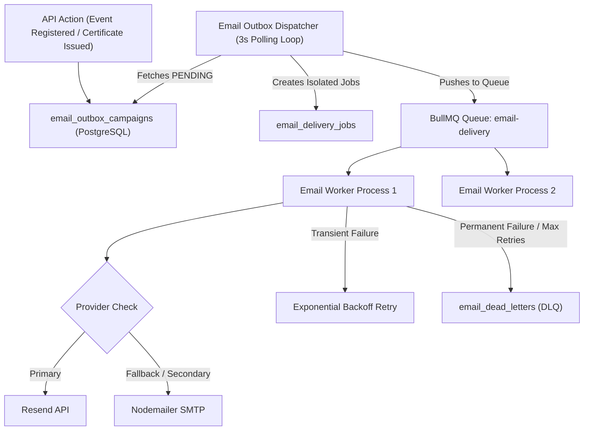

### 12.3 Background Workers
1. **Email Outbox Dispatcher (`emailOutboxDispatcher.ts`):** Continuous loop running every 3 seconds; fetches pending campaigns and atomicity-isolated delivery jobs.
2. **Email Delivery Worker (`emailWorker.ts`):** Processes `email-delivery` BullMQ queue with concurrency controls, dispatching emails via Resend or SMTP.
3. **Campaign Fanout Worker (`emailCampaignFanoutWorker.ts`):** Chunks large event broadcasts into isolated recipient jobs.
4. **Account Purge Worker (`accountPurgeService.ts`):** Cron worker executing every hour; permanently deletes accounts whose 7-day deletion grace period has expired.
5. **Workspace Recognition Worker (`workspaceRecognitionWorker.ts`):** Recalculates monthly Orbits budgets and reconciles Redis ZSET rankings against the PostgreSQL ledger.

---

# SECTION 13 — External Integrations

| Provider | Purpose | Authentication | Fallback Behavior |
|---|---|---|---|
| **Cloudinary** | Media CDN, developer avatars, event banners, private verification docs | API Key & Secret | In local dev, verification documents fall back to local disk with HMAC signed URLs |
| **Resend** | High-deliverability transactional emails (OTPs, invitations) | Bearer API Key | Automatically falls back to Nodemailer SMTP upon rate limits or sandbox restrictions |
| **Nodemailer (SMTP)** | Direct SMTP delivery (Gmail App Passwords, custom mailers) | SMTP User & Pass | Falls back to simulated terminal output in non-production environments |
| **Twilio** | SMS Gateway for college verification phone OTPs | Account SID & Auth Token | Fails closed in production; outputs OTP to server logs in development |
| **Firebase Admin SDK** | Secondary server-side phone authentication verification | Service Account JSON | Optional secondary validation provider |
| **Google OAuth 2.0** | Third-party signin and registration | Client ID & Client Secret | Users can authenticate with traditional email/password |
| **GitHub Apps / OAuth** | Profile linking, repository imports, and commit analytics | Client ID & Secret / App Private Key | Manual project creation without automated GitHub sync |
| **Tesseract.js** | Client & server optical character recognition (OCR) | Local WASM engine | Manual form entry if OCR confidence is low |
| **Codeforces API** | Competitive programming contest ratings and solved problems | Public REST API | Cached metrics retained during upstream Codeforces downtime |
| **LeetCode (GraphQL)** | Contest ratings, problem breakdown (Easy/Med/Hard), badges | Public GraphQL endpoint | In-memory and Redis caches serve last verified stats |

---

# SECTION 14 — File and Media Management

### 14.1 Direct Signed Cloudinary Upload Lifecycle
To minimize backend server load and bandwidth consumption, all public image uploads follow a direct-to-CDN signed upload pattern:

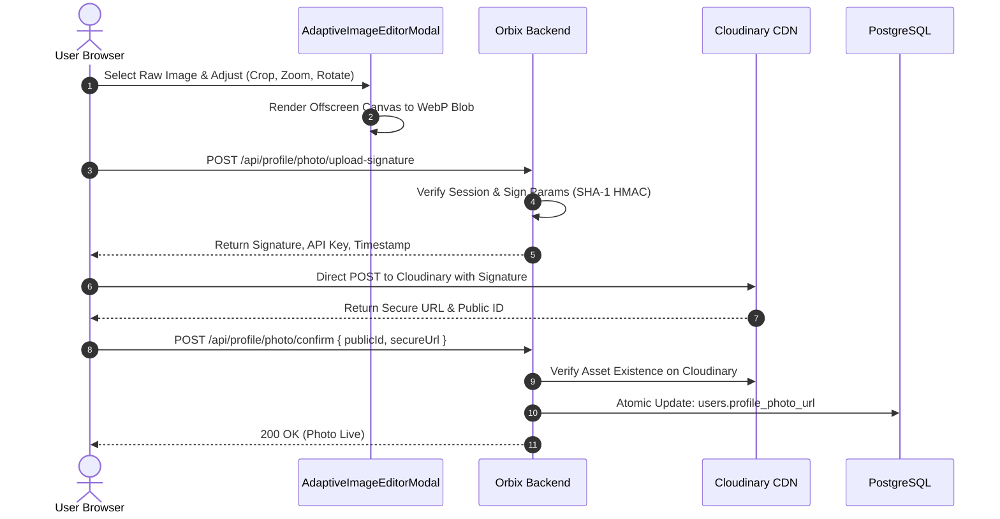

### 14.2 Private Document Storage & HMAC Document Proxy
Unlike public profile photos, sensitive student verification documents (college ID cards, fee receipts) must never be publicly accessible:
- If Cloudinary is configured, documents are stored with `type: "authenticated"` or `type: "private"`.
- In local development or private deployments, documents are stored in `Backend/uploads/college_verifications/`.
- Access is restricted through signed short-lived proxy URLs (`/api/verification/college/document-proxy`) verified using `DOCUMENT_PROXY_HMAC_SECRET` with HMAC-SHA256 signatures and 15-minute expiration windows.

---

# SECTION 15 — Security Architecture

### 15.1 Zero-Trust Founder Authorization
The internal founder review console (`/internal/college-verifications`) enforces zero-trust access:
- `requireFounder` middleware (`Backend/src/middlewares/founder.middleware.ts`) checks the authenticated user's immutable UUID against the `ORBIX_FOUNDER_USER_IDS` environment variable.
- Rejects email-based checks to prevent identity spoofing via email changes.
- Fails closed with HTTP 403 Forbidden if unconfigured.

### 15.2 Anti-Abuse & Rate Limiting Controls
- **Authentication Failures:** Redis sliding-window tracking triggers exponential delays after 5 failed attempts and blocks IPs after 10 consecutive failures.
- **Event Share Throttling:** Capped at 30 share events per 60 seconds per IP/User to prevent denial-of-service or database spam.
- **Peer Connection Invitations:** Limited to 3 direct invitations per event cycle with a 1-hour cooldown.

### 15.3 Input Sanitization & Attack Mitigations
- **SQL Injection Prevention:** 100% of database queries use parameterized SQL bindings (`$1, $2, ...`) via `pg.Pool`.
- **Cross-Site Scripting (XSS):** Form structures, markdown descriptions, and blog comments pass through `formSecuritySanitizer.ts` on the backend and `DOMPurify` on the frontend.
- **CSV Formula Injection:** Dynamic form export utilities strip or escape leading formula characters (`=`, `+`, `-`, `@`) to prevent remote code execution in spreadsheet software.

---

# SECTION 16 — Application Data Flows

### 16.1 Student Registration & Verification Flow
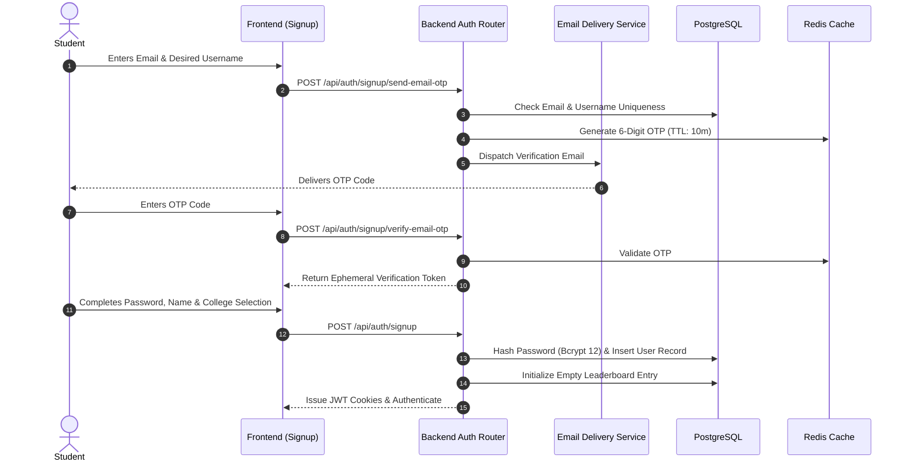

### 16.2 Team Workspace Orbits Awarding & Ledger Flow
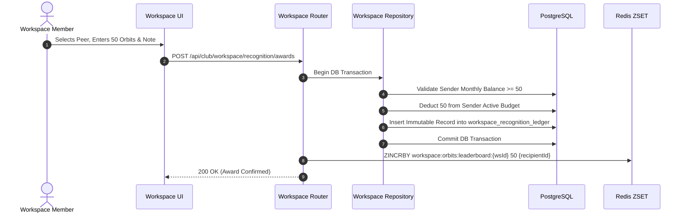

---

# SECTION 17 — Infrastructure and Deployment Architecture

### 17.1 Production Runtime Model
Orbix is engineered to run in containerized or bare-metal Linux environments (AWS EC2, Google Cloud Run, Railway, or DigitalOcean Droplets).
- **Frontend Serving:** Built via `vite build` into `Frontend/dist/` and served via Nginx or Cloudflare Pages with client-side routing fallback (`try_files $uri $uri/ /index.html;`).
- **Backend Serving:** Executed via Node.js (`tsx src/index.ts` in dev, compiled JS or PM2 in production).
- **Health Checks:**
  - `GET /health` (root load-balancer health probe)
  - `GET /api/health` (centralized API router health probe)
  - `GET /api/club/workspace/health` (team workspace & Redis health probe)

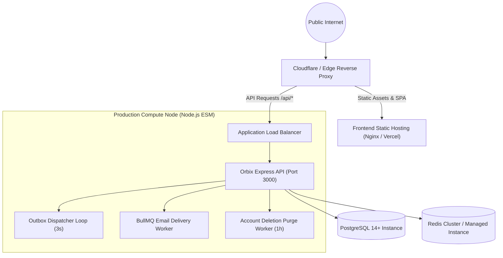

---

# SECTION 18 — Environment Variables and Configuration

| Variable | Purpose | Used By | Required? |
|---|---|---|---|
| `PORT` | HTTP port for backend server (default: 3000) | `Backend/src/index.ts` | No |
| `NODE_ENV` | Runtime environment (`development` \| `production` \| `test`) | Backend & Frontend | Yes |
| `JWT_SECRET` | Cryptographic secret for signing user JWTs | `Backend/src/Routes/auth/` | **Yes (Production)** |
| `DATABASE_URL` | PostgreSQL connection string (Supabase / Neon / AWS) | `Backend/src/database/client.ts` | **Yes** |
| `PGHOST`, `PGPORT`, `PGUSER`, `PGPASSWORD`, `PGDATABASE` | Individual database connection parameters | `Backend/src/database/client.ts` | Optional (if URL unset) |
| `REDIS_HOST`, `REDIS_PORT` | Redis host and port (default: 6379) | `Backend/src/redis/client.ts` | **Yes** |
| `REDIS_PASSWORD`, `REDIS_USERNAME` | Redis authentication credentials | `Backend/src/redis/client.ts` | Optional |
| `CLOUDINARY_CLOUD_NAME`, `CLOUDINARY_API_KEY`, `CLOUDINARY_API_SECRET` | Cloudinary storage API credentials | `Backend/src/config/cloudinary.ts` | **Yes (Production)** |
| `DOCUMENT_PROXY_HMAC_SECRET` | 32+ char secret for HMAC signing of private document URLs | `collegeVerificationService.ts` | **Yes (Production)** |
| `EMAIL_PROVIDER` | Email driver: `auto`, `resend`, or `smtp` | `Backend/.../resendService.ts` | No (defaults to auto) |
| `RESEND_API_KEY`, `RESEND_FROM_EMAIL` | Resend API key and verified sending domain | `Backend/.../resendService.ts` | Optional (if using SMTP) |
| `SMTP_HOST`, `SMTP_PORT`, `SMTP_USER`, `SMTP_PASS` | SMTP server credentials for Nodemailer | `Backend/.../resendService.ts` | Optional (if using Resend) |
| `TWILIO_ACCOUNT_SID`, `TWILIO_AUTH_TOKEN`, `TWILIO_PHONE_NUMBER` | Twilio SMS API credentials for phone OTPs | `Backend/.../smsGatewayService.ts` | **Yes (Production)** |
| `FRONTEND_URL` | Canonical frontend client origin (CORS & redirects) | Backend Auth & Verification | **Yes (Production)** |
| `GOOGLE_CLIENT_ID`, `GOOGLE_CLIENT_SECRET`, `GOOGLE_CALLBACK_URL` | Google OAuth 2.0 application credentials | `Backend/src/Routes/auth/oauthRoutes.ts` | Optional |
| `GITHUB_CLIENT_ID`, `GITHUB_CLIENT_SECRET`, `GITHUB_CALLBACK_URL` | GitHub OAuth application credentials | `Backend/src/Routes/auth/oauthRoutes.ts` | Optional |
| `ORBIX_FOUNDER_USER_IDS` | Comma-separated allowlist of founder user UUIDs | `Backend/.../founder.middleware.ts` | **Yes (Review Console)** |
| `VITE_API_BASE_URL` | Frontend API base path (default: `/api`) | `Frontend/src/api/apiClient.ts` | No |
| `VITE_FIREBASE_API_KEY`, `VITE_FIREBASE_PROJECT_ID` | Client Firebase credentials for phone auth | `Frontend/src/config/` | Optional |

---

# SECTION 19 — Error Handling, Reliability and Performance

### 19.1 Centralized Email Error Classification
The email subsystem implements `Backend/src/services/email/emailErrorClassifier.ts`, which inspects error codes and messages to categorize errors:
- **`TRANSIENT`:** Rate limits, network timeouts, 5xx gateway errors $\to$ Scheduled for retry with exponential backoff ($2^n \times 30\text{ seconds}$).
- **`PERMANENT_RECIPIENT`:** Invalid mailbox address, hard bounce, recipient unsubscribed $\to$ Immediately routed to Dead Letter Queue (`email_dead_letters`) without retrying.
- **`SYSTEMIC`:** Missing API keys, SQL syntax bugs $\to$ Alerts operators and freezes campaign execution to prevent cascading failures.

### 19.2 Database Query Optimization & Indexes
- Trigram GIN indexes on `institutions.name` allow sub-10ms prefix and typo-tolerant searches across 50,000+ national universities.
- Partial indexes on `club_events(slug)` and `club_event_shares(event_id, share_type, account_type)` accelerate public event page loads and prevent share count recalculation bottlenecks.

---

# SECTION 20 — Testing and Quality Assurance

### 20.1 Current Testing State
- **Automated Tests:** Following commit `62a93be`, dedicated test runner files (`*.test.ts`, `*.spec.ts`) are not present in the repository.
- **Type Checking:** Strict type verification is enforced via `npm run build` (`tsc -b`) on the frontend and `npx tsc --noEmit` on the backend.
- **Linting:** ESLint 10 with `typescript-eslint` runs via `npm run lint`.
- **Manual QA Scripts:** `Backend/scripts/` contains 16 standalone execution scripts to test and apply schema migrations, verify database constraints, and inspect data consistency.

### 20.2 Recommended QA Roadmap
To prepare the platform for enterprise scale, the engineering team should introduce:
1. Vitest test runner for backend unit tests covering `orbixScore.ts`, `clubCredibilityEngine.ts`, and `SignupValidator.ts`.
2. Supertest integration tests for authenticated API route lifecycles (`/api/auth/*`, `/api/club/events/*`).
3. Playwright end-to-end tests for the registration, event RSVP, and check-in terminal camera scanning flows.

---

# SECTION 21 — Module Dependencies and Internal Communication

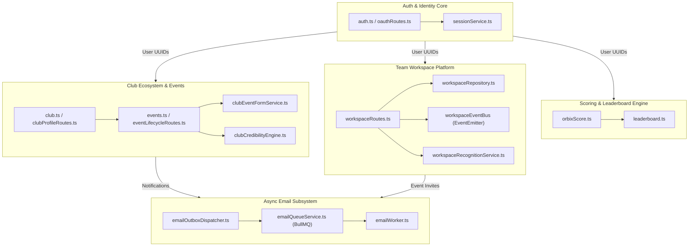

---

# SECTION 22 — Developer Setup and Local Execution

### 22.1 Prerequisites
- Node.js v20.x or higher (LTS recommended)
- PostgreSQL 14+ installed and running locally
- Redis server running on `localhost:6379`
- Package manager: `npm`

### 22.2 Step-by-Step Installation Commands

#### 1. Clone Repository & Setup Environment
```bash
git clone https://github.com/Vineet-Chandel/Orbix.git
cd Orbix

# Configure Backend Environment
cp Backend/.env.example Backend/.env
# Edit Backend/.env to provide DATABASE_URL, JWT_SECRET, and REDIS_HOST

# Configure Frontend Environment
cp Frontend/.env.example Frontend/.env
```

#### 2. Install Dependencies
```bash
# Install Backend Dependencies
cd Backend
npm install

# Install Frontend Dependencies
cd ../Frontend
npm install
```

#### 3. Database Initialization & Seeding
```bash
cd ../Backend

# Apply complete consolidated production schema
psql -d orbix -f src/database/schema_production_complete.sql

# Seed Indian Higher Education Institutions (AISHE)
npm run seed:institutions

# Seed Benchmark Competitive Coders (Optional)
npx tsx seed_leaderboard.ts
```

#### 4. Run Development Servers
```bash
# Terminal 1: Start Backend (Express with hot-reload via tsx watch)
cd Backend
npm run dev

# Terminal 2: Start Frontend (Vite development server on port 5173)
cd Frontend
npm run dev
```

---

# SECTION 23 — Current Implementation Status and Technical Gaps

### 23.1 Status Classification Table
| Feature / Subsystem | Implementation Status | Supporting Files | Notes |
|---|---|---|---|
| **User Registration & Email OTP** | **Implemented** | `Backend/src/Routes/auth/auth.ts` | Fully operational with Resend/SMTP/Dev fallback |
| **Bcrypt & Session Tracking** | **Implemented** | `Backend/.../sessionService.ts` | 12-round hashing with Redis session revocation |
| **Orbix Score V2 Engine** | **Implemented** | `Backend/src/scoring/orbixScore.ts` | Deterministic 6-pillar concave scoring |
| **Global & College Leaderboards**| **Implemented** | `Backend/src/Routes/leaderboard/` | Multi-filter pagination with trigram search |
| **16 Platform Portals Sync** | **Implemented** | `Backend/src/Routes/portals/` | Web scrapers & GraphQL sync for competitive platforms |
| **Institutional Club Verification**| **Implemented** | `Backend/src/Routes/club/club.ts` | 5-stage verification with phone & email OTPs |
| **Club Credibility Engine** | **Implemented** | `Backend/src/scoring/clubCredibilityEngine.ts` | Bayesian reputation model with dynamic weights |
| **Team Workspace Platform** | **Implemented** | `Backend/src/Routes/workspace/` | Slack/Linear replacement for student chapters |
| **Dynamic Event Form Engine** | **Implemented** | `Backend/.../clubEventFormService.ts` | Multi-section branching, quiz mode, auto-save drafts |
| **Live Check-in Terminal** | **Implemented** | `Frontend/.../ClubEventCheckinTerminal.tsx` | Camera QR scanning via jsQR with native fallbacks |
| **Certificate Studio & Wallet** | **Implemented** | `Backend/.../certificatePdfService.ts` | Pure-vector PDF-Lib generation & SHA-256 verification |
| **Likes & Event Sharing** | **Implemented** | `Backend/.../eventEngagementService.ts` | Anti-inflation accounting (+1, +0, +1) |
| **Resume AST Parsing & Sync** | **Implemented** | `Backend/src/services/resume/` | 7-dimension scoring with selective profile sync |
| **Project 3-Way Merge Engine** | **Implemented** | `Backend/.../projectMergeEngine.ts` | GitHub diffing with user override preservation |
| **Student College Verification** | **Implemented** | `Backend/.../collegeVerificationService.ts` | Tesseract.js OCR, dual OTPs, founder review |
| **Automated Test Suites** | **Deprecated / Pruned** | Pruned in commit `62a93be` | Relies on TypeScript compiler and linting |
| **Docker / Container Config** | **Documented / Planned**| None present in root | Application currently runs directly on Node/Vite |

---

# SECTION 24 — Existing Documentation Audit

| Document Name | Location | Primary Subject | Accuracy Status | Audit Findings & Reconciliation |
|---|---|---|---|---|
| `IMAGE_PLACEMENTS_SPEC.md` | `Frontend/src/components/media/` | Adaptive image cropping & placement matrix | **Accurate / Authoritative** | Defines rendered dimensions, aspect ratios, fit strategies, and Cloudinary derivative parameters across all 10 platform placements. |
| `AlgorithmDocumentary.tsx` | `Frontend/src/.../documentaries/` | Orbix Score V2 mathematical architecture | **Accurate** | Explains the 6 canonical pillars, concave saturation formulas, anti-cheat bounding, and platform normalization. |
| `ClubCredibilityDocumentary.tsx`| `Frontend/src/.../documentaries/` | Bayesian club credibility algorithm | **Accurate** | Documents prior initialization ($S_0=50, W_0=10$), dynamic weights ($B, S, A, V, T, P$), and 70/30 lifetime/recent blending. |
| `ClubVerificationDocumentary.tsx`| `Frontend/src/.../documentaries/`| 5-stage institutional club verification | **Accurate** | Documents reviewer evaluation criteria, coordinator validation, and status state machines. |
| `CollegeChaptersDocumentary.tsx`| `Frontend/src/.../documentaries/` | AISHE campus hub topology | **Accurate** | Explains campus chapters, dual-scope events (Campus vs Pan-India), and leadership keys. |
| `CollegeVerificationDocumentary.tsx`| `Frontend/src/.../documentaries/`| 7-step student identity verification | **Accurate** | Documents OCR parsing, dual-channel institutional email & phone OTPs, founder review, and 72-hour safeguards. |
| `LikesEventSharingDocumentary.tsx`| `Frontend/src/.../documentaries/`| Social appreciation & event sharing | **Accurate** | Details publication blog likes, 3-action event distribution, anti-inflation accounting rules, and 3-invitation cooldowns. |
| `PlatformRegistryDocumentary.tsx`| `Frontend/src/.../documentaries/` | 16 supported developer platforms | **Accurate** | Documents metric extractors, contest rating trackers, and contribution synchronizers. |
| `ProfilePrivacyDocumentary.tsx` | `Frontend/src/.../documentaries/` | Public vs. Private developer profiles | **Accurate** | Details field visibility matrix, recruiter message gating, zero-lag sync, and digital card ownership. |
| `ResumeIntelligenceDocumentary.tsx`| `Frontend/src/.../documentaries/`| Resume AST parsing & 7-dimension scoring| **Accurate** | Explores document ingestion, structured fact provenance, 7 evaluation dimensions, and consent-driven profile sync. |

---

# SECTION 25 — README Preparation Handoff

### 25.1 Executive Summary for README Writers
Orbix is an open-source, production-grade developer platform designed to unify student coding credentials, foster campus engineering chapters, and bridge academic talent with real-world recognition. Built on modern web standards (React 19, Express 5, PostgreSQL, Redis, and BullMQ), Orbix eliminates fragmented resumes by extracting and normalizing achievements from 16 leading developer portals into a unified developer card and a standardized, diminishing-returns leaderboard.

### 25.2 Key Differentiators to Emphasize
1. **Mathematical Objectivity:** Does not rely on self-reported developer skills. Ratings and problems solved are fetched and normalized directly from LeetCode, Codeforces, GitHub, etc., and computed via the bounded Orbix Score V2 engine.
2. **True Institutional Mapping:** Directly integrated with the Ministry of Education AISHE database containing verified Indian universities and colleges.
3. **Comprehensive Chapter Management:** Unlike generic event tools, Orbix provides clubs with a complete operational suite: dynamic registration forms with quizzes, ticket QR scanning check-in terminals, pure-vector PDF certificate issuance with SHA-256 validation, and a full Slack/Discord-style Team Workspace.
4. **Academic Identity Trust:** Multi-channel verification combining client/server OCR analysis of college ID cards, institutional `.edu` email token links, Twilio SMS phone verification, and a zero-trust founder review queue.

### 25.3 Features That Must NOT Be Misrepresented as Third-Party Cloud SaaS
- The Team Workspace real-time chat is backed by internal PostgreSQL repositories and Redis event channels, not third-party SaaS chat vendors (e.g., Stream or Sendbird).
- Certificate PDF generation is performed internally using pure JavaScript (`pdf-lib`) and rendered deterministically on the server, not via external rendering APIs.
- The OCR processing is handled internally using WASM-based Tesseract.js rather than paid proprietary vision APIs.

### 25.4 Suggested Official README.md Structure
1. **Project Banner & Badges:** (Build status, TypeScript, React 19, PostgreSQL, License).
2. **What is Orbix?:** Problem statement and high-level value proposition.
3. **Key Features:** (Developer Identity Card, Leaderboard, Club Portals, Team Workspace, Certificate Studio, Resume Intelligence).
4. **Interactive Architecture Diagram:** High-level system overview.
5. **Technology Stack Table:** Frontend, backend, database, queue, and security technologies.
6. **Quickstart Guide:** Prerequisites, clone commands, environment setup, database bootstrap, and local run instructions.
7. **Platform Directory:** Table of the 16 natively indexed developer platforms.
8. **Security & Academic Trust:** Summary of identity verification and privacy controls.
9. **Contributing & Code of Conduct:** Guidelines for pull requests and issue reporting.
10. **License & Acknowledgments:** Author credentials and open-source licenses.

---

# APPENDIX — Final Review & Verification Sign-Off

### Repository Coverage Summary
- **Inspected Source Directories:** `Frontend/src/` (Components, App views, Landing pages, API modules, Redux store), `Backend/src/` (Controllers, Routes, Services, Middlewares, Queues, Workers, Redis, Database models & migrations), `Backend/scripts/`, `Backend/data/`.
- **Inspected Database Tables:** All 131 PostgreSQL relational tables defined in `schema_production_complete.sql` and sequential migrations `001` through `065`.
- **Inspected External Integrations:** Cloudinary, Resend, Nodemailer SMTP, Twilio SMS, Firebase Admin, Google OAuth, GitHub Apps/OAuth, Tesseract.js, Codeforces API, LeetCode GraphQL.
- **Documentation Reconciled:** 10 core technical documentaries and placement specifications verified against source implementations.
- **Architectural Integrity:** Verified that no production secrets are exposed and that all execution flows match actual registered route handlers and controller implementations.

*End of Project Codebase Master Guide — Orbix Engineering & Architecture Group.*
