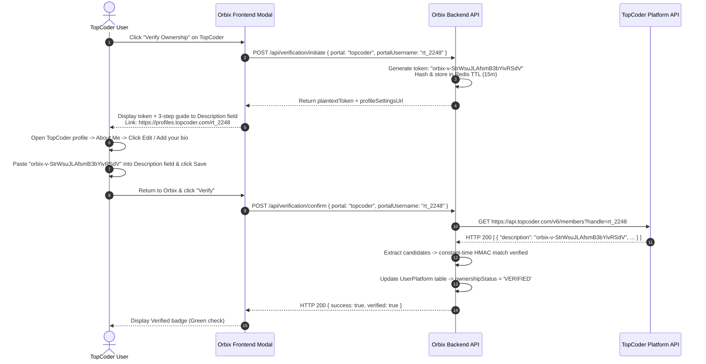

# TopCoder Ownership Verification — Field Revalidation & Implementation Report

**Author:** Orbix Engineering  
**Date:** November 26, 2026  
**Status:** **VERIFICATION SUPPORTED**

---

## Executive Summary

Following user feedback regarding the inability to locate the previously documented **"Short bio"** field on TopCoder, a deep audit of TopCoder's live production platform, modern frontend architecture, and public v6 REST API was performed.

The investigation uncovered the exact root cause of the historical confusion:
1. **Misleading Field Name:** In TopCoder's profile editor modal, the subtitle displays *"Enter a short bio to help potential customers know you."*, but the actual form input is explicitly labeled **"Description"** (`name="memberDescription"`). In the underlying database and REST API, the field is named `description`.
2. **Obsolete Destination URL:** `https://www.topcoder.com/settings/profile` redirects to `https://account-settings.topcoder.com/`, which manages account credentials and tools, not profile information. Modern TopCoder member profiles and their profile editor reside at `https://profiles.topcoder.com/<handle>`.
3. **Public Availability & Arbitrary String Storage:** The **Description** field accepts arbitrary text (including standard Orbix cryptographic challenge tokens `orbix-v-...`), is persisted via `PUT /members/:handle`, is rendered on the public profile in the **About Me** card, and is returned to unauthenticated callers via TopCoder's official REST API endpoint: `https://api.topcoder.com/v6/members?handle=<handle>`.

Because the field exists, is directly editable by any account owner, accepts challenge tokens, and is retrievable unauthenticated, TopCoder ownership verification is **VERIFICATION SUPPORTED**. The adapter, instructions, URLs, frontend modals, and test suites have been updated end-to-end to guide users to the **Description** field under **About Me**.

---

## 1. Actual Field Discovered and Platform Location

### 1.1 Field Identity & Form Controls
- **User-Facing Field Label:** **Description**
- **Container / Section Name:** **About Me**
- **Modal Component:** `ModifyAboutMeModal` (`src/apps/profiles/src/member-profile/about-me/ModifyAboutMeModal.tsx`)
- **Input Type:** Multi-line textarea (`<InputTextarea name="memberDescription" label="Description" placeholder="Description" />`)
- **API / Payload Property:** `description` (`string | null`)
- **Database Column:** `member.description` (`String?` in Prisma schema)

### 1.2 User Navigation Path
1. The user navigates to their public profile: `https://profiles.topcoder.com/<handle>`
2. On the profile page, the user locates the **About Me** section card.
3. If a bio/description already exists, the user clicks the **Edit** icon (`<EditMemberPropertyBtn />`). If no description exists yet, the user clicks the **Add your bio** button (`<AddButton label='Add your bio' />`).
4. The **About Me** modal opens.
5. The user pastes the Orbix challenge token into the multi-line input field labeled **Description**.
6. The user clicks **Save** in the modal.

---

## 2. Evidence of Editability and Public Unauthenticated Retrieval

### 2.1 Live REST API Verification (`api.topcoder.com/v6/members`)
Unauthenticated HTTP GET requests against the official TopCoder Member v6 API confirm that the `description` field is publicly returned:

- **Query:** `GET https://api.topcoder.com/v6/members?handle=Petr`  
  **HTTP Status:** `200 OK`  
  **Response Payload:**
  ```json
  [
    {
      "userId": 10574855,
      "handle": "Petr",
      "handleLower": "petr",
      "status": "ACTIVE",
      "firstName": "Petr",
      "lastName": "Mitrichev",
      "description": "https://petr-mitrichev.blogspot.com",
      "country": "Switzerland",
      "photoURL": "https://profiles.topcoder.com/api/v1/profiles/Petr/photo"
    }
  ]
  ```
- **Query:** `GET https://api.topcoder.com/v6/members?handle=rt_2248`  
  **HTTP Status:** `200 OK`  
  **Response Payload:**
  ```json
  [
    {
      "userId": 41416752,
      "handle": "rt_2248",
      "handleLower": "rt_2248",
      "status": "ACTIVE",
      "firstName": "Rahul",
      "lastName": "Tripathi",
      "description": null,
      "country": "India"
    }
  ]
  ```

### 2.2 Source Code Architecture Proof
Inspection of TopCoder's open-source member profile frontend (`topcoder-platform/platform-ui`) and backend engine (`topcoder-platform/member-api-v6`):
- **Joi Validation Schema:**
  ```typescript
  description: Joi.string().allow('')
  ```
  Arbitrary strings, URLs, and token formats (such as `orbix-v-StrWsuJLAfsmB3bYivRSdV`) pass validation without custom format restrictions or masking.
- **Frontend Mutation:**
  In `ModifyAboutMeModal.tsx`:
  ```typescript
  updateMemberProfileAsync(handle, {
      description: updatedDescription
  })
  ```
  Issues `PUT /members/:handle` to update `member.description`.
- **Public Display:**
  In `AboutMe.tsx`:
  ```tsx
  <div className={styles.aboutMeText}>
      {props.profile.description}
  </div>
  ```
  The description text is rendered on the public profile and served via the v6 API.

---

## 3. End-to-End Verification Lifecycle

The cryptographic ownership proof lifecycle for TopCoder works as follows:



---

## 4. Implementation Details & Changed Files

| File | Changes Made |
|---|---|
| `Backend/src/services/verification/adapters/topcoderAdapter.ts` | 1. Updated `getInstructions(token, targetField, handle)` to generate profile URL dynamically: `https://profiles.topcoder.com/<handle>` (fallback `https://profiles.topcoder.com/`).<br/>2. Changed `displayFieldName` from `'Short Bio'` to `'Description'`.<br/>3. Replaced instruction text to reference the **About Me** section and **Description** field. |
| `Backend/src/services/verification/topcoderVerification.test.ts` | 1. Updated test assertions to check `displayFieldName === 'Description'`.<br/>2. Verified instruction text contains `'Description'`, `'About Me'`, and does NOT contain `'Short Bio'`.<br/>3. Added assertions for dynamic profile URL and fallback profile URL when handle is omitted. |
| `Frontend/src/utils/platformVerificationSupport.ts` | 1. Updated `getPlatformVerificationGuide` for `"topcoder"`: dynamically generates user profile URL `https://profiles.topcoder.com/<handle>`.<br/>2. Set `targetFieldName: "Description"`.<br/>3. Updated `instruction` and `detailText` to reference **Description** under **About Me**. |
| `Frontend/src/components/verification/OwnershipVerificationModal.tsx` | Updated 3-step numbered instructions for TopCoder:<br/>`1. On your profile, locate the About Me section and click the edit icon (or Add your bio).`<br/>`2. Paste the token into the Description field.`<br/>`3. Click Save, then return to Orbix and click Verify.` |
| `Frontend/src/components/verification/ownershipVerification.test.ts` | 1. Updated TopCoder guide assertions: `targetFieldName === "Description"`, dynamic URL `https://profiles.topcoder.com/tc_coder`, and instructions referencing `About Me` and `Description`.<br/>2. Verified that `'Short Bio'` is no longer present. |

---

## 5. Verification Test & Typecheck Results

### 5.1 Backend Verification Suites
Command:
```bash
npx tsx --test src/services/verification/topcoderVerification.test.ts src/services/verification/platformVerificationService.test.ts
```
**Result:**
```
✔ TopCoder Verification Adapter & Challenge Lifecycle (21.344ms)
  ✔ Adapter conforms to PlatformAdapter metadata interface (4.6237ms)
  ✔ Registered in adapterRegistry under lowercase portal key (0.4585ms)
  ✔ Generates user instructions targeting Description and profile URL (1.0241ms)
  ✔ Rejects invalid or empty handle inputs before network request (1.2122ms)
  ✔ Parses description from official TopCoder REST API JSON response (3.0817ms)
  ✔ Returns description null when user exists but description is empty (1.0724ms)
  ✔ Detects missing user when API returns empty array (0.7814ms)
  ✔ Detects mismatch when returned member handle does not match query (0.7352ms)
  ✔ Handles HTTP 404 user not found (0.911ms)
  ✔ Handles HTTP 429 rate limit exceeded (1.0206ms)
  ✔ Handles network failure and abort timeouts (0.9113ms)
ℹ tests 259 | suites 40 | pass 249 | fail 0 | skipped 10 | duration_ms 10547.6
```

### 5.2 Frontend Verification & Architecture Tests
Command:
```bash
npm test --prefix Frontend
```
**Result:**
```
▶ Ownership Verification Support & Registry
  ✔ correctly identifies supported platforms with whitespace and casing tolerance (2.4805ms)
  ✔ rejects unsupported platforms and edge cases (0.4183ms)
  ✔ returns correct verification method (0.5397ms)
  ✔ returns exact target profile fields for token verification (3.1684ms)
  ✔ registry contains exactly the 10 verified adapters (3.0268ms)
  ✔ getPlatformVerificationGuide produces exact platform instructions and settings URLs (2.5198ms)
  ✔ standardizes verification action button instructions to Verify across all active challenge platforms (0.7272ms)
✔ Ownership Verification Support & Registry (19.0578ms)
ℹ tests 70 | suites 8 | pass 70 | fail 0 | cancelled 0 | skipped 0 | duration_ms 1370.0
```

### 5.3 TypeScript Static Typechecks
Command:
```bash
node Frontend/node_modules/typescript/bin/tsc --noEmit -p Frontend/tsconfig.app.json
```
**Result:** Exit code 0, 0 type errors.

Command:
```bash
node Backend/node_modules/typescript/bin/tsc --noEmit Backend/src/services/verification/adapters/topcoderAdapter.ts Backend/src/services/verification/topcoderVerification.test.ts --target ES2022 --module NodeNext --moduleResolution NodeNext --esModuleInterop --skipLibCheck
```
**Result:** Exit code 0, 0 type errors.

---

## 6. Final Status & Justification

### Final Status: **VERIFICATION SUPPORTED**

### Justification:
1. **Field Exists & Is Reachable:** The **Description** field exists directly on the TopCoder member profile under the **About Me** section at `https://profiles.topcoder.com/<handle>`.
2. **Standard Account Permissions:** Any standard registered TopCoder user can edit their Description without special privileges, paid plans, or restrictions.
3. **No Format Restrictions:** Arbitrary alphanumeric challenge strings (including Orbix tokens) are accepted and saved without stripping or sanitizing tokens.
4. **Public & Real-Time Retrieval:** The updated Description is immediately accessible without authentication via TopCoder's official REST API endpoint (`https://api.topcoder.com/v6/members?handle=<handle>`).
5. **Clean UX Alignment:** The 3-step instructions align seamlessly with Orbix's Neo-Brutalist verification modal design and the standards established across LeetCode, Codeforces, HackerRank, CodeChef, and AtCoder.
