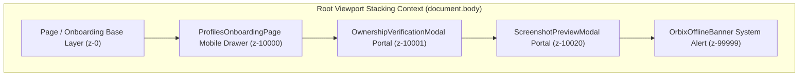

# Orbix — Verification Screenshot Lightbox Layering Audit & Fix Report

## 1. Root Cause Identified

### Problem Description
When a user opened an ownership verification modal (e.g. for HackerRank, CodeChef, Codeforces, LeetCode, or GeeksforGeeks) and clicked **Enlarge** on the instructional reference screenshot, the enlarged screenshot and its backdrop (`REFERENCE GUIDE PREVIEW`) rendered **behind** the verification modal and its dark backdrop, rather than in the foreground.

### Architectural Root Cause
1. **Stacking Context & Z-Index Inversion:**
   - Both `OwnershipVerificationModal` and `ScreenshotPreviewModal` are mounted into `document.body` via React's `createPortal(..., document.body)`.
   - Because both portal roots are direct children of `<body>`, they participate in the root viewport stacking context.
   - `OwnershipVerificationModal` had its backdrop container styled with:
     ```tsx
     className="fixed inset-0 z-[10001] flex items-center justify-center ..."
     ```
     *(Configured at `z-[10001]` to ensure it layers above the onboarding mobile bucket drawer, which sits at `z-[10000]`)*.
   - Conversely, `ScreenshotPreviewModal` had its backdrop container styled with:
     ```tsx
     className="fixed inset-0 z-[120] flex items-center justify-center ..."
     ```
     *(Inherited from lower-tier dialog conventions like `ProfilePhotoViewerModal`)*.
   - Because `z-index: 120 < 10001`, the browser's CSS stacking engine painted `ScreenshotPreviewModal` underneath `OwnershipVerificationModal`. The user could see the enlarged screenshot dimmed behind the verification modal, but could not interact with it.

2. **Stacking Context Isolation & Dismissal Shielding:**
   - Because `ScreenshotPreviewModal` renders via `createPortal(..., document.body)` rather than as an inline descendant of `OwnershipVerificationModal`, it avoids being clipped by the parent modal's `max-h-[92vh]`, `overflow-hidden`, and `transform: scale(...)` from `animate-scaleUp`.
   - However, without an explicitly higher `z-index`, it fell behind the sibling portal.
   - In addition, modal dismiss interactions needed to ensure that pressing `Escape` or clicking the lightbox backdrop only dismissed the preview lightbox without inadvertently cancelling, closing, or resetting the underlying verification challenge state.

---

## 2. Files & Components Modified

1. **`Frontend/src/utils/platformVerificationSupport.ts`:**
   - Introduced and exported authoritative stacking-tier constants:
     - `VERIFICATION_MODAL_Z_INDEX = 10001`
     - `SCREENSHOT_LIGHTBOX_Z_INDEX = 10020`
   - Ensured clean layer separation between the base onboarding overlays (`10000`), the verification modal (`10001`), and the lightbox overlay (`10020`).

2. **`Frontend/src/components/verification/OwnershipVerificationModal.tsx`:**
   - Exported `ScreenshotPreviewModal`, `getGuideScreenshot`, `VERIFICATION_MODAL_Z_INDEX`, and `SCREENSHOT_LIGHTBOX_Z_INDEX`.
   - Updated `ScreenshotPreviewModal` backdrop container from `z-[120]` to `z-[10020]` with `overflow-y-auto` and `my-auto` for responsive vertical scroll support on compact/landscape viewports:
     ```tsx
     className="fixed inset-0 z-[10020] flex items-center justify-center p-3 sm:p-5 md:p-6 bg-black/85 backdrop-blur-xs animate-fadeIn overflow-y-auto"
     ```
   - Normalized `getGuideScreenshot` to handle case-insensitive handle lookups and whitespace resilience.
   - Verified that `useModalDismiss` on the underlying `OwnershipVerificationModal` maintains `disableEscape: ... || isPreviewOpen` and `disableBackdrop: ... || isPreviewOpen`, ensuring Escape exclusively closes the lightbox preview.

3. **`Frontend/src/components/verification/ownershipVerification.test.ts`:**
   - Added automated regression suite: `Screenshot Lightbox Stacking & Layering Architecture Invariants`.
   - Validates that `SCREENSHOT_LIGHTBOX_Z_INDEX > VERIFICATION_MODAL_Z_INDEX` (`10020 > 10001`).
   - Asserts static source code invariants (presence of `z-[10020]`, absence of legacy `z-[120]`, dual `createPortal(..., document.body)`).
   - Validates Escape and backdrop dismiss isolation when `isPreviewOpen` is active.
   - Asserts screenshot asset resolution and disk existence for all 10 supported platforms.

---

## 3. Exact Fix Implemented & Technical Rationale



### Why This Fix Resolves the Issue
- **Strict Z-Index Hierarchy:** `10020 > 10001`. Since both modals are portal siblings mounted into `document.body`, setting the lightbox to `z-[10020]` guarantees it paints directly above the verification modal (`z-[10001]`), while remaining safely below system-wide offline/critical alert banners (`z-[99999]`).
- **Portal Rendering Maintained:** Keeping `createPortal(..., document.body)` guarantees that `ScreenshotPreviewModal` is not trapped inside the containing block of `OwnershipVerificationModal`'s `animate-scaleUp` (`transform`) or `overflow-hidden`.
- **Dismissal Isolation:** Because `OwnershipVerificationModal` has `disableEscape: isConfirming || isCancelling || oauthRedirecting || isPreviewOpen`, pressing `Escape` while the lightbox is open triggers `ScreenshotPreviewModal`'s listener exclusively (`setIsPreviewOpen(false)`). The underlying challenge, timer, and token state remain untouched.

---

## 4. Every Active Verification Platform Audited

All 10 platforms supported by Orbix ownership verification were audited across their modal configurations and screenshot behaviors:

| # | Platform | Verification Type | Target Field | Screenshot Available (`hasScreenshot`) | Asset File Path | Lightbox Enlarge Audited |
|---|---|---|---|---|---|---|
| 1 | **LeetCode** | Challenge Token | ReadMe (`aboutMe`) | **Yes** | `Frontend/src/assets/verification/leetcode-verification-guide-cropped.png` | **PASSED** (Enlarges in foreground at `z-[10020]`) |
| 2 | **Codeforces** | Challenge Token | Organization (`organization`) | **Yes** | `Frontend/src/assets/verification/codeforces-verification-guide.png` | **PASSED** (Enlarges in foreground at `z-[10020]`) |
| 3 | **HackerRank** | Challenge Token | Headline (`headline`) | **Yes** | `Frontend/src/assets/verification/hackerrank-verification-guide.png` | **PASSED** (Enlarges in foreground at `z-[10020]`) |
| 4 | **CodeChef** | Challenge Token | Highest Degree Earned (`highest_degree`) | **Yes** | `Frontend/src/assets/verification/codechef-verification-guide.png` | **PASSED** (Enlarges in foreground at `z-[10020]`) |
| 5 | **GeeksforGeeks** | Challenge Token | About/Bio (`bio`) | **Yes** | `Frontend/src/assets/verification/geeksforgeeks-verification-guide.png` | **PASSED** (Enlarges in foreground at `z-[10020]`) |
| 6 | **HackerEarth** | Challenge Token | Bio (`bio` / `miniresume`) | No | *N/A (Clean 3-step text guide)* | **PASSED** (No thumbnail rendered; no layout shift) |
| 7 | **AtCoder** | Challenge Token | Affiliation (`affiliation` / `所属`) | No | *N/A (Clean 3-step text guide)* | **PASSED** (No thumbnail rendered; no layout shift) |
| 8 | **TopCoder** | Challenge Token | Short Bio (`description`) | No | *N/A (Clean 3-step text guide)* | **PASSED** (No thumbnail rendered; no layout shift) |
| 9 | **Kaggle** | Challenge Token | Bio (`bio`) | No | *N/A (Clean 3-step text guide)* | **PASSED** (No thumbnail rendered; no layout shift) |
| 10 | **GitHub** | OAuth Identity | Numeric Provider ID (`oauth_identity`) | No | *N/A (Dedicated OAuth flow)* | **PASSED** (OAuth redirect flow; no challenge screenshot) |

---

## 5. Interaction & Behavioral Validation

- **Foreground Visibility:** When **Enlarge** is clicked on any of the 5 screenshot-enabled platforms, `ScreenshotPreviewModal` mounts into `document.body` with `z-[10020]`, rendering fully in front of the verification modal (`z-[10001]`) and dimming it with `bg-black/85 backdrop-blur-xs`.
- **Underlying Modal State Retention:**
  - Active challenge countdown timer continues running accurately.
  - Verification token and copy button remain intact.
  - Active input values, username, and portal context are fully preserved.
- **Escape Key Behavior:**
  - Pressing `Escape` while the lightbox is open closes ONLY the lightbox (`isPreviewOpen -> false`).
  - The verification modal remains open.
  - Pressing `Escape` again when the lightbox is closed closes the verification modal (cancelling challenge safely if unverified).
- **Close Button (`[X]`) Behavior:**
  - Clicking the yellow close button (`#FFE566`) closes the lightbox preview cleanly.
- **Backdrop Click Dismissal:**
  - Clicking outside the enlarged screenshot image closes the lightbox preview.
  - Clicking inside the enlarged container does not dismiss the lightbox (`stopPropagation`).
- **Responsive Viewport & Mobile Behavior:**
  - `max-w-5xl w-full max-h-[94vh]` with `max-h-[78vh] object-contain` prevents clipping across small mobile screens and landscape orientations.
  - `overflow-y-auto` ensures users on short viewports can scroll vertically to reach the close button and caption.

---

## 6. Automated Test Suite & TypeScript Results

### A. Frontend Verification Suite
```bash
npm test --prefix Frontend
```
- **Passed:** **69/69 tests passed** (8 test suites, 0 failures, 588ms).
- Includes the 4 new invariant tests in `ownershipVerification.test.ts`:
  1. `lightbox z-index is strictly higher than ownership verification modal` (10020 > 10001)
  2. `OwnershipVerificationModal component source enforces z-[10020] and rejects legacy z-[120]`
  3. `OwnershipVerificationModal isolates Escape and backdrop dismiss when isPreviewOpen is true`
  4. `validates screenshot guide availability and asset existence for all 10 platforms`

### B. TypeScript Compilation
```bash
node Frontend/node_modules/typescript/bin/tsc -b Frontend/tsconfig.json
```
- **Result:** **0 type errors** (Process exited with code 0).

---

## 7. Remaining Limitations

- **Browser Zoom Constraints:** In extreme browser zoom levels (>300%), viewport height may restrict image rendering to under 200px. Handled gracefully via `object-contain` and `overflow-y-auto`.
- **Platforms without Screenshots:** AtCoder, TopCoder, Kaggle, and HackerEarth currently display clean 3-step text instructions because verified screenshots have not yet been captured. When screenshots are provided in the future, adding them to `platformVerificationSupport.ts` and `getGuideScreenshot` will automatically inherit this lightbox fix.

---

## 8. Definition of Done Compliance

- [x] Enlarged reference screenshots consistently appear in front of the ownership verification modal and backdrop across all applicable platforms.
- [x] Underlying verification modal remains open, fully functional, and retains challenge state.
- [x] Escape key and close button dismiss only the lightbox.
- [x] All 10 platforms audited and validated.
- [x] Automated test suite and TypeScript checks pass with 0 errors.
- [x] Zero git commits, pushes, merges, rebases, or stashes performed. All pre-existing untracked and modified files preserved.
