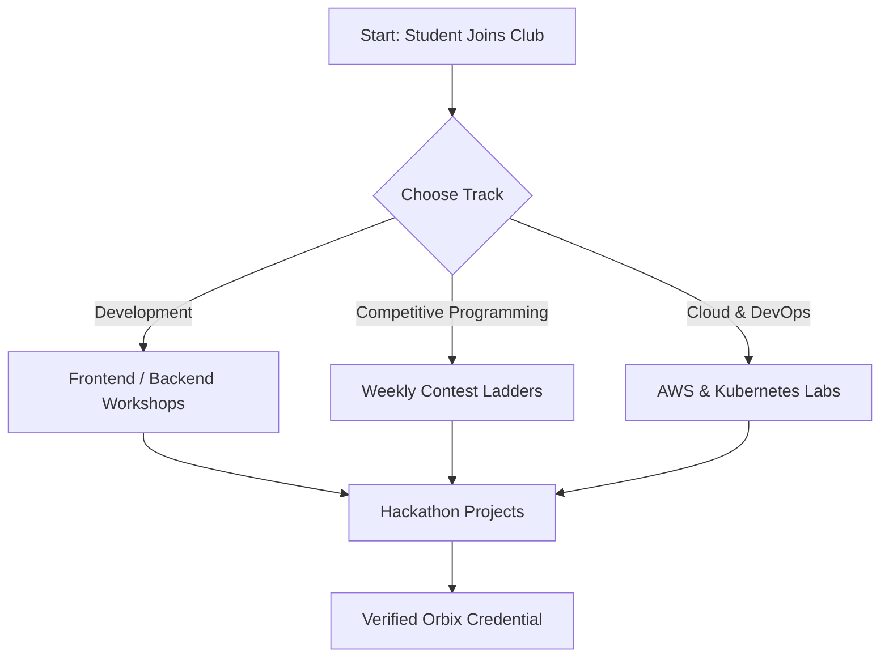
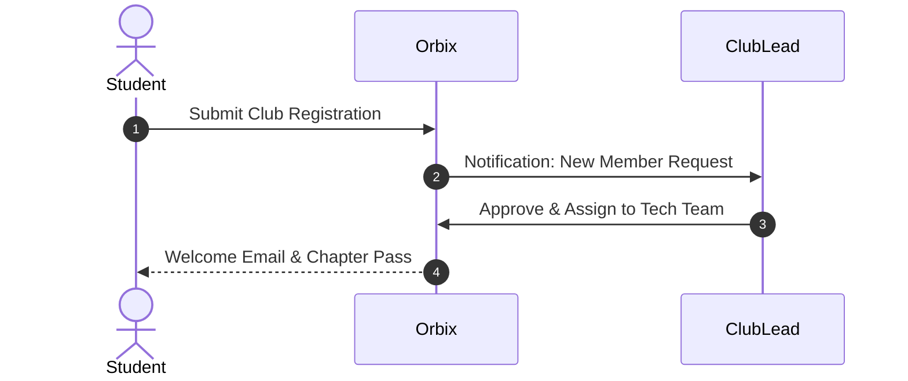

# Markdown Preview Compatibility Suite

A comprehensive test suite for GitHub Flavored Markdown (GFM) compatibility, formatting, and rendering standards.

---

## 1. Heading Hierarchy & Setext Headings

# Heading 1 (ATX)
## Heading 2 (ATX)
### Heading 3 (ATX)
#### Heading 4 (ATX)
##### Heading 5 (ATX)
###### Heading 6 (ATX)

Heading Level 1 (Setext)
===

Heading Level 2 (Setext)
---

### Heading with **Bold**, *Italic*, and `Inline Code`
### Duplicate Heading
### Duplicate Heading
### Duplicate Heading

---

## 2. Text Formatting

- **Bold text using asterisks** and __bold text using underscores__
- *Italic text using asterisks* and _italic text using underscores_
- ***Bold and italic combined***
- ~~Strikethrough text~~
- `Inline code snippet` and ``inline code with `backtick` inside``
- Nested formatting: **Bold with *italic* and `code` inside**
- Escaped Markdown: \*not italic\*, \*\*not bold\*\*, \`not code\`, \[not a link\]
- Subscript and superscript via HTML: H<sub>2</sub>O and E = mc<sup>2</sup>
- Keyboard tag: Press <kbd>Ctrl</kbd> + <kbd>C</kbd> to copy.

---

## 3. Paragraphs & Line Breaks

First paragraph of text demonstrating comfortable line height and standard readable margins suitable for documentation.

Second paragraph with a soft line break.
This is on a new line after soft break.

This line ends with two spaces for a hard line break:  
This text is on a new line.

Backslash hard break:\
This line follows a backslash break.

---

## 4. Fenced Code Blocks & Syntax Highlighting

### JavaScript
```javascript
// Quick Sort in JavaScript
function quickSort(arr) {
  if (arr.length <= 1) return arr;
  const pivot = arr[arr.length - 1];
  const left = [], right = [];
  for (let i = 0; i < arr.length - 1; i++) {
    if (arr[i] < pivot) left.push(arr[i]);
    else right.push(arr[i]);
  }
  return [...quickSort(left), pivot, ...quickSort(right)];
}
console.log(quickSort([5, 3, 8, 4, 2]));
```

### TypeScript / TSX
```tsx
import React, { useState } from 'react';

interface CounterProps {
  initialCount?: number;
}

export const Counter: React.FC<CounterProps> = ({ initialCount = 0 }) => {
  const [count, setCount] = useState<number>(initialCount);
  return (
    <button onClick={() => setCount(prev => prev + 1)}>
      Count: {count}
    </button>
  );
};
```

### Python
```python
# Fibonacci generator with typing
from typing import Generator

def fibonacci(n: int) -> Generator[int, None, None]:
    a, b = 0, 1
    for _ in range(n):
        yield a
        a, b = b, a + b

print(list(fibonacci(10)))
```

### Rust
```rust
fn main() {
    let numbers = vec![1, 2, 3, 4, 5];
    let sum: i32 = numbers.iter().sum();
    println!("Sum of numbers: {}", sum);
}
```

### Go
```go
package main

import "fmt"

func main() {
    messages := make(chan string)
    go func() { messages <- "ping" }()
    msg := <-messages
    fmt.Println(msg)
}
```

### Bash / Shell
```bash
#!/usr/bin/env bash
set -euo pipefail

echo "Deploying Orbix Chapter..."
npm --prefix Frontend run build
docker build -t orbix-app:latest .
echo "Deployment completed successfully!"
```

### SQL
```sql
SELECT 
    c.id, 
    c.name, 
    COUNT(e.id) AS total_events
FROM clubs c
LEFT JOIN club_events e ON e.club_id = c.id
WHERE c.is_active = true
GROUP BY c.id, c.name
ORDER BY total_events DESC;
```

### JSON
```json
{
  "club": "Orbix Developers",
  "verified": true,
  "metrics": {
    "members": 142,
    "eventsHosted": 18
  },
  "tags": ["cloud", "react", "ai"]
}
```

### Plaintext (Code fence without language)
```
Plain un-highlighted text block
Preserves spaces,     indentation, and
special characters: < > & " ' % #
```

---

## 5. Lists & Task Lists

### Unordered Lists
* Level 1 Bullet
  * Level 2 Nested Item A
  * Level 2 Nested Item B
    * Level 3 Sub-item
* Level 1 Another Bullet

### Ordered Lists (Starting at custom index)
5. Fifth Step
6. Sixth Step
   1. Sub-step A
   2. Sub-step B
7. Seventh Step

### Task Lists (GitHub Checkboxes)
- [x] Initial club charter drafted
- [x] Core committee members appointed
- [ ] Schedule autumn hackathon
  - [x] Reserve campus auditorium
  - [ ] Send sponsor outreach emails
- [ ] Review pending member applications

---

## 6. Blockquotes & GitHub Alerts

### Standard Blockquote
> Technology empowers communities when knowledge is shared openly.
> 
> *— Orbix Community Principle*

### Nested Blockquote
> Level 1 quote
> > Nested Level 2 quote with **bold formatting** and `code`

### GitHub Alerts
> [!NOTE]
> Useful information that users should know, even when skimming content.

> [!TIP]
> Helpful advice for doing things better or more efficiently.

> [!IMPORTANT]
> Key information users need to know to achieve their goal.

> [!WARNING]
> Urgent info that needs immediate user attention to avoid problems.

> [!CAUTION]
> Advises about risks or negative outcomes of certain actions.

---

## 7. GFM Tables

| Category | Initiative | Target Audience | Status |
| :--- | :---: | ---: | :--- |
| **Workshop** | React 19 & Next.js | Beginners | `Completed` |
| **Hackathon** | Cloud Sprint 2026 | All Students | `Upcoming` |
| **Open Source** | Orbix Core Contributions | Advanced | `Active` |
| **Panel** | Industry AMA with Alumni | Campus-wide | `Draft` |

Table with escaped pipes:

| Symbol | Meaning | Example |
| :--- | :--- | :--- |
| `\|` | Escaped Pipe in Cell | `x \| y` |
| `&&` | Logical AND | `a && b` |

---

## 8. Links & Autolinks

- Inline link: [Orbix Official Platform](https://orbix.dev "Empowering Dev Workflows")
- Autolinked URL: https://github.com/google
- Email link: contact@orbix.dev
- Anchor link to section: [Jump to Headings](#1-heading-hierarchy--setext-headings)
- Link with internal code: [`quickSort()` Implementation](#javascript)

---

## 9. Images

Standard image with alt text and title:


Broken image fallback test:


---

## 10. Footnotes

Here is a simple footnote[^1] and here is a second footnote[^note-two] with multiline content.

[^1]: This is the first footnote explaining the citation.
[^note-two]: This is a more comprehensive footnote.
    It spans multiple lines and contains additional notes.

---

## 11. Mathematical Expressions (KaTeX)

Inline equation: The famous mass-energy equivalence is $E = mc^2$, and Euler's identity is $e^{i\pi} + 1 = 0$.

Block equation (Quadratic Formula):
$$\frac{-b \pm \sqrt{b^2 - 4ac}}{2a}$$

Block equation (Gaussian Distribution Integral):
$$\int_{-\infty}^{\infty} e^{-x^2} \, dx = \sqrt{\pi}$$

---

## 12. Mermaid Diagrams

### Flowchart


### Sequence Diagram


---

## 13. Additional Diagram Formats (GeoJSON, TopoJSON, STL)

*Note: Per GitHub standard specifications, specialized 3D STL and TopoJSON map files degrade gracefully into syntax-highlighted code blocks.*

```json
{
  "type": "FeatureCollection",
  "features": [
    {
      "type": "Feature",
      "properties": { "name": "Campus Main Quad" },
      "geometry": {
        "type": "Point",
        "coordinates": [77.2090, 28.6139]
      }
    }
  ]
}
```

---

## 14. Unicode, Emojis & Multilingual Content

- Standard Emojis: 🚀 🌟 💻 ⚡ 🛡️ 🎓 🔥 🌈
- GitHub Emoji Shortcodes: :rocket: :tada: :sparkles: :fire: :white_check_mark: :warning:
- Hindi (Devanagari): ऑर्बिक्स छात्र क्लब - तकनीकी नवाचार और सामूहिक शिक्षा।
- Japanese (Kanji/Kana): テクノロジーコミュニティへようこそ。
- Arabic (Right-to-Left): مرحباً بكم في مجتمعنا التقني
- Greek: Γνῶθι σεαυτόν (Know thyself) - $\alpha, \beta, \gamma, \delta$

---

## 15. HTML Details & Security Sanity

<details>
<summary>Click to view Chapter Leadership & Committee details</summary>

Here is the collapsible secret content:
- **President**: Alex Rivera
- **Technical Lead**: Priya Sharma
- **Design Lead**: David Chen

</details>

### XSS & Sanitization Immunity Test
<!-- The following unsafe injections must be safely neutralized without executing -->
<script>console.log("XSS attempt blocked");</script>

<a href="javascript:console.log('XSS link blocked')">Malicious JS Link (Blocked)</a>
